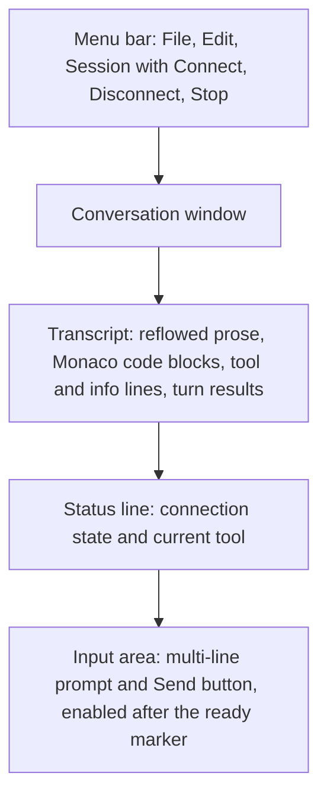
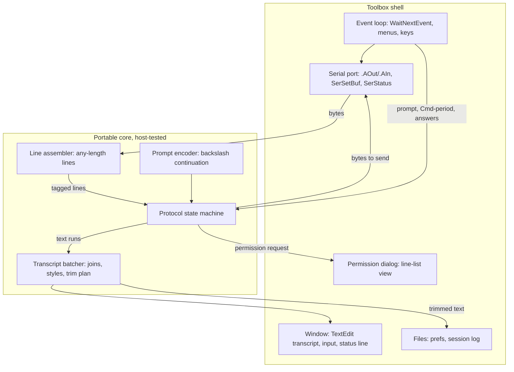
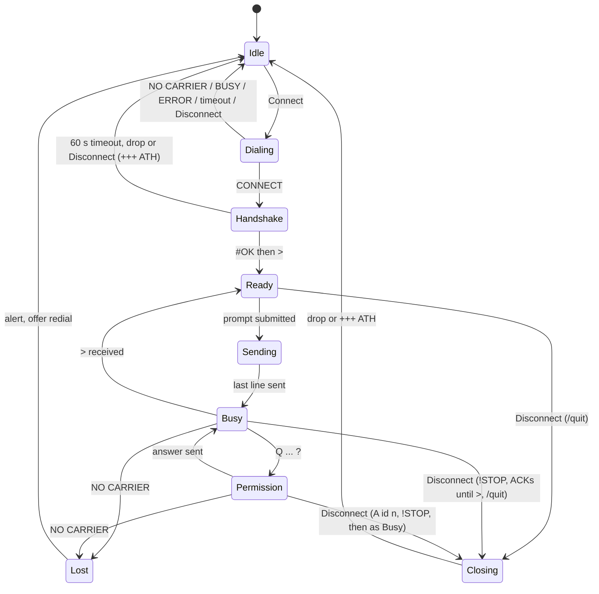

# Native SE/30 Client - Plan

## Goal Capsule

- **Objective:** Using Claude Code from the SE/30 feels like using a Mac application: the conversation stays readable on screen, code and diffs are legible, and permission decisions are made with the full request in view.
- **Means:** A native System 7.5.5 application, written in C with Retro68, that speaks the existing app mode of PROTOCOL.md v1.
- **Product authority:** This Product Contract. The bridge, `run.sh` and PROTOCOL.md v1 are fixed inputs, not active scope.
- **Execution profile:** One pull request to `schreibaer/claude30`, adding a new `client/` tree; nothing outside `client/`, `tools/` and `docs/` changes. Build order is U1, U3, U2, then U4 to U9: U2's link test drives the U3 protocol core.
- **Stop conditions:** Stop and ask if any requirement turns out to need a bridge or PROTOCOL.md change (R16), or if the U2 link test on the real SE/30 shows loss at every offered speed.
- **Who finishes:** An implementing agent builds and tests U1 to U9 on the host and in an emulator. The person runs the real-hardware checks (U2 link test, the Definition of Done hardware row) on their SE/30.
- **Open blockers:** None.

---

## Product Contract

### Summary

A single-window SE/30 application dials the bridge through the WiFi232, switches to app mode, and shows the conversation with reflowed prose, monospaced code blocks, a tool-activity status line and native permission dialogs.
It needs no change on the host side.
The client is plain C built with Retro68: a Toolbox-free core (protocol, line assembly, text batching) that is unit-tested on the host, wrapped in a thin Toolbox shell for the serial port, window, dialogs and files.

### Problem Frame

Today the SE/30 reaches Claude through ZTerm in tty mode, which the bridge renders as a fixed 80x24 stream behind a `--More--` pager.
Earlier answers scroll off and cannot be recovered, diffs are clipped to a few screens, and a permission decision is a single keystroke typed after the context it refers to may have left the screen.
The bridge already speaks a tagged app-mode protocol with flow control for exactly this case, but nothing on the SE/30 side uses it.
The pain points above are inferred from how tty mode works; they have not yet been checked against a real session.

### Key Decisions

- **One conversation window, not one window per turn and not a project-aware client.** It is the smallest form that gets off the terminal model and the only one that ships without bridge changes. Governs R5, R16. (session-settled: user-approved — chosen over a window-per-turn client and a client with a host file pane: per-turn windows are awkward on a 9-inch screen, and a file pane needs a PROTOCOL v2 and bridge changes)
- **Target System 7.5.5 only, on a stock SE/30 with 32 MB.** Memory is not a design constraint; the TextEdit 32 KB text limit still is, so the permission body is the one place that uses its own line-list view. Governs R10, R12, R15.
- **Old transcript text moves to a log file instead of being kept in the window.** Whole-session scrollback in the window would need a custom text view, which is not worth it for a first version. Accepted for v1: past 32 KB, older text is readable only in the log file, outside the app. Governs R10.
- **The app owns the modem.** The user never types AT commands: the dial string is a stored setting sent verbatim, and dialing, handshake and hangup are app actions. Governs R1, R2, R3.
- **No keyboard default and no plain-letter shortcuts in the permission dialog.** Neither a stray Return nor text typed ahead of the dialog may approve a write or a shell command. Governs R11.
- **A dropped link keeps the transcript and offers a redial, which starts a fresh conversation.** The bridge starts a fresh session per call, so the app says so rather than pretending to resume. Governs R4.

### Requirements

**Connection**

- R1. The app opens the modem port at 57,600 baud 8N1, sends the user's dial string (default `ATDTbridge`), then sends `#HELLO SE30 1` and ignores everything until `#OK se30bridge 1` arrives.
- R2. Port, speed and dial string are set in a settings dialog and remembered across launches.
- R3. Disconnect and Quit hang up the modem with `+++`, the guard pause, then `ATH`.
- R4. When the link drops or the handshake does not complete, the app shows an alert, keeps the transcript on screen, and offers to redial. A drop right after a sent `/quit` counts as a normal Disconnect, with no alert.

**Conversation window**

- R5. One window holds the transcript, a multi-line input area below it, and a one-line status area.
- R6. Prose (`T` and its `+` continuations) is reflowed to the window width in a proportional font; code (`C[`, `C`, `C]`) is shown in Monaco without rewrapping. A `+` line joins a `T` line with one space and a `C` line with nothing.
- R7. Each `U` line updates the status area and leaves a one-line entry in the transcript; `E` and `I` lines are visually distinct from Claude's prose.
- R8. Each `R` line adds the turn's status and cost to the transcript, and the input area accepts a new prompt only after `>`.
- R9. A prompt is sent in Mac Roman as one CR-terminated line per input line, with every line but the last ending in a backslash, so the bridge joins them into one prompt; the `>` the bridge returns after each continuation line does not end the send. Bridge commands such as `/new` and `/edits on` typed in the input area pass through unchanged.
- R10. When the transcript approaches the TextEdit 32 KB limit, the oldest text leaves the window and is appended to a per-session log file on disk, so no output is lost.
- R17. Return sends the prompt, Option-Return inserts a line break, and a Send button does the same as Return.
- R18. Each sent prompt is added to the transcript, and later to the log file, in a style distinct from Claude's output.
- R19. The transcript follows new output only while it is scrolled to the bottom, and trimming old text (R10) does not move the visible position.

**Permissions**

- R11. A permission request (`Q`, optional `D[`...`D]` body, `?`) opens a modal dialog showing the tool, the summary and the body, with Allow, Deny and Always buttons and Cmd-Y, Cmd-N and Cmd-A as keyboard equivalents. Keys typed before the dialog opened are discarded, and unmodified keys do nothing.
- R12. The permission body is shown in a scrolling line list outside TextEdit, so it is accepted at any length; app mode sends the whole diff, file or command with no cap.
- R20. Cmd-period while the dialog is open answers Deny and then sends `!STOP`. A dropped link closes the dialog without answering, and the transcript notes the abandoned request.

**Flow control and interruption**

- R13. The app sends `!ACK` for each `W` once everything received before it is drawn, including while a permission request is being built or shown.
- R14. Cmd-period, or Stop in the Session menu, sends `!STOP` while a turn is running, and the app itself marks the turn as interrupted in the transcript, because the bridge may report the result as `success`.
- R21. The serial input buffer holds at least one full flow-control window, at least 8 KB, and is drained on every event-loop pass.

**Platform**

- R15. The app runs on a stock SE/30 under System 7.5.5 with no FPU, no Color QuickDraw and no TCP/IP stack, and it names the Toolbox managers it relies on.
- R16. The bridge and PROTOCOL.md v1 are unchanged; the app works against the bridge as it exists today, including bridge lines of any length.

### Window Layout



### Key Flows

- F1. Connect and first prompt
  - **Trigger:** User chooses Connect.
  - **Steps:** App dials (R1); status shows dialing, then connected; handshake completes; `>` enables the input area; user sends a prompt, which appears in the transcript (R9, R17, R18); prose, code and tool lines stream into the transcript (R6, R7); `R` closes the turn (R8).
  - **Covered by:** R1, R5 to R9, R17, R18
- F2. Turn with a permission request
  - **Trigger:** Claude wants to run a tool that needs approval.
  - **Steps:** The dialog opens with the full body (R11, R12); `W` lines arriving meanwhile are acknowledged (R13); the user answers with a button or Cmd-key; the app sends `A <id> y|n|a`; the turn continues. Cmd-period here follows R20.
  - **Covered by:** R11 to R13, R20, R21
- F3. Interrupt
  - **Trigger:** User presses Cmd-period during a turn.
  - **Steps:** App sends `!STOP`; the bridge ends the turn with an `R` line; the app marks the turn interrupted; `>` re-enables input (R14, R8).
  - **Covered by:** R8, R14
- F4. Link lost
  - **Trigger:** Carrier drops or the bridge exits mid-session.
  - **Steps:** Alert explains the link is gone (R4); transcript stays; Redial runs F1 and the transcript marks that a fresh conversation began.
  - **Covered by:** R1, R4

### Acceptance Examples

- AE1. **Covers R12, R13, R21.** Given Claude proposes a 600-line diff or a Write of a 2,000-line file, when the request arrives, then the dialog opens with the whole body scrollable, every `W` during it gets an `!ACK`, and no line is lost.
- AE2. **Covers R11.** Given a permission dialog is open, when the user presses Return or was typing a word containing "a", then nothing is sent; only a button click or Cmd-Y, Cmd-N or Cmd-A answers it.
- AE3. **Covers R10.** Given a long session whose transcript passes 32 KB, when new output arrives, then the oldest text leaves the window, the same text is in the session log file, and the newest output is visible.
- AE4. **Covers R4.** Given the WiFi232 loses Wi-Fi mid-turn, when the link drops, then an alert appears, the transcript is intact, and Redial starts a new conversation that the transcript labels as new.
- AE5. **Covers R9, R17.** Given the user types `/new` and presses Return, then the bridge receives `/new` unchanged and starts a fresh conversation.
- AE6. **Covers R9, R17.** Given the user types two lines separated by Option-Return and presses Return, then the bridge receives them as one prompt with the line break kept, and input stays disabled until the turn ends.
- AE7. **Covers R20.** Given a permission dialog is open, when the user presses Cmd-period, then the app sends a Deny answer followed by `!STOP`, the dialog closes, and the turn ends.

### Success Criteria

- A one-hour session at 57,600 baud, including at least one diff of several hundred lines, completes with no dropped, duplicated or garbled lines.
- Menus, the cursor and window dragging stay responsive while Claude streams a long answer.
- Curly quotes and dashes from Claude display correctly, since app mode is Mac Roman end to end.

### Scope Boundaries

**Deferred for later**

- Scrolling back through the whole session inside the window (custom text view).
- Save Transcript and printing.
- Menu items for `/new` and `/edits on|off`; typing them works (R9).
- A host project file pane, which needs a PROTOCOL v2 and bridge changes.
- Several concurrent sessions or windows.

**Deferred to Follow-Up Work**

- Detecting and resending lost bytes (NAK and retransmit). It needs a PROTOCOL v2 and bridge changes; this plan only detects loss (KTD3).

**Considered and not built**

- RTS/CTS hardware handshaking: the WiFi232's support is unverified and window flow control already bounds bursts. Revisit if U2 shows software overruns despite the 32 KB buffer.
- Async serial reads with completion routines: polling from the event loop keeps up at 57,600 baud with a 32 KB driver buffer (KTD1). Revisit only if the event loop stalls longer than the buffer can absorb.

**Outside this work**

- Any change to `bridge.py`, `run.sh` or PROTOCOL.md.
- Color, sound, and support for System 6 or System 7 before 7.5.5.
- A TCP/IP stack, SSH or encryption on the SE/30; the link stays on the LAN.

### Dependencies / Assumptions

- The SE/30 runs System 7.5.5 with 32 MB RAM, stock 68030, no accelerator.
- The WiFi232 is set up as in `README.md` (`ATNET0`, a stored `bridge` alias for the host Mac on port 2324), and `run.sh` is running on the host.
- Each call gets a fresh bridge and conversation (`README.md`), which R4's redial behavior relies on.
- The code lives in `schreibaer/claude30`, whose root already holds `bridge.py`, `run.sh`, `PROTOCOL.md` and `README.md`.
- For sessions at 57,600 baud the SE/30 runs with AppleTalk and virtual memory off and no floppy activity, since those hold off serial interrupts (Apple Q&A DV25).
- Assumption: the ZTerm pain points in the Problem Frame are real; they have not been checked against a recorded session.

### Outstanding Questions

**Deferred to Implementation**

- Whether the WiFi232 reports a dropped connection as a `NO CARRIER` result line at 57,600 baud; KTD6 assumes it does. If it does not, a dropped carrier during a turn shows only as a "No output" warning until the user disconnects.
- Whether System 7.5.5 boots in the Snow emulator; if not, U9 uses Basilisk II only and timing is checked on the real SE/30.

### Sources / Research

- `PROTOCOL.md`: app-mode tags, `!ACK` window flow control (default 8 counted lines), Mac Roman both ways. PROTOCOL.md states a 255-byte line cap, but `bridge.py` splits only `T` and `C` lines (at 200 bytes) and sends `D`, `Q`, `U` and `I` lines at any length.
- `bridge.py:245`: `read_prompt` joins lines ending in a backslash into one prompt and, in app mode, sends `>` before each line it reads.
- `bridge.py:375`: `ask_permission` sends every detail line in app mode with no length cap, unlike tty mode, which clips to three screens.
- `bridge.py:334`: `_app_text` splits paragraphs at 200 bytes into `T` plus `+` continuations.
- `README.md`: WiFi232 dial setup and the fresh-bridge-per-call behavior.
- Apple Q&A DV25 (https://developer.apple.com/library/archive/qa/dv/dv25.html) and Tech Note HW545: the SE/30's serial hardware buffers 3 bytes and drops data at 38.4k/57.6k when interrupts are held off.
- Inside Macintosh: Devices, Serial Driver chapter (https://developer.apple.com/library/archive/documentation/mac/Devices/Devices-315.html): open `.AOut` before `.AIn`, `SerReset`, `SerSetBuf` up to 32 KB, close order.
- Inside Macintosh: Text, TextEdit (https://developer.apple.com/library/archive/documentation/mac/Text/Text-40.html): 32 KB text cap and about 8,000 lines in a styled record.
- Retro68 (https://github.com/autc04/Retro68): CMake `add_application`, Rez, bundled Multiversal headers, default 1 MB SIZE resource.
- Snow (https://github.com/twvd/snow) emulates the SE/30 serial chip with a TCP bridge on port 1984; Basilisk II maps the modem port to a pty; tcpser emulates a Hayes modem in front of a TCP host.

---

## Planning Contract

Product Contract preservation: unchanged in meaning and IDs. Two implementation questions under Outstanding Questions were resolved here (KTD7, KTD11) and replaced by implementation-time checks, and the `NO CARRIER` question now names the KTD6 fallback; Scope Boundaries gained follow-up and considered-not-built entries.

### Key Technical Decisions

- KTD1. **Poll the serial driver from the event loop.** Each pass asks `SerGetBuf` how many bytes are waiting and reads exactly that many synchronously, with `WaitNextEvent` sleeping a few ticks while connected. A 32 KB driver buffer (`SerSetBuf`) absorbs stalls from TextEdit reflow and file writes. Async reads with completion routines were rejected as extra complexity with no gain at this rate. Governs R13, R21.
- KTD2. **A Toolbox-free core compiled twice.** Line assembly, tag parsing, the session state machine, prompt encoding and transcript batching live in plain C with no Toolbox calls. Retro68 builds them into the app, and the host C compiler builds them into unit tests. The Toolbox shell (serial, window, dialogs, files) stays thin. Governs R6, R9, R13, R14, R16, R20.
- KTD3. **Detect lost bytes; do not recover them.** After each read the app checks `SerStatus` error bits (hardware overrun, software overrun, framing). On any error it inserts a visible "line noise, output above may be damaged" marker in the transcript and status line, then carries on. Resending needs PROTOCOL v2, which R16 rules out. Governs R16; see Scope Boundaries.
- KTD4. **The ready marker `>` ends a turn, not `R`.** The bridge sends `>` with no `R` after an exception, and cost may be `-`. A `>` that follows a continuation line of a multi-line prompt is swallowed (R9), and any code block left open is closed when `>` arrives. Governs R8, R9.
- KTD5. **Handshake prelude.** After the modem reports `CONNECT`, the app sends one bare CR so leftover input cannot turn the HELLO line into a Claude prompt. Then it sends `#HELLO SE30 1` and ignores everything (tty echo, banner) until `#OK se30bridge 1`. The handshake times out after 60 seconds, because the bridge starts Claude before echoing. Modem result lines `NO CARRIER`, `BUSY`, `NO ANSWER` and `ERROR` end the attempt with an alert. Governs R1, R4.
- KTD6. **Disconnect and link loss.** Disconnect sends `/quit` when the session is ready, waits up to 3 seconds for the link to drop, then sends `+++` with a 1.2-second guard on each side and `ATH`. A drop that follows a sent `/quit` is a normal disconnect (R4). Disconnect or Quit while Busy or in Permission first sends `A <id> n` for any open request (KTD12) and `!STOP`, keeps acknowledging each `W` until `>`, then takes the Ready path; if `>` has not arrived after 10 seconds it hangs up with `+++`/`ATH` directly. This matters because bridge.py waits for each `!ACK` with no end-of-file release, so hanging up on an unacknowledged `W` leaves the bridge process stuck on the host. Disconnect or Quit while Dialing or in Handshake hangs up directly. Every move to Idle that the app starts from an online state (handshake timeout, Disconnect, Quit) runs the `+++`/`ATH` hangup, and Connect and Redial dial only after the modem answers `OK` to a bare `AT`, so a dial string can never reach a live bridge as a prompt. Only a `NO CARRIER` line is a lost link. Silence is not: the bridge sends nothing while a long tool runs or while Claude writes a large Write input. After 90 seconds without input in Busy, the status line shows "No output for m:ss" with Stop and Disconnect available; if a serial error was recorded during the turn (KTD3), the app also sends one spare `!ACK`, at most once per turn, to release a `W` that may have been garbled. Governs R3, R4, R20.
- KTD7. **Styled TextEdit with one point size.** Prose is Geneva 9, code and diffs Monaco 9, so line height stays even. Text is appended once per event-loop pass, not per line. When the record passes 28 KB or 2,400 lines (TextEdit keeps line positions in 16-bit pixels), the app cuts back to about 20 KB at a line boundary, writes the cut text to the log first, and keeps the view position (R19). The app never joins or re-breaks code lines; TextEdit wraps all runs to the window, so a code line wider than the window soft-wraps at the window edge. Governs R6, R10, R18, R19.
- KTD8. **Permission body in its own line list.** Body lines are stored in a growable handle-based array and drawn with QuickDraw in Monaco 9, with a standard scroll bar, so no TextEdit limit applies. A body line wider than the list wraps at character boundaries onto continuation rows that start with a `¬` marker, so every character of a long command or diff line is visible; the list scrolls vertically only. Governs R11, R12.
- KTD9. **One `!ACK` per `W`, sent after drawing.** The bridge counts acknowledgements, so an extra one lets two windows through and a missing one stalls it. The app records each `W` and sends its `!ACK` after the lines before it are in the transcript or line list, including while the permission dialog is open, whose filter procedure keeps the serial pump running. Governs R13.
- KTD10. **Pinned Retro68, 68k only, own SIZE resource.** Builds use a pinned Retro68 Docker image digest (or master commit) for `m68k-apple-macos`. The app's `.r` file defines its own SIZE resource (2 MB preferred, 1 MB minimum, `canBackground`, `acceptSuspendResumeEvents`), a creator code, menus, dialogs and alerts. No floating point. Governs R15.
- KTD11. **Settings in the Preferences folder, logs next to the app.** Settings live in a version-stamped `PREF` resource in "Claude30 Prefs" in the System Folder's Preferences folder (`FindFolder`). Transcript logs go in a "Claude30 Logs" folder beside the application, one TEXT file per session named by date and time, so the user finds them without opening the System Folder. Governs R2, R10.
- KTD12. **One answer per permission request.** The app sends at most one `A <id>` per `?`, and only for the id it is showing. A late or duplicate answer would reach the bridge as a Claude prompt. Cmd-period sends `A <id> n` and then `!STOP` (R20); Cmd-period after `Q` but before `?` waits for `?` and does the same. Governs R11, R20.

### High-Level Technical Design

Component layout. The core has no Toolbox calls (KTD2); the shell owns every Toolbox call.



Session states in the protocol state machine:



`W` and `!ACK` can arrive in any state from Handshake onward and never change the state (KTD9). `Stopping` is not a separate state: Cmd-period in Busy sends `!STOP` and stays in Busy until `>`. Silence in Busy never changes the state; it only updates the status line (KTD6).

### Risks & Dependencies

| Risk | Effect | Mitigation |
|---|---|---|
| SE/30 serial hardware drops bytes at 57,600 baud | Damaged transcript text or a garbled protocol line | U2 link test on real hardware before UI work; loss marker (KTD3); 38,400 and 19,200 speeds (R2) |
| A dropped protocol line desynchronizes flow control | Bridge waits for an `!ACK` that never comes | After 90 seconds of silence in a turn with a recorded serial error, one spare `!ACK` (KTD6); otherwise the user stops or disconnects, and redial starts a fresh bridge (`run.sh` forks per call) |
| Carrier drops while the bridge waits for an `!ACK` | bridge.py stays blocked on the host after the call ends | Outside the client's reach under R16; user Disconnect avoids it (KTD6), and the user guide says how to find and stop a stuck `bridge.py` |
| Retro68 has no tagged releases | A toolchain update breaks the build | Pinned image digest or commit (KTD10) |
| Emulators do not model the WiFi232 or, except Snow, the SE/30 serial chip | Emulator runs pass while hardware fails | tcpser in the rig; Snow for timing; hardware rows in the Definition of Done |
| WiFi232 result codes or carrier-loss reporting differ from Hayes defaults | Wrong alert text, or a slow lost-link detection | Treat unknown modem lines before `CONNECT` as failure text shown to the user; the "No output" status warning and Disconnect cover a missing `NO CARRIER` (Outstanding Questions) |

### Output Structure

```text
client/
  CMakeLists.txt          Retro68 app build
  claude30.r              SIZE, vers, MENU, DLOG/DITL, ALRT, STR#
  src/
    core/                 Toolbox-free (KTD2)
      linebuf.c/.h        any-length line assembly
      protocol.c/.h       tag parser + session state machine
      prompt.c/.h         prompt encoding
      batch.c/.h          transcript runs, joins, trim planning
    mac/
      main.c              event loop, menus
      serial.c/.h         Serial Driver wrapper
      modem.c/.h          dial, hangup, result codes
      window.c/.h         transcript, input, status line
      permdlg.c/.h        permission dialog + line list
      prefs.c/.h          settings dialog and PREF file
      log.c/.h            session log files
  tests/
    CMakeLists.txt        host build of core + tests
    test_linebuf.c
    test_protocol.c
    test_prompt.c
    test_batch.c
    fixtures/             recorded bridge sessions
tools/
  send-to-mac.sh          ZMODEM install over the WiFi232
  emu/                    emulator + tcpser setup, stress bridge
docs/
  plans/                  this plan
```

---

## Implementation Units

### U1. Project scaffold and builds

**Goal:** An empty System 7 application that opens a window and quits cleanly, plus a host test build, both reproducible from a pinned toolchain.

**Requirements:** R15; KTD2, KTD10.

**Dependencies:** None.

**Files:**
- `client/CMakeLists.txt`
- `client/claude30.r`
- `client/src/mac/main.c`
- `client/tests/CMakeLists.txt`
- `client/README.md`

**Approach:**
1. Set up the Retro68 CMake project with `add_application`, a real creator code and a 68k-only target.
2. Define SIZE, `vers`, the menu bar (Apple, File, Edit, Session) and an About alert in `claude30.r`.
3. Write the event loop skeleton: `MaxApplZone`, Toolbox init, `WaitNextEvent`, menu dispatch, suspend/resume.
4. Add a host CMake project that compiles `client/src/core/` with the host C compiler and runs tests with CTest.
5. Document the pinned Retro68 image digest and both build commands in `client/README.md`.

**Patterns to follow:** Retro68 `Samples/Dialog` for CMake and `.r` layout.

**Test scenarios:**
- Test expectation: none -- scaffolding; proven by both builds succeeding and the app launching and quitting in an emulator.

**Verification:** The Retro68 build produces a `.dsk` image whose app launches in Basilisk II, shows its menu bar, and quits with Cmd-Q. The host test build runs an empty test suite.

### U2. Serial port and link test

**Goal:** Reliable byte transfer on the modem port at a chosen speed, with loss detection, and a link test that proves the real SE/30 can keep up before any UI work.

**Requirements:** R1 (port part), R21; KTD1, KTD3.

**Dependencies:** U1, U3 (the link test uses the protocol core).

**Files:**
- `client/src/mac/serial.c`
- `client/src/mac/serial.h`
- `client/src/mac/main.c` (Session > Link Test menu item)
- `client/README.md` (link test and install procedure)
- `tools/emu/README.md`
- `tools/emu/basilisk-modem.sh`
- `tools/emu/stress_bridge.py`
- `tools/send-to-mac.sh`

**Approach:**
1. Open `.AOut` then `.AIn`; on `portInUse`, alert and stop.
2. `SerReset` with the chosen speed, 8 data bits, no parity, 1 stop bit. Turn off all handshaking with `Control` code 14 on the output driver.
3. Install a 32 KB locked input buffer with `SerSetBuf`, allocated once at startup.
4. Provide poll (bytes waiting plus a read of exactly that many), write and error-check calls (`SerStatus` cumulative errors, cleared after each check).
5. Close in Inside Macintosh order: restore the buffer, `KillIO`, close input, close output. Run this on quit and on every fatal path.
6. Link Test: dial with the stored dial string, handshake, send a fixed prompt to `run.sh --demo` repeatedly for a chosen duration, and report bytes received, lines received and serial errors in a window. It drives the session through the U3 core: one `!ACK` per `W`, `A <id> n` for each `? <id>` the demo sends, and the next prompt only after `>`. It shares the dial and handshake code that U4 completes.
7. Emulator rig: Basilisk II with its modem port on a pty through socat, tcpser in front of `run.sh --demo`, with tcpser answering `ATDTbridge` (`tools/emu/basilisk-modem.sh`, `tools/emu/README.md`).
8. Stress bridge (`tools/emu/stress_bridge.py`): a small Python script that speaks app mode like `bridge.py` and sends scripted cases the demo lacks: a 2,000-line permission body, lines over 4 KB, an error turn with no `R`, and windows back to back. It is a test tool; `bridge.py` stays unchanged.
9. Install script: `tools/send-to-mac.sh` listens once on a second port (2325, limited to the WiFi232's address like `run.sh`) and sends the `.bin` with `sz` (ZMODEM, binary). On the SE/30, ZTerm dials `ATDT<mac-ip>:2325` and receives it with MacBinary decoding on.

**Execution note:** Install the build on the real SE/30 with `tools/send-to-mac.sh` and ZTerm, then run the link test at 57,600 baud for 60 minutes (AppleTalk and virtual memory off) before starting U5. If it reports errors, repeat at 38,400, then at 19,200, and record each result in `client/README.md`.

**Test scenarios:**
- Serial code is Toolbox-only and is proven in the emulator and on hardware, not by host tests.
- Emulator: open, link test for 5 minutes against `run.sh --demo` through tcpser, close; reopening works without restarting the app.
- Emulator: start the app while another program holds the modem port; an alert names the port and the app keeps running.
- Hardware: 60-minute link test at 57,600 reports zero serial errors, or the README records the speed that does.
- Emulator: a 5-minute link test passes through at least 100 demo turns, each answered and acknowledged, with no stall.

**Verification:** Link test results recorded for the real SE/30; the port is released after quit (ZTerm can open it straight afterwards).

### U3. Protocol core

**Goal:** A host-tested core that turns bridge bytes into typed events and user actions into exactly the bytes PROTOCOL v1 and `bridge.py` expect.

**Requirements:** R6 (joins), R8, R9, R13, R14, R16, R20; F1, F2, F3; KTD2, KTD4, KTD5, KTD9, KTD12.

**Dependencies:** U1.

**Files:**
- `client/src/core/linebuf.c`, `client/src/core/linebuf.h`
- `client/src/core/protocol.c`, `client/src/core/protocol.h`
- `client/src/core/prompt.c`, `client/src/core/prompt.h`
- `client/tests/test_linebuf.c`, `client/tests/test_protocol.c`, `client/tests/test_prompt.c`
- `client/tests/fixtures/` (recorded `run.sh --demo` app-mode sessions)

**Approach:**
1. Line assembler: grows a heap buffer for lines of any length, splits on CR LF, ignores stray LF.
2. Tag parser for every bridge line in PROTOCOL.md, plus modem result lines before the handshake.
3. State machine as drawn in High-Level Technical Design, emitting events (text run, code line, tool line, error, info, permission start/line/end/ask, result, ready, lost) and outgoing bytes.
4. Window accounting per KTD9: a pending-ACK count that the shell clears by telling the core "drawn up to here".
5. Prompt encoder per R9 and KTD4: Mac Roman pass-through, line breaks become backslash continuation lines, CR terminators. If the last line ends in a backslash, the encoder appends one space before its CR, so the bridge does not wait for another line (bridge.py strips the space).
6. Permission answers and Cmd-period sequencing per KTD12 and R20.
7. Capture fixtures by recording the bytes `run.sh --demo` sends in app mode.

**Execution note:** Implement test-first against the recorded fixtures; the bridge behavior is fixed, so fixtures are the contract.

**Patterns to follow:** `bridge.py` `Terminal.tag`, `_app_text`, `read_prompt` and `ask_permission` define the exact byte shapes.

**Test scenarios:**
- Happy path: a fixture turn with `U`, `T`, `+`, `C[`, `C`, `+`, `C]`, `R`, `>` yields events in order; a `+` after `T` joins with one space and after `C` with nothing.
- A 3,000-byte `D` line arrives whole as one permission line.
- Covers AE6. A two-line prompt encodes as `line one\` CR then `line two` CR; the `>` the bridge sends after the first line produces no ready event.
- An empty prompt sends nothing.
- `I Error: boom` followed by `>` with no `R` ends the turn with a ready event, and an open code block is closed.
- `R success -` parses with cost unknown.
- Each `W` raises the pending-ACK count by one; marking drawn sends exactly one `!ACK` per `W`, never more, including two `W`s inside one permission body.
- Covers AE7. Cmd-period during Permission with id 3 sends `A 3 n` CR then `!STOP` CR, and nothing more for id 3.
- Cmd-period after `Q 4` but before `? 4` sends nothing until `? 4`, then sends `A 4 n` and `!STOP`.
- A second answer for an id already answered is refused.
- Handshake: `CONNECT 57600`, the echoed `#HELLO SE30 1`, then `#OK se30bridge 1` and `>` reach Ready; output before `#OK` is ignored.
- `NO CARRIER` while Busy yields a lost event; after a sent `/quit`, a drop yields a normal disconnect instead.
- `BUSY` or `ERROR` while Dialing returns to Idle with a reason.

**Verification:** All core tests pass on the host; every tag in PROTOCOL.md has at least one parsing test.

### U4. Modem control and session lifecycle

**Goal:** Connect, handshake, disconnect and link-loss handling wired from the Session menu, with clear status and alerts.

**Requirements:** R1, R3, R4; F1, F4; AE4; KTD5, KTD6.

**Dependencies:** U2, U3.

**Files:**
- `client/src/mac/modem.c`, `client/src/mac/modem.h`
- `client/src/mac/main.c`
- `client/claude30.r` (connection alerts)

**Approach:**
1. Connect sends the stored dial string and hands result lines to the core (KTD5).
2. Timers for the 60-second handshake, the 10-second mid-turn disconnect fallback and the 90-second "No output" warning (KTD6) run off `TickCount` in the event loop.
3. Disconnect and Quit follow KTD6 in every connected state; Quit while connected disconnects first. Every app-started exit from an online state hangs up, and dialing starts only after `AT` returns `OK`.
4. Lost link: alert "The connection to the bridge was lost" with Redial and OK; the transcript keeps its text, and a redial adds a "New conversation" divider (R4).

**Test scenarios:**
- Emulator: Connect against tcpser and `run.sh --demo` reaches Ready and the status line shows "Connected".
- Emulator: Connect with `run.sh` stopped shows the modem's failure as an alert and returns to Idle.
- Covers AE4. Emulator: kill tcpser mid-turn; the alert appears, the transcript is intact, and Redial starts a new conversation marked in the transcript.
- Emulator: Disconnect while Ready ends with no alert, and the host's `bridge.py` process has exited.
- Emulator: Disconnect while the stress bridge streams a long turn stops the turn, ends with no alert, and the host's `bridge.py` process has exited.
- Emulator: Disconnect during Handshake hangs up; the next Connect reaches Ready with no stray prompt in the bridge.
- Emulator: a stress-bridge turn silent for 3 minutes shows "No output" in the status line and then finishes normally.

**Verification:** Every connection path in the state diagram is exercised once in the emulator.

### U5. Transcript batching and session log

**Goal:** Readable, bounded transcript text with distinct styles and lossless spill to a log file.

**Requirements:** R6, R7, R8, R10, R18, R19; AE3; KTD3, KTD7, KTD11.

**Dependencies:** U3.

**Files:**
- `client/src/core/batch.c`, `client/src/core/batch.h`
- `client/src/mac/log.c`, `client/src/mac/log.h`
- `client/tests/test_batch.c`

**Approach:**
1. Core batcher collects events into styled runs per event-loop pass: prose, code, tool line, error, info, user prompt, turn result, interrupted marker, line-noise marker (KTD3).
2. Trim planning in the core: given current length and line count, return the cut point at a line boundary per KTD7.
3. The log module creates the logs folder and session file on first spill and appends cut text before the shell deletes it from TextEdit.
4. User prompts are added as runs when sent (R18), so they reach the log the same way.
5. Run styles, chosen so no two kinds look alike on a 1-bit screen:

| Run kind | Font and face | Marker |
|---|---|---|
| Prose | Geneva 9 plain | none |
| Code and diffs | Monaco 9 plain, indented 8 px | none |
| User prompt | Geneva 9 bold | `> ` prefix |
| Tool line (`U`) | Geneva 9 italic | `• ` prefix |
| Info (`I`) | Geneva 9 italic | `i ` prefix |
| Error (`E`) | Geneva 9 bold | `× Error: ` prefix |
| Turn result (`R`) | Geneva 9 plain, underlined | `— ` prefix |
| Interrupted marker | Geneva 9 bold italic | `— Interrupted` |
| Line-noise marker | Geneva 9 bold | `× Line noise: output above may be damaged` |
| New-conversation divider | Geneva 9 bold, underlined | `New conversation` with date and time |

**Test scenarios:**
- Happy path: one pass with prose, a tool line and code produces three runs with the right styles in order.
- Covers AE3. At 28.5 KB the trim plan cuts to about 20 KB at a line boundary; the cut text equals exactly what leaves the record.
- 6,500 short lines under 28 KB still trigger a trim on the line count.
- A single 40 KB code line is split so no run exceeds the TextEdit limit.
- A sent prompt produces a user-prompt run before any of Claude's output for that turn.
- Each run kind in the style table gets its own face and marker.

**Verification:** Batch tests pass on the host; in the emulator, a 45-minute demo session keeps scrolling smoothly and the log file holds every trimmed line.

### U6. Conversation window, input and menus

**Goal:** The single conversation window from the Window Layout, with input, send keys, status line and Session menu.

**Requirements:** R5, R7, R8, R14, R17, R18, R19; F1, F3; AE5, AE6; KTD7.

**Dependencies:** U4, U5.

**Files:**
- `client/src/mac/window.c`, `client/src/mac/window.h`
- `client/src/mac/main.c`
- `client/claude30.r` (Send button, menus)

**Approach:**
1. Styled TextEdit transcript with a vertical scroll bar; the scroll-follow rule from R19 decides auto-scroll after each batch insert and trim.
2. Plain TextEdit input area; Return sends, Option-Return inserts a line break, the Send button matches Return, and input is dimmed outside Ready.
3. Status line shows connection state, the current tool from `U` lines, and the line-noise warning.
4. Session menu: Connect, Disconnect, Stop (Cmd-period), Link Test, Settings. Cmd-period sets the interrupted marker per R14.
5. Window grow and zoom reflow the transcript to the new width.

**Test scenarios:**
- Covers AE5. Emulator: type `/new` and press Return; the bridge answers "New conversation."
- Covers AE6. Emulator: type two lines with Option-Return between them; the demo bridge echoes one prompt.
- Emulator: scroll up during a long demo answer; the view stays put until scrolled back to the bottom.
- Emulator: Cmd-period during a turn ends it and the transcript shows it as interrupted.

**Verification:** One full demo session in the emulator uses every menu item and send gesture without a crash or stuck state.

### U7. Permission dialog

**Goal:** A modal permission dialog that shows the whole request, keeps flow control alive and can't be answered by accident.

**Requirements:** R11, R12, R13, R20; F2; AE1, AE2, AE7; KTD8, KTD9, KTD12.

**Dependencies:** U2 (stress bridge), U3, U6.

**Files:**
- `client/src/mac/permdlg.c`, `client/src/mac/permdlg.h`
- `client/claude30.r` (DLOG/DITL with user item for the line list)

**Approach:**
1. Store body lines in a growable handle array as `D` lines arrive; open the dialog when `?` arrives.
2. Fixed-size dialog that fits a 512x342 screen below the menu bar: tool and summary at the top (wrapped, up to three lines), the line list in the middle with about 20 visible Monaco 9 rows and a vertical scroll bar, and the three buttons at the bottom. Long body lines wrap onto marked continuation rows (KTD8).
3. Flush pending key events when the dialog opens; the filter accepts only Cmd-Y, Cmd-N, Cmd-A and Cmd-period, and ignores Return and plain keys.
4. The filter procedure runs the serial pump on every null event, so `W` lines are acknowledged and a lost link closes the dialog (R20).

**Test scenarios:**
- Covers AE1. Emulator against the stress bridge (U2): a Write of a 2,000-line file opens complete; scrolling reaches the last line; no line is lost.
- Covers AE2. With the dialog open, pressing Return or typing "a" sends nothing.
- Cmd-A sends `A <id> a` and closes the dialog.
- A 3,000-byte single-line command shows every character across continuation rows.
- Covers AE7. Cmd-period sends Deny then stop, and the turn ends.
- Lost link with the dialog open closes it, and the transcript notes the abandoned request.

**Verification:** In the emulator, every answer path sends exactly one answer, and the bridge never stalls waiting for an `!ACK`.

### U8. Settings and preferences

**Goal:** Port, speed and dial string set once and remembered.

**Requirements:** R2; KTD11.

**Dependencies:** U2.

**Files:**
- `client/src/mac/prefs.c`, `client/src/mac/prefs.h`
- `client/claude30.r` (settings dialog)

**Approach:**
1. Settings dialog: modem or printer port, speed 57,600, 38,400 or 19,200, and dial string (default `ATDTbridge`).
2. Load the `PREF` resource at startup; write it on OK. A missing or older-version resource falls back to defaults.
3. A note in the dialog reminds the user that the bridge's `--baud` and the WiFi232 speed must match.

**Test scenarios:**
- Change speed to 38,400, quit and relaunch; the setting persists and the port opens at 38,400.
- Delete the prefs file; the app launches with defaults.
- A prefs file from an older version loads defaults without crashing.

**Verification:** Settings round-trip across launches in the emulator.

### U9. Emulator test rig, release files and user guide

**Goal:** Anyone can run the full client against the real bridge in an emulator, and the person can get the finished app onto the SE/30 and set it up.

**Requirements:** Success Criteria; supports AE1 to AE7.

**Dependencies:** U2, U4 to U8.

**Files:**
- `tools/emu/README.md` (Snow section, checklist)
- `client/README.md`

**Approach:**
1. The Basilisk II rig, stress bridge and install script come from U2; this unit documents them for a fresh setup.
2. Snow setup for timing runs on its TCP port, if System 7.5.5 boots there.
3. Release files: the 68k build already emits a MacBinary `.bin` (resource fork and Finder info intact) and an HFS `.dsk` image; the README names both as the release outputs.
4. Install route: `tools/send-to-mac.sh` and ZTerm (U2). The `.dsk` image is the fallback for a BlueSCSI or SCSI2SD card or an HFS floppy.
5. Client guide: install (the ZMODEM route above), settings, AppleTalk and virtual memory off, link test, matching `--baud`, where logs live, and how to find and stop a stuck `bridge.py` on the host.
6. A manual test checklist mapping each acceptance example to its emulator or hardware step.

**Test scenarios:**
- On the real SE/30, ZTerm receives the `.bin` through `tools/send-to-mac.sh` and the app launches from the Finder with its icon and creator intact.
- The stress bridge's 2,000-line case reaches the client and is acknowledged window by window.
- Following the checklist from a fresh Basilisk II setup reaches a Ready session against `run.sh --demo`.

**Verification:** Following `tools/emu/README.md` from scratch reaches a Ready session against `run.sh --demo`.

---

## Verification Contract

| Gate | Command or step | Applies to |
|---|---|---|
| Host unit tests | `cmake -S client/tests -B build-host && cmake --build build-host && ctest --test-dir build-host` | U3, U5 |
| 68k build | `cmake -S client -B build-68k -DCMAKE_TOOLCHAIN_FILE=<retro68>/m68k-apple-macos/cmake/retro68.toolchain.cmake && cmake --build build-68k` inside the pinned Retro68 image | all units |
| Emulator checklist | `tools/emu/README.md` checklist against `run.sh --demo` and the stress bridge | U2, U4, U6, U7, U8 |
| Real bridge | One emulator session against `run.sh --cwd <project>` with a real permission request | U7 |
| Hardware | Link test (U2) and a one-hour session on the SE/30 | Success Criteria |

The bridge's own behavior is not retested; `bridge.py` is unchanged (R16).

## Definition of Done

- Host unit tests and the 68k build pass from a clean checkout with the pinned toolchain.
- Every acceptance example AE1 to AE7 has passed its emulator step in the checklist.
- The person has run the U2 link test and a one-hour session on the real SE/30, and the speed that ran clean is recorded in `client/README.md`.
- The release `.bin` and `.dsk` are produced by the 68k build, and the install route in `client/README.md` has been followed once on the real SE/30.
- `bridge.py`, `run.sh` and `PROTOCOL.md` are byte-for-byte unchanged.
- No experimental or abandoned code from approaches that were dropped remains in the diff.
