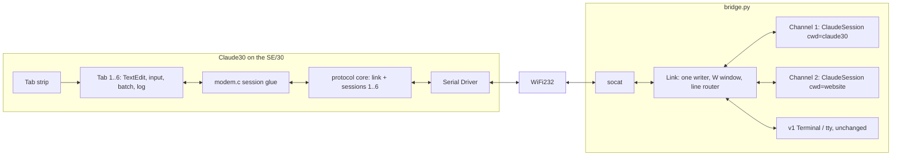
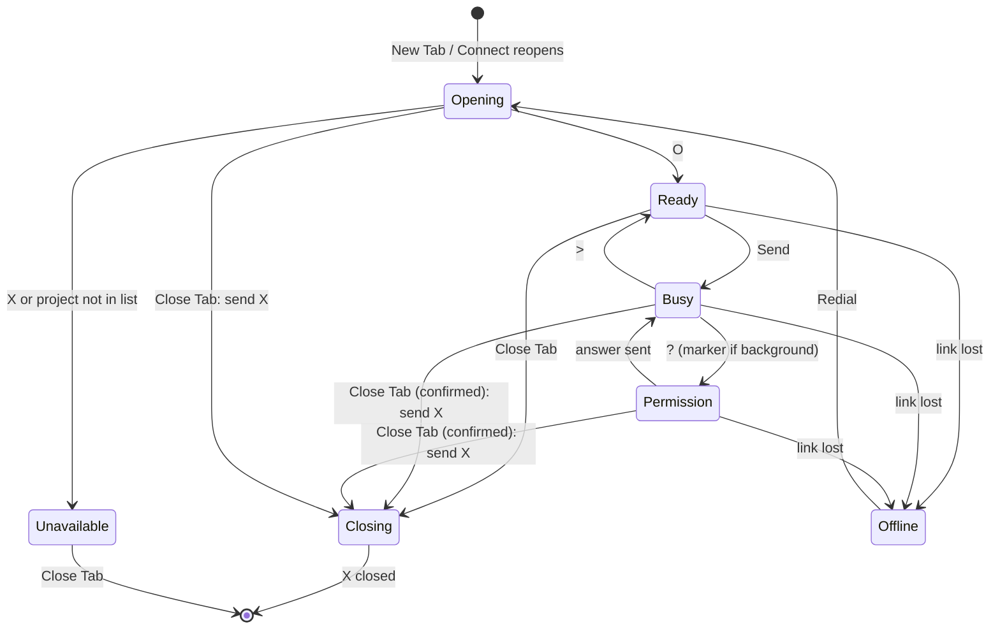

# Project Tabs - Plan

## Goal Capsule

- **Objective:** From the SE/30 alone, the person can pick which host project Claude works in and keep several projects going at once, switching between them without hanging up or touching the host Mac.
- **Means:** A tab strip in Claude30, one Claude conversation per tab, multiplexed over the one serial call by a new PROTOCOL.md version 2 that the bridge speaks alongside v1 and tty mode (KTD1, KTD2).
- **Product authority:** This Product Contract. PROTOCOL.md v1 and tty mode are compatibility constraints (R13, R14), not active scope.
- **Execution profile:** One pull request to `schreibaer/claude30`. The bridge and the client change together because the new client speaks only v2 (KTD9). Build order is U1, U2, U3, U4, then U5 to U8.
- **Stop conditions:** Stop and ask if v2 cannot keep v1 app mode and tty mode working unchanged for existing clients (R13, R14), or if background transcripts cannot receive text without drawing over the front tab on System 7.5.5 (KTD7).
- **Who finishes:** An implementing agent builds and tests U1 to U8 on the host and in Basilisk II. The person runs the hardware row of the Definition of Done on the real SE/30.
- **Open blockers:** None.

---

## Product Contract

### Summary

Claude30 gains a row of tabs across the top of its window. Each tab is its own Claude conversation in a project chosen from a list the bridge sends at connect time.
All tabs share one WiFi232 call: the bridge runs their Claude sessions side by side and tags every line with the tab it belongs to.
Tabs keep working while they are in the background, and a background permission request marks its tab instead of interrupting the tab in front.

### Problem Frame

Today the project is fixed on the host: `run.sh --cwd ~/code/myproject` starts every call in one directory, and each call runs one conversation.
Working on a second repository means walking to the host Mac, restarting `run.sh` with a different `--cwd`, and redialing, which also throws away the conversation in progress.
The SE/30 is meant to be the whole terminal, so project choice belongs on the SE/30, and a long Claude task in one repo should not block work in another.

### Key Decisions

- **Tabs run at the same time.** A background tab keeps streaming and can ask for permission, chosen over pausing every tab but the front one, so a long task in one project does not hold up another. Governs R4, R6, R7.
- **Projects come from a host-side list, never from a typed path.** The link is unencrypted and anyone on the LAN who can dial in gets the same power, so the host owner decides which folders are reachable. Cloning from GitHub is out. Governs R9, R10, R11.
- **A conversation lasts for one call.** After a hangup or a dropped link, a redial reopens the same tabs in the same projects with fresh conversations. Resuming old Claude conversations is deferred. Governs R12.
- **At most 6 tabs.** Sized for the 512-pixel screen and the shared 57,600 baud line. Governs R1.

### Requirements

**Tabs in Claude30**

- R1. The window shows a tab strip with one tab per open conversation, up to 6. Each tab is labelled with its project name, truncated to fit.
- R2. Each tab has its own transcript, input text, status line text and session log file. Switching tabs shows that tab's transcript and input exactly as it was left.
- R3. New Tab opens a project picker. Close Tab ends that tab's conversation on the host and removes the tab. Closing a tab whose turn is running or waiting for permission asks for confirmation first.
- R4. A tab's label shows when its turn is running, when new output arrived while it was in the background, and when it is waiting for permission. The permission marker is the strongest of the three.
- R5. Stop (Cmd-period), Send, and the transcript's Edit commands act on the front tab only.
- R6. A permission request from a background tab never opens over the front tab. Its dialog opens when the person switches to that tab, and the status line names the waiting tab meanwhile.
- R7. Output from every tab is received and kept while it is in the background, including when it has to leave the window for the log because the transcript is full.
- R8. The open tabs' projects are remembered across launches. Connect reopens them, and with no remembered tabs it opens the picker.

**Projects on the host**

- R9. The bridge offers a list of projects: the subdirectories of each `--projects` root, plus the `--cwd` directory when one is given. With neither option, the list is the current directory alone, so today's `run.sh --cwd` invocation keeps working.
- R10. The client opens a project only by a name from that list. The bridge never builds a path from text the client sent.
- R11. If a remembered project is no longer in the list at reconnect, its tab keeps its transcript, says the project is not available, and takes no prompts until closed.

**Calls and compatibility**

- R12. A dropped link keeps every tab and its transcript and offers Redial, as today. A redial reopens every tab's project with a fresh conversation, and each tab's transcript marks "New conversation".
- R13. PROTOCOL.md v1 app mode keeps working unchanged, so the Claude30 build already on the SE/30 still connects to the new bridge.
- R14. tty mode for ZTerm is unchanged.
- R15. `/new` and `/edits on|off` typed in a tab affect only that tab's conversation.

### Acceptance Examples

- AE1. **Covers R4, R6.** Given tabs "claude30" (front) and "website" (background, running), when "website" asks to run `npm test`, then the "website" tab shows the permission marker, the status line says "website is waiting for permission", and no dialog opens. When the person clicks "website", the dialog opens with the full command.
- AE2. **Covers R7.** Given a background tab whose turn produces 40 KB of output, when the person switches to it, then the last ~20 KB is in the window and the earlier text is in that tab's log file.
- AE3. **Covers R12, R8.** Given three open tabs and a dropped link, when the person clicks Redial, then all three tabs reconnect to the same projects, each transcript shows "New conversation", and no tab was closed.
- AE4. **Covers R11.** Given a remembered tab for project "oldrepo" that was moved out of `~/code`, when the person connects, then that tab says "oldrepo is not available on the host", its Send button stays disabled, and the other tabs open normally.
- AE5. **Covers R13.** Given the bridge from this plan and the Claude30 build from PR #1, when the old app connects, then it works exactly as before in the `--cwd` project.

### Success Criteria

- The person runs a long task in one project, switches to a second tab, and finishes a short exchange there while the first is still working, all without touching the host.
- A one-hour session with three tabs on the real SE/30 shows no misrouted output: every line lands in the tab whose project produced it.

### Scope Boundaries

- Resuming a previous Claude conversation after a hangup or across launches (Key Decisions).
- Typing a host path, browsing the host file system beyond the project list, or cloning repositories.
- Project selection in tty mode. ZTerm users keep `--cwd` (R14).
- Splitting the window or showing two tabs side by side.

#### Considered and not built

- **Output priority for the front tab.** The bridge writes lines from all sessions in arrival order through one queue, so a busy background tab shares the line fairly but does not yield to the front tab. Prose is short by the system prompt's instruction, so a starved front tab is unlikely. Revisit if the hardware session shows the front tab waiting behind background output.
- **Per-session flow control.** One `W`/`!ACK` window for the whole link is enough, because the window exists to protect the SE/30's serial buffer, which all tabs share (KTD3).
- **Falling back to v1 when the bridge is old.** A v2 client against a v1 bridge times out at the handshake with a message naming the cause (KTD9). Negotiating down would mean keeping the whole v1 path in the client for one upgrade window.

#### Deferred to Follow-Up Work

- Conversation resume across calls, using the Agent SDK's session ids.

### Dependencies / Assumptions

- The Agent SDK runs several `ClaudeSDKClient` instances in one process, each with its own `cwd`. Each instance starts its own `claude` CLI process, so six tabs mean six CLI processes on the host. Verified for the installed SDK version during U2.
- The person reinstalls Claude30 from the new release files (`tools/send-to-mac.sh`) and updates `bridge.py` on the host at the same time.

### Sources / Research

- `bridge.py`: `Terminal` mixes link state (window counting, input routing) with per-conversation state (`busy`, `_in_fence`, `on_interrupt`). `main_async` runs one session loop.
- `client/src/core/protocol.h`: `Proto` holds both link state (dial, handshake, hangup, `pending_acks`, `noise`) and turn state (`perm_*`, `stopped`, `swallow`).
- `bridge.py` `ClaudeSession._can_use_tool`: the Agent SDK runs each permission request as its own task, so two tool calls could ask at once and each prompt discarded the other's answer, leaving the turn stuck with Send disabled. Fixed ahead of this plan by asking one at a time; `tests/test_bridge_permissions.py` covers it.
- `client/src/mac/window.c`, `modem.c`, `log.c`: one transcript, one batch and one log file as module statics.
- `docs/plans/2026-11-24-0950-feat-native-se30-client-plan.md`: the v1 client plan. Its KTD6 (disconnect while busy), KTD9 (one `!ACK` per `W`) and KTD12 (one answer per request) carry over per session.
- Memory notes: the SE/30 runs System 7.5.5 with 32 MB, its serial chip drops bytes at 57,600 under interrupt load, and v1 has no retransmit.

---

## Planning Contract

### Key Technical Decisions

- KTD1. **PROTOCOL.md v2 tags each line with a one-digit session id.** Session-scoped lines carry the id `1` to `6` as their first byte, directly followed by the v1 tag (`2T text`, `2>`, `2? 4`). Lines without a leading digit are link-level. A per-line prefix costs one byte per line but a garbled line can only lose itself; a "switch to session n" line would misroute everything after it if noise ate it. v1 tags never start with a digit, so parsing stays unambiguous. Both sides ignore a session-scoped tag they do not know, so later work (such as file viewing) can add tags without a new version. v2 adds no checksums or resends. Governs R1, R2.
- KTD2. **The bridge keeps v1 and tty mode in the same process.** `#HELLO SE30 1` enters v1 app mode exactly as today, `#HELLO SE30 2` enters v2. The semantic output methods (`text`, `tool`, `ask_permission`, `result`, `notice`) move to a per-session channel object, so `ClaudeSession` and `DemoSession` run unchanged against a v1 terminal or a v2 channel. Governs R13, R14.
- KTD3. **One writer and one flow-control window for the whole link.** All channels send through a single queue that writes whole lines, counts the window and waits for `!ACK`. The window guards the SE/30's serial buffer, which every tab shares. A channel waiting for a permission answer waits on its own answer queue, so it never blocks other channels' output. Governs R6, R7.
- KTD4. **Session ids are chosen by the client.** The client sends `<n>O <project>` to open, and the bridge answers `<n>O <project>` once Claude has started or `<n>X <reason>` if it could not. `<n>X` from the client closes a session: the bridge denies any open permission request, stops any running turn, stops the Claude session and confirms with `<n>X closed`. No `!STOP` is needed first. The client owns tab slots, so it never has to map bridge-assigned ids back to tabs. Governs R3, R8.
- KTD5. **The project list is sent in the handshake.** After `#OK se30bridge 2` the bridge sends `P[`, one `P <name>` line per project, then `P]`. The handshake ends at `P]`. `P[`, `P` and `P]` count toward the flow-control window like any other line, so the client acknowledges `W` during the handshake. `!LIST` asks for the list again (the picker uses it so new folders appear without redialing). Names are directory basenames. A name that cannot be encoded in Mac Roman, or a duplicate across roots, is skipped with a log line on the host. Governs R9, R10.
- KTD6. **No `>` per continuation line in v2.** A v2 prompt is `<n>P <line>`, and a line ending in `\` continues. The bridge sends `<n>>` only when it is ready for a new prompt, so the client's "swallow the extra `>`" logic (v1 KTD4) is not needed in v2. Governs R2.
- KTD7. **Every tab keeps its own TextEdit record and receives text in the background.** Background records receive and trim text exactly like the front one (R7), with drawing suppressed. Two techniques are candidates: an empty view rectangle while hidden, or pointing the record at a hidden port. Pick at implementation time by testing in Basilisk II (Deferred to Implementation). Switching tabs swaps which record owns the transcript area and redraws it. Governs R2, R7.
- KTD8. **The protocol core separates the link from sessions.** `Proto` keeps dialing, handshake, hangup, the `W` count and line noise. A new per-session struct holds what v1 kept per turn: permission id and state, stop, deny-on-ask, closing. Every event carries a session id. Disconnect runs v1 KTD6 per session (deny open requests, `!STOP`, wait for each `<n>>`), then sends `!QUIT` and hangs up. Governs R5, R6, R12.
- KTD9. **The new client speaks v2 only.** The client sends one bare CR, then `#HELLO SE30 2`, and waits for a line that starts with `#OK se30bridge 2`, ignoring any words after it (later bridges may append capability words such as `files=rw`). On a 60-second timeout it says "No answer from the bridge. It may be older than this app: update bridge.py on the host." Old clients keep working because the bridge keeps v1 (KTD2). Governs R13.
- KTD10. **Open tabs persist as project names in a version 2 PREF resource.** Version 1 prefs load with no remembered tabs. The order of the names is the tab order. Governs R8.
- KTD11. **Limits stay inside v1's line budget.** Session-scoped lines keep v1's 200-byte payload split, so a prefixed line is still at most 255 bytes. The bridge refuses a 7th session with `<n>X too many tabs` (`--max-sessions`, default 6). Governs R1.
- KTD12. **The SIZE resource grows to 3 MB preferred, 1.5 MB minimum.** Six transcripts at the 28 KB trim limit plus their style and line tables fit well inside that. Memory partition size is not tight on the person's 32 MB machine. Governs R1, R2.

### High-Level Technical Design

Components and where session ids live. The bridge's link layer owns the one writer and the `W` window. Each channel owns one Claude session.



A v2 call with two tabs, one of which asks for permission in the background. Directional; PROTOCOL.md v2 (U1) is the authority on exact tags.

```
C: #HELLO SE30 2
B: #OK se30bridge 2
B: P[
B: P claude30
B: P website
B: P]
C: 1O claude30
C: 2O website
B: 1O claude30
B: 1>
B: 2O website
B: 2>
C: 2P run the tests and fix what fails
B: 2U Bash npm test            <- website tab, in the background
C: 1P explain linebuf.c
B: 1T linebuf.c collects bytes into lines...
B: 2Q 1 Bash npm test -- --fix
B: 2? 1                         <- marks the website tab; no dialog yet
B: W
C: !ACK
B: 1R success $0.0110
B: 1>
   (person clicks the website tab; the dialog opens)
C: 2A 1 y
B: 2R success $0.0420
B: 2>
C: !QUIT
```

Tab lifecycle in the client.



### Risks & Dependencies

| Risk | Mitigation |
|---|---|
| A garbled session digit sends a line to the wrong tab. | The core drops a line whose digit names no open session, and counts it as line noise (KTD1). A digit naming another open tab cannot be detected; the existing `SerStatus` noise marker covers the damage. |
| Six CLI processes on the host start slowly at reconnect. | Opens run concurrently on the bridge; each tab shows "Starting Claude…" until its `<n>O` arrives. |
| Drawing suppression for background TextEdit records behaves differently on the real ROM than in the emulator. | Stop condition in the Goal Capsule. The hardware session includes background output. |
| A new client dialing an old bridge sends `#HELLO SE30 2`, which the old bridge treats as a prompt and runs one Claude turn. | KTD9's timeout message, and the README tells the person to update the bridge first. |

---

## Implementation Units

### U1. PROTOCOL.md version 2

- **Goal:** Write the v2 contract that U2 to U5 implement.
- **Requirements:** R1, R2, R3, R9, R10, R13.
- **Dependencies:** None.
- **Files:** `PROTOCOL.md`.
- **Approach:**
  1. Keep the v1 section byte-for-byte and add a v2 section after it.
  2. Specify the handshake and project list (KTD5, KTD9), the session prefix (KTD1), open and close (KTD4), prompts and continuation (KTD6), link-level lines (`W`, `!ACK`, `!QUIT`, `!LIST`, `I`), limits (KTD11), and one typical exchange.
- **Test expectation:** none -- specification text. U4's tests check the bridge against it.
- **Verification:** Every tag the bridge or client sends in v2 appears in the spec, and the v1 section is unchanged.

### U2. Bridge: link layer, channels and v2 handshake

- **Goal:** One bridge process runs several Claude sessions over one call, without changing v1 or tty behavior.
- **Requirements:** R6, R7, R13, R14, R15.
- **Dependencies:** U1.
- **Files:** `bridge.py`.
- **Approach:**
  1. Split `Terminal` into a link layer (input routing, the single writer queue, window counting per KTD3) and output objects that expose the semantic methods (KTD2): the existing v1/tty terminal, and a v2 channel that prefixes its id.
  2. Pass `cwd` and `accept_edits` to `ClaudeSession`, `DemoSession` and `describe_tool` explicitly as per-channel state. `/edits` changes only its channel's value and never writes the shared `args` (R15).
  3. At connect, start the default tty/v1 session as a background task while input is read, so tty and v1 behave as today. On `#HELLO SE30 2`, stop that session before replying, so v2's `#OK` never waits on a CLI start and no seventh CLI process stays running. A start failure in that task reports only through tty/v1 notices.
  4. On `#HELLO SE30 2`, start a v2 dispatcher: route `<n>…` lines to channel queues, handle `<n>O`/`<n>X` by starting and stopping channel tasks, `!STOP` per channel, `!QUIT` to end the call.
  5. Each channel task runs today's prompt loop (`/new`, `/edits`, turns) for its own session (R15). Each channel keeps the one-at-a-time permission lock that `ClaudeSession` already has, so two tool calls in one tab never have two requests open at once.
  6. On EOF, stop every channel's session so no CLI process is left running.
- **Patterns to follow:** today's `main_async` loop and `Terminal.tag` window logic.
- **Test scenarios:** in `tests/test_bridge_v2.py` (U4).
- **Verification:** `bridge.py --demo` serves a v1 client, a v2 client with two channels, and ZTerm-style tty input.

### U3. Bridge: project list and `--projects`

- **Goal:** The host owner chooses which folders the SE/30 can open.
- **Requirements:** R9, R10, R11.
- **Dependencies:** U2.
- **Files:** `bridge.py`, `run.sh`, `README.md`.
- **Approach:**
  1. Add a repeatable `--projects DIR` and `--max-sessions N` (KTD11).
  2. Change the `--cwd` default to unset, so the bridge can tell whether it was given. The list includes the `--cwd` directory only when it was passed, or the current directory when neither `--cwd` nor `--projects` was passed (R9). v1 app mode and tty mode still run in `--cwd`, or in the current directory when it is unset, as today.
  3. Build the list at handshake and at each `!LIST` per R9 and KTD5: non-hidden subdirectories, sorted, Mac Roman encodable, first root wins on duplicates.
  4. `<n>O <name>` looks the name up in a freshly built list and refuses anything else with `<n>X not available` (R10).
  5. Document the new options and the "update bridge and app together" note in `README.md`. `run.sh` already passes options through, so it only needs its usage comment updated.
- **Test scenarios:** in `tests/test_bridge_v2.py` (U4).
- **Verification:** A `--projects` root with three folders and one hidden folder lists exactly the three.

### U4. Bridge tests and v2 stress bridge

- **Goal:** Prove the bridge's v2 behavior on the host, and give the client a scripted v2 bridge for emulator and end-to-end tests.
- **Requirements:** R6, R7, R9, R10, R13.
- **Dependencies:** U2, U3.
- **Files:** `tests/test_bridge_v2.py` (new, standard-library `unittest`), `tests/test_bridge_permissions.py`, `tools/emu/stress_bridge.py`, `tools/emu/README.md`.
- **Approach:** Run `bridge.py --demo` as a subprocess over pipes with temporary `--projects` folders, acting as a client that acknowledges every `W`. Port `stress_bridge.py` to v2 so each case runs in the session it was asked in. This seam catches routing, flow control and project validation; it misses real Agent SDK behavior, which the emulator session against `run.sh --cwd` covers.
- **Test scenarios:**
  - `#HELLO SE30 2` gets `#OK se30bridge 2` and a `P[ … P]` list matching the temporary folders.
  - Opening sessions 1 and 2 in two projects and prompting both: every line of each demo turn carries the right prefix, and the demo text names the right project directory.
  - Session 2 waits on a permission request while session 1 finishes its whole turn and sends `1>`.
  - Exactly one `W` per window of counted lines across both sessions, and output stops until `!ACK`.
  - `<n>O ../etc`, `<n>O` with an unlisted name, and a 7th session are each refused with `<n>X`.
  - `/new` in session 1 prints "New conversation." only in session 1.
  - `/edits on` in session 1, then `/new` in session 2: session 2 still has edits off (the demo session reports its edit mode in a notice so the test can see it).
  - With only `--projects <tmp>`, the list holds exactly the tmp subfolders and not the bridge's working directory.
  - With a demo session whose start is slow, `#HELLO SE30 2` still gets `#OK se30bridge 2` and the list at once, and no child process remains for the default directory.
  - With 10 projects and `--window 8`, a `W` arrives inside the list and the list completes after `!ACK`.
  - `<n>X` during a turn, and during an open permission request, stops that session and answers `<n>X closed`, and other sessions keep running.
  - Closing stdin ends the process with no child processes left.
  - Two concurrent permission requests in one session put only one `Q` on the wire until it is answered (extend `tests/test_bridge_permissions.py` to v2 channels).
  - `#HELLO SE30 1` still produces the v1 exchange from PROTOCOL.md (characterization test, R13).
  - tty input without a HELLO still gets echo and the `--More--` pager (R14).
- **Verification:** The suite passes, and the C end-to-end test (U5) runs against the v2 stress bridge.

### U5. Protocol core: link and sessions

- **Goal:** The client's portable core handles up to six sessions over one link and reports every event with its session id.
- **Requirements:** R2, R5, R6, R12.
- **Dependencies:** U1, U4.
- **Files:** `client/src/core/protocol.c`, `client/src/core/protocol.h`, `client/src/core/batch.c`, `client/src/core/batch.h`, `client/tests/test_protocol.c`, `client/tests/test_bridge_session.c`, `client/tests/fixtures/record_demo.py`, `client/tests/fixtures/demo_session.bin`.
- **Approach:**
  1. Split `Proto` into link state and a per-session array per KTD8. Add an id argument to the event callback and to `proto_send_prompt`, `proto_stop`, `proto_answer`, plus `proto_open` and `proto_close`.
  2. Replace the v1 handshake with KTD9's and collect the project list (KTD5) into the core for the shell to read. Count `W` during the handshake so it is acknowledged.
  3. Parse the session digit (KTD1), drop and count lines for unknown sessions, and drop v1's swallow logic (KTD6).
  4. Disconnect and link loss apply v1 KTD6 and KTD12 per session, then `!QUIT` and hangup. The 90-second silence warning and its spare `!ACK` trigger when any session has a running turn, not only the front one.
  5. A prompt that is exactly `/quit` in a tab is not sent; the shell treats it as Close Tab for that tab.
  6. Re-record the demo fixture from the v2 bridge, and point the end-to-end test at v2.
- **Execution note:** Keep the existing per-turn tests passing for session 1 before adding multi-session cases, so the split is proven not to change single-session behavior.
- **Patterns to follow:** existing `session_line` dispatch and `test_protocol.c` fixtures.
- **Test scenarios:**
  - Handshake: `#OK se30bridge 2` then `P[`, two `P` lines, `P]` gives `EV_CONNECTED` and a two-entry project list. `#OK se30bridge 2 files=rw` is accepted the same way. `#OK se30bridge 1` alone times out with the KTD9 message.
  - A handshake whose list holds 10 projects with a `W` after the 8th line sends one `!ACK` and reaches `EV_CONNECTED`.
  - Session 2 busy in the background and silent for 90 seconds, front session 1 idle: the silence warning fires.
  - Interleaved lines for sessions 1 and 2 produce events tagged 1 and 2 in arrival order.
  - A line with digit 5 when only 1 and 2 are open emits nothing for any session and counts as noise.
  - Permission requests open in sessions 1 and 2 at once: answering 2 sends `2A <id> y` only, and session 1 stays in Permission.
  - Stop on session 1 while session 2 is busy sends `1!STOP` only.
  - Disconnect with session 1 busy and session 2 in Permission: sends `2A <id> n`, `2!STOP`, `1!STOP`, keeps acknowledging `W`, waits for both `>`, then `!QUIT` and hangup. Hangs up directly after 10 seconds if a `>` never comes.
  - `NO CARRIER` closes every session's open dialog and emits one link-lost event.
  - A multi-line prompt on session 3 sends `3P` lines with `\` continuations, and one `3>` ends the wait.
  - End to end: two sessions against `bridge.py --demo` complete their turns, and the stress bridge's `burst` and `stream` cases in two sessions at once finish with all lines routed.
- **Verification:** Host unit tests and the end-to-end test pass.

### U6. Tabs in the window and session glue

- **Goal:** One window shows a tab strip, and every tab owns its transcript, input, status, batch and log.
- **Requirements:** R1, R2, R4, R5, R6, R7.
- **Dependencies:** U5.
- **Files:** `client/src/mac/window.c`, `client/src/mac/window.h`, `client/src/mac/modem.c`, `client/src/mac/modem.h`, `client/src/mac/log.c`, `client/src/mac/log.h`, `client/src/mac/permdlg.c`, `client/src/mac/permdlg.h`, `client/src/mac/main.c`, `client/src/mac/tabs.c` (new), `client/src/mac/tabs.h` (new), `client/claude30.r`, `client/CMakeLists.txt`.
- **Approach:**
  1. Move the transcript, input, status text, batch, log state and last-tool text from module statics into a tab struct, with a front-tab pointer.
  2. Draw the tab strip with QuickDraw above the transcript (System 7.5.5 has no tab control). The front tab is drawn open and joined to the transcript, the others recessed. The permission marker is the heaviest mark (for example an inverted label) and hides the lighter running and new-output marks. The new-output mark clears when the tab comes to the front. Labels truncate in the middle with `TruncString`, so `claude30-web` and `claude30-api` stay distinct, and the front tab's full project name shows in the status line.
  3. Route core events by session id to their tab's batch, and append each tab's batch every pass. Background records follow KTD7.
  4. Move the pending permission request (title, body lines, line ends, incomplete flag) from `permdlg.c`'s module statics into the tab struct, so a request arriving for one tab while another tab's dialog is open never changes the open dialog. Open the dialog only for the front tab, and when the person switches to a waiting tab, open it then (R6).
  5. Status line precedence: link states (dialing, lost, line noise, log not saving) first, then "NAME is waiting for permission" for the first waiting background tab (with a count if several), then the front tab's own status text.
  6. The line-noise transcript marker goes into every tab with a running turn.
  7. Log file names fit HFS's 31-character limit and are unique per tab: the project name truncated to 12 characters with any `:` replaced, the date and time as `MM-DD HH.MM.SS`, and `#` plus the tab digit.
  8. Raise the SIZE resource (KTD12).
- **Patterns to follow:** existing `window_append`, trim and log flow, and `permdlg` serial pump.
- **Test scenarios:**
  - Covers AE1. In the emulator, with the stress bridge's `perm` case started in a background tab, no dialog opens and the label shows the marker; clicking the tab opens the dialog.
  - Covers AE2. A background tab running the `burst` case trims to the log while hidden, and switching to it shows the tail with the log holding the rest.
  - Switching tabs mid-turn keeps the input text and scroll position of the tab left behind.
  - Cmd-period with a background tab busy and the front tab idle does nothing.
  - With the front tab's dialog open, a background tab's `perm` case arrives: the open dialog's text does not change, and the background tab's dialog shows its own full request when that tab is fronted.
  - Two tabs reopened in the same second write two separate log files.
  - Test expectation for the drawing code itself: emulator checklist only. Routing and batching stay covered by U5's host tests.
- **Verification:** The emulator checklist rows for tabs pass in Basilisk II with the v2 stress bridge.

### U7. Project picker, tab commands and remembered tabs

- **Goal:** The person opens, closes and reopens tabs by project from the SE/30.
- **Requirements:** R3, R8, R11, R12.
- **Dependencies:** U6.
- **Files:** `client/src/mac/picker.c` (new), `client/src/mac/picker.h` (new), `client/src/mac/main.c`, `client/src/mac/prefs.c`, `client/src/mac/prefs.h`, `client/src/mac/resources.h`, `client/claude30.r`, `client/CMakeLists.txt`.
- **Approach:**
  1. A modal picker dialog lists the bridge's projects with the List Manager (`LNew` with the standard LDEF), refreshes with `!LIST` when opened, and greys out projects already open in a tab.
  2. Session menu gains New Tab (Cmd-T) and Close Tab. Cmd-W closes the front window in the usual Mac way, which is Close Tab while the main window is in front, so later windows (such as file viewers) can share the key. Cmd-1 to Cmd-6 switch tabs. Close Tab on a busy tab confirms with an alert (R3). Closing the front tab fronts the tab to its left, or the new first tab.
  3. With zero tabs (picker cancelled at connect, last tab closed), the transcript area shows "No project open. Press Cmd-T.", input and Send are disabled, and New Tab stays enabled while connected. New Tab is disabled while disconnected.
  4. Picker failures: an empty or all-open list shows "No projects available. Add folders with --projects on the host." with only Cancel. A refused open of a tab made from the picker removes the tab and shows the bridge's reason in an alert. A refused remembered tab becomes unavailable (R11). While a tab is opening, its input accepts typing and Send stays disabled until `<n>O`.
  5. Prefs version 2 stores the tab project names (KTD10).
  6. Connect and Redial reopen remembered tabs. A name missing from the list makes that tab unavailable (R11). Each reopened tab gets the "New conversation" divider (R12).
- **Test scenarios:**
  - Covers AE3. Three tabs, drop the link in the emulator (stop socat), Redial: all three reopen with dividers.
  - Covers AE4. Remove a remembered project folder on the host, connect: that tab shows "not available" with Send disabled, the others open.
  - A first launch with version 1 prefs connects and shows the picker.
  - New Tab when 6 tabs are open is disabled.
  - Cancelling the picker at first connect leaves the zero-tab window with Send disabled; Cmd-T opens the picker again.
  - A bridge with an empty `--projects` root shows the empty-list message in the picker.
  - Typing `/quit` in a tab closes that tab only.
  - Quitting with tabs open and relaunching restores the same tab order.
- **Verification:** The emulator checklist rows for the picker and remembered tabs pass.

### U8. User guide, emulator checklist and release files

- **Goal:** The person can install and use tabs from the docs alone.
- **Requirements:** R9, R13.
- **Dependencies:** U3, U7.
- **Files:** `client/README.md`, `README.md`, `tools/emu/README.md`.
- **Approach:** Document tabs, the picker, `--projects`, the update-both-sides note (KTD9) and the new emulator checklist rows. Rebuild `Claude30.bin` and `Claude30.dsk` with the pinned Retro68.
- **Test expectation:** none -- documentation and packaging; the hardware row of the Definition of Done exercises them.
- **Verification:** A reader can go from the README to a two-tab session without other help.

---

## Verification Contract

| Gate | Command or step | Applies to |
|---|---|---|
| Bridge tests | `python3 -m unittest discover -s tests` | U2, U3, U4 |
| Host unit and end-to-end tests | `cmake -S client/tests -B build-host && cmake --build build-host && ctest --test-dir build-host` | U5 |
| 68k build | `cmake -S client -B build-68k -DCMAKE_TOOLCHAIN_FILE=<retro68>/m68k-apple-macos/cmake/retro68.toolchain.cmake && cmake --build build-68k` with the pinned Retro68 | U6, U7, U8 |
| Emulator checklist | `tools/emu/README.md` tab rows in Basilisk II against `run.sh --demo --projects <tmp>` and the v2 stress bridge | U6, U7 |
| v1 compatibility | The PR #1 Claude30 build in Basilisk II against the new bridge | R13, AE5 |
| Real bridge | One emulator session with two tabs against `run.sh --projects <dir>` and real Claude, including one permission request in a background tab | U2, U6 |
| Hardware | A one-hour, three-tab session on the SE/30 | Success Criteria |

## Definition of Done

- Bridge tests, host tests and the 68k build pass from a clean checkout.
- AE1 to AE5 have each passed their emulator step.
- The v1 section of PROTOCOL.md is unchanged, and a v1 client and ZTerm both still work against the new bridge.
- The person has run the three-tab hardware session, and the result is recorded in `client/README.md`.
- Release `.bin` and `.dsk` are rebuilt and copied to the project's release folder.
- No experimental or abandoned code from dropped approaches remains in the diff.

### Deferred to Implementation

- KTD7's drawing-suppression technique, chosen by testing both candidates in Basilisk II.
- Exact tab marker glyphs and tab widths, set by eye on the 512 × 342 screen.
- Whether the picker needs a "Refresh" button or `!LIST` on open is enough.

