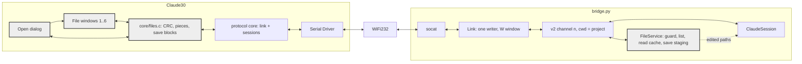
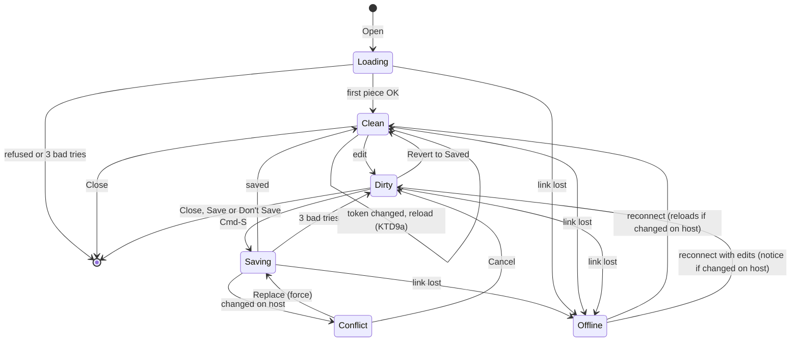

# Project Files on the SE/30 - Plan

## Goal Capsule

- **Objective:** From the SE/30 alone, the person can browse a project's files, read any text file in it, and make small edits that are saved to the host, and a damaged transfer never changes a file on disk.
- **Means:** An Open dialog and file windows in Claude30, backed by new session-scoped file tags in PROTOCOL.md v2 with a CRC-checked, resendable transfer (KTD1, KTD3), served by a file service in `bridge.py` that is confined to the tab's project folder (KTD5).
- **Product authority:** This Product Contract. The project tabs plan (`docs/plans/2026-11-24-1408-feat-project-tabs-plan.md`, on branch `claude/project-thread-c12v4l`) owns PROTOCOL.md v2's framing, sessions and tabs. This plan only adds to it.
- **Execution profile:** One pull request to `schreibaer/claude30`, built on the merged project tabs work. Bridge and client change together. Build order is U1, U2, U3, then U4 to U7.
- **Stop conditions:** Stop and ask if the tabs plan's v2 changes in a way that drops the "unknown session tags are ignored" rule or the per-session project folder, or if TextEdit on System 7.5.5 cannot show tab characters usably and the read-only fallback (KTD8) would leave most of the person's code uneditable.
- **Who finishes:** An implementing agent builds and tests U1 to U7 on the host and in Basilisk II. The person runs the hardware row of the Definition of Done on the real SE/30.
- **Open blockers:** The project tabs work must be merged first. Its plan is reviewed but not yet built.

---

## Product Contract

### Summary

Claude30 gains **File > Open Project File…** (Cmd-O). It shows a Standard File-style dialog that browses the front tab's project folder on the host.
Opening a file shows it in its own window. Small text files can be edited and saved back with Cmd-S. Large files open read-only and load in pieces as the person scrolls.
Every file transfer is checked end to end. The bridge writes a save only after the whole file arrived intact, and only if the file has not changed on the host since it was opened, unless the person chooses Replace.

### Problem Frame

In Claude30 the person sees project files only through Claude: tool lines, prose summaries and the diffs in permission dialogs.
To check what Claude changed, read a file before asking about it, or fix a typo, they have to walk to the host Mac or spend a Claude turn (and tokens) on it.
The SE/30 is meant to be the whole terminal, so reading and lightly editing the project belongs there.
Two facts shape everything: the SE/30's serial port drops bytes at 57,600 baud with no resend in the protocol, and anyone on the LAN who can dial in gets whatever the bridge allows.

### Key Decisions

- **Files belong to the tab's project.** The browser starts at the front tab's project folder and can never leave it. A file window belongs to that tab. Governs R1, R10, R11.
- **Editing is for small text files only.** Files up to the edit limit open editable. Larger files, binaries and files that would not survive a round trip through Mac Roman open read-only or are refused. Governs R4, R5, R6.
- **Saves are all or nothing and never overwrite unseen changes.** A save that arrives damaged is resent or refused. A file that changed on the host since it was opened asks the person before it is replaced. Governs R7, R8.
- **The person's saves don't ask permission, and Claude is told about them.** The person is the one editing, so no permission dialog. Claude hears which files the person changed at the start of its next turn. Governs R9.
- **No create, rename or delete.** Those stay with Claude, behind its permission prompts. Governs R3.

### Requirements

**Browsing**

- R1. File > Open Project File… (Cmd-O) shows a dialog listing the front tab's project folder: folders first, then files, sorted by name. The person opens a folder to go into it and uses a path pop-up or a parent button to go back up, as in Standard File.
- R2. The list hides `.git`, files the project's git ignore rules exclude, and files matching a built-in secrets list (`.env*`, `*.pem`, `*.key`, `id_rsa*`, `id_ed25519*`, `.ssh`). It shows each file's size.
- R3. Nothing in Claude30 creates, renames, moves or deletes host files. The only exception is the temporary file a save writes beside the original and swaps into its place (R12).

**Viewing**

- R4. Opening a text file shows it in a new window titled with the file name and project, in Monaco 9. Up to 6 file windows can be open at once.
- R5. A file over the edit limit (KTD7) opens read-only. Its window loads text in pieces as the person scrolls or drags the scroll bar, and the scroll bar spans the whole file. Files over 32,000 lines show the first 32,000 lines and say so, and the scroll bar spans the lines shown.
- R6. Binary files are refused with a message. Files that are not UTF-8, contain characters Mac Roman lacks, or mix line endings open read-only, and the window says why.

**Editing and saving**

- R7. An editable window supports typing, Cut, Copy, Paste, Clear and Select All, Save (Cmd-S) and Revert to Saved. Its title shows unsaved changes. A save keeps the file's original line endings, final newline and permissions.
- R8. If the file changed on the host since it was opened or last saved, Save shows an alert with Cancel (default) and Replace. Replace overwrites the file. Cancel keeps the edits in the window.
- R9. At the start of Claude's next turn in that tab, the bridge tells Claude which files the person saved since its last turn.
- R10. Closing a dirty file window, closing its tab, disconnecting or quitting asks Save, Don't Save or Cancel per dirty window, and Disconnect runs those saves before hanging up. With the link down, the alert says "Can't save: not connected" and offers only Don't Save and Cancel. A dropped link keeps the windows and their edits, and Save is available again once the tab reconnects.

**Safety on the host**

- R11. The bridge reads and writes only regular files inside the session's project folder, after resolving symbolic links, and only paths shown by R2's rules. Writes go only to existing files that opened editable, plus the one temporary file each save creates beside its file (KTD4).
- R12. A save replaces the file atomically. The file on disk is either the old version or the complete new version, never a partial one.
- R13. `--files rw|ro|off` on the bridge sets what the SE/30 may do, with `rw` as the default. The client greys out Save under `ro` and hides the Open command under `off`.

**Reliability**

- R14. Every read piece and every saved file is checked with a CRC-32. A damaged or incomplete piece is requested again, up to 3 tries, and then the operation fails with a message instead of showing or writing bad text.
- R15. File transfers share the line with Claude's output and never stall it or the window's flow control. A permission request that arrives while the Open dialog is up is announced in the dialog and opens the moment the dialog closes.

### Acceptance Examples

- AE1. **Covers R1, R2.** Given project "claude30" with a `.env` file and the gitignored `.venv/` folder, when the person opens the dialog, then they see `client`, `docs`, `tests`, `tools`, `.gitignore`, `PROTOCOL.md`, `README.md`, `bridge.py` and `run.sh`, and no `.env`, `.git` or `.venv`.
- AE2. **Covers R5.** Given a 4,000-line `bridge.py` over the edit limit, when the person opens it and drags the scroll bar to the middle, then the window shows the lines around line 2,000 within a few seconds and says it is read-only because of its size.
- AE3. **Covers R7, R9.** Given `README.md` open editable, when the person fixes a typo and presses Cmd-S, then the host file has the fix with its LF line endings intact, and Claude's next turn begins knowing that the person edited `README.md`.
- AE4. **Covers R8.** Given `run.sh` open and Claude edits it in the same tab, when the person saves, then the alert says the file changed on the host, and Cancel leaves the host file as Claude wrote it.
- AE5. **Covers R14, R12.** Given the stress bridge corrupting one save block, when the person saves, then the client resends that block, the save completes, and the host file matches the window byte for byte. With every block corrupted, the save fails after 3 tries and the host file is unchanged.
- AE6. **Covers R11.** Given a symbolic link `docs/notes` pointing to `~/Documents`, when the person opens `docs`, then `notes` is not listed. A hand-crafted `1G` request for `../.ssh/id_rsa` gets a refusal.

### Success Criteria

- The person reads a file Claude just changed and fixes a line of it from the SE/30, without touching the host or spending a Claude turn.
- Over a one-hour hardware session with saves at 57,600 baud, no saved file ever differs from what the window showed, even if the status line reports line noise.

### Scope Boundaries

- Creating, renaming, moving or deleting files (R3).
- Files outside the tab's project folder, or browsing the host's file system.
- File access in tty mode (ZTerm) or in v1 app mode.
- Find and replace, syntax colouring, line numbers and Undo. TextEdit has no undo; Revert to Saved is the recovery path.
- Downloading files to the SE/30's disk, or uploading Mac files to the host.

#### Considered and not built

- **Per-character resend in the protocol as a whole.** Only file transfers get CRCs and resends. Claude's prose keeps the existing "line noise" marker, because a damaged transcript line is visible to the person and costs nothing on disk. Revisit if hardware sessions show noise often enough to make prose unreadable.
- **A file pane inside the main window.** A separate window per file matches the Mac and keeps the tabs plan's window layout untouched. The 512 × 342 screen is too small for a pane beside the transcript.
- **A confirmation on every save.** The person chose to save, and the conflict check (R8) catches the dangerous case.
- **Locking files against Claude while a window is open.** The conflict check covers it without blocking Claude's work.

#### Deferred to Follow-Up Work

- Find in a file window.
- Opening the file a tool line names (for example, clicking `U Edit src/parser.py` in the transcript).

### Dependencies / Assumptions

- The project tabs work is merged: v2 sessions with a project folder per session, one writer and one `W` window on the bridge, and session-routed events in the client core.
- The tabs plan keeps "both sides ignore session-scoped tags they don't know" in v2. Its KTD9 has the client accept words after `#OK se30bridge 2` (KTD2), and its U7 makes Cmd-W close the front window (KTD11). Closing a tab is a single `<n>X`, after which the bridge denies open requests and confirms with `<n>X closed`.
- `git` is installed on the host, for ignore rules. Without it, or outside a repository, only the built-in hide list applies (R2).

### Sources / Research

- `PROTOCOL.md` v1 and the tabs plan's v2 framing: one-digit session prefix, 255-byte lines with 200-byte payloads and `+` continuation, tags already taken (`T + C[ C] C U E I Q D[ D] D ? R > W O X P A`).
- `bridge.py`: `describe_tool`'s relative paths, `ClaudeSession.turn` (where R9's note joins the prompt), `transliterate` (read-only display of unencodable text), `Link.send` pacing.
- `client/src/core/batch.h`: TextEdit limits already in use: `TRIM_AT_BYTES` 28,672, `TRIM_AT_LINES` 2,400, and `TE_HARD_LIMIT` 31,000 in `window.c`.
- `client/src/mac/permdlg.c`: a modal dialog that keeps pumping the serial port, the pattern the Open dialog follows.
- `client/src/mac/serial.c`: `serial_errors()` reports lost bytes through `SerStatus`.
- Memory notes: System 7.5.5 with 32 MB, the SE/30 serial chip drops bytes at 57,600 under interrupt load, and v1 has no resend.

---

## Planning Contract

### Key Technical Decisions

- KTD1. **File operations are session-scoped v2 tags.** Each request and reply carries the tab's session digit, so the bridge resolves every path against that session's project folder and nothing else. New tags avoid every v1 and v2 tag. Because both sides ignore unknown session tags, this needs no version bump. Governs R1, R11, R15.
- KTD2. **The bridge advertises file access in the handshake.** The bridge sends `#OK se30bridge 2 files=rw` (or `ro`, `off`), and the client reads the word to enable Open and Save (R13). A tabs-era bridge sends no word, which means `off`. This depends on the tabs plan's client accepting `#OK se30bridge 2` as a prefix. Governs R13.
- KTD3. **The client pulls, and every transfer unit carries a CRC-32.** Reads are client-driven: the client asks for a line range, and the bridge answers with a header, the lines, and a trailer holding the byte count and CRC-32 of exactly those Mac Roman bytes with CR line breaks. A mismatch, a missing trailer within 20 seconds, or a serial error flag during the piece makes the client ask again (R14). A timeout retry first sends one spare `!ACK`, because a lost `W` would otherwise leave the bridge's writer waiting forever. Every retry uses a fresh transfer number, so late lines from an earlier try are dropped as unknown. Saves go up in blocks of about 2 KB. The bridge answers each block with OK or a resend request, and the commit carries the whole file's CRC. CRC-32 over a 1 KB table costs little on a 68030, and `zlib.crc32` matches it on the host. Governs R12, R14.
- KTD4. **Saves are staged, checked, then swapped in.** The bridge collects blocks for a save in memory and checks the whole-file CRC. It converts CR line breaks back to the file's original style, encodes as UTF-8 and compares the file's current SHA-1 with the version token from open. If all agree, it writes a temporary file in the same folder, copies the mode, `fsync`s and `os.replace`s it. A token mismatch answers "changed", and the client asks the person (R8). A commit with a force flag skips only the token check. Governs R7, R8, R12.
- KTD5. **One path guard for every operation.** The client sends paths relative to the project root. The bridge rejects absolute paths, NUL and empty components, joins the path with the root, runs `os.path.realpath`, and requires the result to be inside the root's real path. It then applies R2's hide rules to every component and requires a regular file for reads and writes. Listings skip entries whose real path leaves the root, and names holding a control character (C0 or DEL), which could break a protocol line. Requests for such names are refused as `bad name`. Hidden files are refused even when asked for by exact name. Ignore results are cached per folder for the session's life, refreshed on each listing of that folder. Governs R2, R11.
- KTD6. **Ignore rules come from git.** For a listing, the bridge passes the folder's entries to `git check-ignore --stdin` run in the project root, and drops the matches. The built-in secrets list (R2) applies always, so a tracked `.env` is hidden too. Outside a repository, or without git, only the built-in list applies. Governs R2.
- KTD7. **The edit limit is 28 KB of Mac Roman text and 2,000 lines.** 28 KB matches `TRIM_AT_BYTES` (28,672) and leaves about 2 KB to grow within `TE_HARD_LIMIT` (31,000). The line cap keeps line count times the 12-pixel line height under the 16-bit limit `batch.h` documents, with headroom for soft wraps. Typing past 31,000 bytes beeps, as the input area already does. Governs R4, R5, R7.
- KTD8. **The bridge decides what is editable and says why.** It flags a file binary if its first 8 KB holds a NUL byte, and refuses it. A file that is not valid UTF-8 opens read-only, decoded as Latin-1. A UTF-8 file opens read-only if any character has no Mac Roman form, if it holds control characters other than tab, if its line endings are mixed, or if it is over KTD7's limit. Read-only text is shown through the existing `transliterate` function, with every remaining C0 control character except tab, and DEL, replaced by `?`, and lines split only on the file's own line endings. Editable text skips `transliterate`: its `B` lines are `str.encode('mac_roman')` bytes written through a raw output method on the single writer, so `≤` or a non-breaking space survives a round trip, and the trailer CRC covers exactly the bytes sent. Tab characters pass through unchanged. If TextEdit on the real ROM draws them unusably, files containing tabs fall back to read-only with tabs expanded to 4 spaces (Deferred to Implementation). Governs R5, R6.
- KTD9. **Read-only windows keep a sliding slice of the file.** The bridge caches one converted line array per open file per session, keyed by path and version token. `G` carries a byte budget as well as a line count, and the bridge ends a piece at whichever comes first (at most 200 lines or 4 KB), reporting the actual count in `H`. The window keeps at most about 24 KB in its TextEdit record. Scrolling near either edge fetches the next piece and drops lines from the far end until the record is back under budget. A single line longer than the budget is clipped in the view and the status strip says so. While a jump loads, the old text stays, the thumb sits at the target and the status strip says "Loading line N…". Select All and Copy cover the loaded slice, and the status strip names its line range. The scroll bar maps to file line numbers, not to TextEdit's pixels. If the version token changes while the window is open, the window reloads at the same line and says the file changed on the host. Governs R5.
- KTD9a. **Open windows notice host changes.** A file window re-checks its version token with a zero-line `G` when it comes to the front, when its tab's turn ends, and after a reconnect. A clean window reloads and shows "Changed on the host". A dirty window keeps its edits and shows the same notice, so the conflict alert on Save is no surprise. Governs R5, R8.
- KTD10. **The user-edit note goes into the next prompt.** Each v2 channel keeps the set of paths the person saved. Before the next `<n>P` prompt goes to Claude, the bridge prefixes one bracketed line naming those files and asking Claude to re-read them before editing, then clears the set. Claude Code's own "file modified since read" check backs this up. Governs R9.
- KTD11. **File windows are ordinary document windows owned by a tab.** Each file window records its session id. Cmd-W closes the front window: a file window closes itself, and only the main window maps Cmd-W to Close Tab. The tabs plan's U7 already does this. Edit commands, Save, Revert and Cmd-W act on the front window of either kind. Cmd-period, Send, New Tab, Cmd-1 to Cmd-6 and the Session menu always act on the main window's front tab. Cmd-O opens the dialog for the front file window's tab when one is in front, otherwise for the front tab. File windows open at about 480 × 300 with a 16-pixel cascade, can be resized and zoomed, and hide while another tab is in front. A Window menu lists the main window and the open file windows. Full Screen is disabled while a file window is open. Closing a tab, disconnecting and quitting first walk that tab's dirty file windows (R10). The SIZE resource grows by 512 KB over the tabs plan's KTD12, to 3.5 MB preferred and 2 MB minimum. Governs R4, R10.
- KTD12. **The Open dialog is a modal dialog on the serial pump.** It follows `permdlg.c`: a List Manager list with the standard LDEF, a path pop-up and Open and Cancel buttons. It keeps feeding the core while it waits for a listing, so Claude's output and `W` acknowledgements continue in the background. If a permission request arrives while the dialog is open, the dialog shows "Claude is waiting for permission in <project>", and the permission dialog opens as soon as the Open dialog closes, with its usual click-arming delay. Governs R1, R15.

### High-Level Technical Design

Where the new pieces sit. Shaded nodes are new. The link layer, channels, sessions and tab strip come from the tabs plan.



The file tags. Directional: PROTOCOL.md's v2 file section (U1) is the authority on exact spelling. `<x>` is a client-chosen transfer number, and paths come last because they may contain spaces.

```
Client -> bridge                        Bridge -> client
<n>L <path>                             <n>L[ <path>
                                        <n>L <d|f> <size> <name>      (one per entry)
                                        <n>L]
<n>G <x> <first> <count> <path>         <n>H <x> <first> <count> <total> <token> <e|r[:reason]>
                                        <n>B <line>                   (count lines, <n>+ continuation)
                                        <n>Z <x> <bytes> <crc32>
<n>F <x> <token> <path>                 <n>K <x> 0                    (save may start)
<n>S[ <x> <seq>
<n>S <line>                             (lines of one ~2 KB block)
<n>S] <x> <seq> <bytes> <crc32>         <n>K <x> <seq>  or  <n>N <x> <seq> resend
<n>S. <x> <bytes> <crc32> [force]       <n>K <x> saved <newtoken>
                                        <n>N <x> changed | <reason>
any refused request                     <n>N <x|-> <reason>
```

One save with a damaged block and a conflict check.

```
C: 2F 7 9f2c41 README.md
B: 2K 7 0
C: 2S[ 7 1  ... 2S] 7 1 2048 1a2b3c4d
B: 2K 7 1
C: 2S[ 7 2  ... 2S] 7 2 1310 55aa0f13
B: 2N 7 2 resend               <- CRC did not match
C: 2S[ 7 2  ... 2S] 7 2 1310 55aa0f13
B: 2K 7 2
C: 2S. 7 3358 c0ffee11
B: 2K 7 saved 77d0e2           <- staged, checked, swapped in (KTD4)
```

A file window's states.



### Risks & Dependencies

| Risk | Mitigation |
|---|---|
| A garbled session digit sends a file line to another tab's transfer. | The CRC and byte count fail, and the piece is requested again (KTD3). |
| TextEdit draws tab characters badly in Monaco on the real ROM. | KTD8's read-only fallback, decided by an emulator and hardware check before U6's editing work. |
| A large read keeps the line busy and delays Claude's prose in other tabs. | Pieces are at most 200 lines or 4 KB, and the bridge's single writer interleaves them with other sessions' lines (R15). |
| A path trick escapes the project folder. | One guard (KTD5) used by every operation, with tests for `..`, absolute paths, symbolic links in and out of the root, and hidden names. |
| A reconnect gives the tab a fresh session while a file window holds edits. | Windows keep the path and version token, not a bridge handle, so a save after reconnect works and still runs the conflict check. |
| The tabs plan changes its v2 framing before it is built. | Stop condition in the Goal Capsule. |

---

## Implementation Units

### U1. PROTOCOL.md: the v2 file section

- **Goal:** Write the file contract that U2 to U4 implement.
- **Requirements:** R1, R5, R7, R8, R11, R13, R14, R15.
- **Dependencies:** The tabs plan's U1 (PROTOCOL.md v2).
- **Files:** `PROTOCOL.md`.
- **Approach:**
  1. Add a "Files" subsection inside v2 that states KTD1's tags, the byte budget on `G` (KTD9), the zero-line token check (KTD9a), KTD2's `files=` word, KTD3's CRC rules (CRC-32 as in zlib, over Mac Roman bytes with CR line breaks), and the version token as an opaque string.
  2. List every refusal reason (`not found`, `hidden`, `outside project`, `bad name`, `binary`, `read-only`, `too big`, `changed`, `files off`, `busy`) so the client can show plain messages.
  3. Add the damaged-block exchange from the High-Level Technical Design.
- **Test expectation:** none -- specification text. U3's tests check the bridge against it.
- **Verification:** Every file tag the bridge or client sends appears in the spec, and none clashes with a v1 or v2 tag.

### U2. Bridge: file service

- **Goal:** The bridge lists, reads and saves files in a session's project folder under KTD4 to KTD10.
- **Requirements:** R2, R3, R6, R7, R8, R9, R11, R12, R13, R14.
- **Dependencies:** U1, and the tabs plan's U2 and U3 (channels with their own `cwd`).
- **Files:** `bridge.py`, `README.md`, `run.sh` (usage comment only).
- **Approach:**
  1. Add a `FileService` per v2 channel, built with the channel's project root and the `--files` mode (R13).
  2. Implement the path guard (KTD5) and hide rules (R2, KTD6) once, and route every request through them.
  3. Listing: entries of one folder, guarded, sorted folders first, with sizes.
  4. Reading: classify and convert the file (KTD8), cache the line array by path and token (KTD9), and answer `G` with a header, lines with `+` continuations, and the CRC trailer. Editable text goes through a raw-bytes output method that skips `transliterate` (KTD8).
  5. Saving: track open transactions by transfer number, check each block's CRC, then on commit run KTD4's checks and atomic replace. Drop a transaction left idle for 2 minutes.
  6. Record saved paths on the channel and add KTD10's note in front of the next prompt.
  7. Append `files=<mode>` to `#OK se30bridge 2` (KTD2) and refuse all file tags with `files off` when disabled.
  8. Document `--files` in `README.md` with a note that the link is unencrypted and the mode applies to anyone who can dial in.
- **Patterns to follow:** `describe_tool` for relative paths, the tabs plan's channel output methods for line framing (with the raw-bytes exception above), `transliterate` for read-only text only.
- **Test scenarios:** in `tests/test_bridge_files.py` (U3).
- **Verification:** `bridge.py --demo --projects <tmp>` serves listings, reads and saves to a scripted v2 client.

### U3. Bridge tests and stress cases for files

- **Goal:** Prove the file service on the host, and give the client scripted file cases including damage.
- **Requirements:** R2, R5, R6, R7, R8, R9, R11, R12, R13, R14.
- **Dependencies:** U2, and the tabs plan's U4 (v2 test harness and v2 stress bridge).
- **Files:** `tests/test_bridge_files.py` (new, standard-library `unittest`), `tools/emu/stress_bridge.py`, `tools/emu/README.md`.
- **Approach:** Reuse the tabs plan's subprocess harness over pipes against temporary project folders. Add stress cases `files-bigread` (a 40,000-line file), `files-noise` (the bridge corrupts one byte in every third read piece and rejects the second save block once) and `files-conflict` (the file changes between open and save). This seam catches the guard, conversion, CRCs and atomic replace. It misses TextEdit behavior and real serial loss, which the emulator and hardware rows cover.
- **Test scenarios:**
  - Covers AE1. A listing of a temp git repo with `.env`, `.git`, an ignored `build/` and a tracked `.env.example` shows neither `.env` nor `.env.example` (built-in list), nor `.git` or `build`.
  - Covers AE6. A symlink inside the root pointing outside is not listed. `G` for `../x`, `/etc/hosts`, `a/../../x` and a NUL-containing path each get `N … outside project`.
  - A symlink inside the root pointing to another file inside the root is listed and readable.
  - Reading a 10-line LF file gives a header flagged `e`, 10 `B` lines, and a trailer whose CRC equals `zlib.crc32` of the lines joined with CR.
  - A 300-byte line arrives as `B` plus one `+` continuation, and the CRC covers the joined line.
  - A UTF-8 file containing `≤`, `≠` and a non-breaking space opens editable, arrives with those characters as Mac Roman bytes, and saving it unchanged leaves the file byte-identical.
  - A file named with an embedded CR LF is not listed, and a request for it is refused as `bad name`. A Latin-1 file holding a lone CR followed by `2T x` arrives as `B` lines with the control character replaced and a matching CRC, and no `T` event reaches any tab.
  - A `G` with a 4 KB budget over a file of 500-byte lines returns 8 lines and says so in `H`.
  - A file with an emoji, one with mixed CRLF and LF, and one over 28 KB are each flagged `r` with the matching reason, and a PNG is refused as `binary`.
  - Covers AE3. Saving a changed CRLF file with no final newline writes CRLF endings, no final newline and the original mode, and the next prompt to the demo session starts with the user-edit note naming that file.
  - Covers AE4. Changing the file between `F` and `S.` answers `changed`, and the file keeps the other content. The same commit with `force` replaces it.
  - Covers AE5. A block with a wrong CRC gets `N … resend` and a corrected block is accepted. A commit whose whole-file CRC is wrong is refused and the file is unchanged.
  - Saving to a read-only-flagged file, to a hidden file and to a path that does not exist is refused.
  - Killing the bridge between the temporary write and the replace leaves the original file intact, with no temporary file left after the next save.
  - `--files ro` refuses `F` and appends `files=ro`. `--files off` refuses `L` and `G` too.
  - The handshake under v2 still produces the tabs plan's exchange apart from the appended `files=` word.
- **Verification:** The suite passes alongside the tabs plan's `tests/test_bridge_v2.py`.

### U4. Protocol core: file transfers

- **Goal:** The client's portable core runs listings, piece reads and block saves per session, with CRC checks and resends, and reports results as events.
- **Requirements:** R5, R7, R8, R13, R14, R15.
- **Dependencies:** U1, U3, and the tabs plan's U5 (session-aware core).
- **Files:** `client/src/core/files.c` (new), `client/src/core/files.h` (new), `client/src/core/crc32.c` (new), `client/src/core/crc32.h` (new), `client/src/core/protocol.c`, `client/src/core/protocol.h`, `client/tests/test_files.c` (new), `client/tests/test_bridge_session.c`, `client/tests/CMakeLists.txt`, `client/CMakeLists.txt`.
- **Approach:**
  1. `crc32` with a 1 KB table built at startup, matching zlib.
  2. The protocol core hands lines with file tags to `files.c` with their session id. It reads the `files=` word from `#OK` (KTD2).
  3. `files.c` keeps a small table of transfers. Each read collects one piece into a buffer, checks the byte count and CRC, and either emits a piece event or asks again, up to 3 tries (KTD3). A serial error reported during the piece also forces a retry.
  4. Saves split the window's text into ~2 KB blocks on line boundaries, send one block per call from the shell's idle loop so typing stays responsive, wait for each OK, resend on `N`, then commit.
  5. Link loss fails every open transfer with one event per transfer, and the shell keeps windows open (R10).
- **Execution note:** Write the CRC and piece-assembly tests first against `zlib.crc32` vectors produced by the bridge, so both sides are proven to agree before any Mac code uses them.
- **Patterns to follow:** `protocol.c`'s tag dispatch and timers, `test_protocol.c` fixtures, `linebuf.c` for line assembly.
- **Test scenarios:**
  - CRC-32 of "123456789" is `cbf43926`, and of a recorded bridge piece equals the trailer.
  - A piece with a matching trailer emits one piece event holding exactly the joined lines.
  - A piece whose trailer CRC differs sends the same `G` again, and a third failure emits a failure event with "the link is too noisy".
  - A piece with a serial error flagged in the middle is retried even when the CRC happens to match.
  - No trailer within 20 seconds sends one spare `!ACK`, then retries with a new transfer number. Lines for the old or any unknown transfer number are dropped and counted as noise.
  - A piece whose `W` line is lost, with no turn running in any tab, recovers on the retry and the read completes.
  - A 5 KB save sends three blocks, and an `N` on block 2 resends only block 2.
  - A `changed` answer emits a conflict event, and a forced retry sends `S.` with `force`.
  - `#OK se30bridge 2` with no word reports files off. `files=ro` reports read-only.
  - Link loss with one read and one save open emits two failure events and sends nothing more.
  - End to end against `bridge.py --demo`: list, read a file in two pieces and save it back unchanged, and the host file is byte-identical.
- **Verification:** Host unit tests and the end-to-end test pass.

### U5. Open Project File dialog

- **Goal:** The person browses the front tab's project and picks a file to open.
- **Requirements:** R1, R2, R13, R15.
- **Dependencies:** U4, and the tabs plan's U6 and U7 (tabs and session menu).
- **Files:** `client/src/mac/opendlg.c` (new), `client/src/mac/opendlg.h` (new), `client/src/mac/main.c`, `client/src/mac/resources.h`, `client/claude30.r`, `client/CMakeLists.txt`.
- **Approach:**
  1. A `DLOG`/`DITL` with a List Manager list (`LNew`, standard LDEF), a path pop-up (Popup CDEF, `MenuHandle` filled per folder), Open and Cancel.
  2. Entering a folder sends `L` and shows "Loading…" until the listing arrives. The dialog pumps serial and core events like `permdlg.c` (KTD12), and shows the waiting-permission line when a request is pending.
  3. Folders are marked with a trailing `/`, and sizes appear right-aligned in the cell. A parent button sits beside the pop-up.
  4. Double-click or Open goes into a folder or opens a file. Return is the default button, Cmd-period cancels, and typing selects by name prefix as in Standard File.
  5. An empty folder says "Empty folder". A refusal or link loss shows its reason in plain words in the list area and keeps Cancel live. The bridge caps a listing at 500 entries and the dialog says when it was cut.
  6. Opening a file already open brings its window forward. A 7th file window, or a refused file, shows an alert with the reason.
  7. File menu gains Open Project File… (Cmd-O), hidden under `files=off`, disabled with no tab ready.
- **Patterns to follow:** `permdlg.c` for the serial pump and arming, `prefs.c` for the dialog setup, the tabs plan's picker for List Manager use.
- **Test scenarios:**
  - Covers AE1. In the emulator against a demo bridge on a copy of the repo, the root lists exactly the visible entries.
  - Opening a folder and choosing the root from the pop-up returns to the root listing.
  - A background tab's output continues to arrive while the dialog is open.
  - A front-tab permission request arriving mid-listing shows the waiting line in the dialog, and the permission dialog opens right after Cancel.
  - An empty folder, a refused folder and a dropped link each show their message and leave Cancel working.
  - With `--files off` the Open command is absent.
  - Test expectation for drawing: emulator checklist only. Listing parsing stays covered by U4's host tests.
- **Verification:** The emulator checklist rows for the Open dialog pass in Basilisk II.

### U6. File windows: view, edit, save

- **Goal:** Each opened file gets a window that pages large files, edits small ones and saves safely.
- **Requirements:** R4, R5, R6, R7, R8, R10, R13, R14.
- **Dependencies:** U5.
- **Files:** `client/src/mac/filewin.c` (new), `client/src/mac/filewin.h` (new), `client/src/mac/main.c`, `client/src/mac/window.c`, `client/src/mac/modem.c`, `client/src/mac/resources.h`, `client/claude30.r`, `client/CMakeLists.txt`.
- **Approach:**
  1. A document window with a vertical scroll bar and a monostyled TextEdit record in Monaco 9, word-wrapped to the window. A status strip at the bottom says "Read-only: <reason>", "Loading…", "Saving 2 of 3…" or "Changed on the host".
  2. Editable files load in the same budgeted pieces as read-only files, each retried on its own, and fill the TextEdit record only after every piece passed its CRC. Any edit sets the dirty flag. Read-only files use KTD9's sliding slice, with the scroll bar's value as a file line number.
  3. Cmd-S runs U4's save. A conflict shows an alert with Cancel as default and Replace.
  4. Revert to Saved discards edits after a confirmation and reloads.
  5. Window title shows a bullet when dirty. Command routing, window geometry, hiding with the tab, the Window menu and Full Screen follow KTD11.
  6. Token re-checks and reloads follow KTD9a.
  7. Hook the tabs plan's tab close, disconnect and quit paths to walk dirty windows first (R10), with the offline alert when the link is down. Link loss marks windows offline and disables Save until reconnect.
  8. Grow the SIZE resource (KTD11).
- **Execution note:** Before step 2, check in Basilisk II and on the SE/30 how TextEdit draws a tab character in Monaco 9, and settle KTD8's fallback.
- **Patterns to follow:** `window.c` for TextEdit, scroll bar and Edit menu handling, `permdlg.c` alerts with safe defaults.
- **Test scenarios:**
  - Covers AE2. With the stress bridge's `files-bigread`, dragging the scroll bar to the middle shows that region within a few seconds, and scrolling back up refetches the start.
  - Covers AE3. Editing and saving a demo file updates the host file, and the title's dirty mark clears.
  - Covers AE4. With `files-conflict`, Save shows the alert. Cancel keeps the edits, and Replace saves.
  - Covers AE5. With `files-noise`, a read and a save both complete, and the status strip shows the retries.
  - Typing past 31,000 bytes beeps and inserts nothing.
  - Closing a tab with a dirty file window asks Save, Don't Save or Cancel, and Cancel keeps both the tab and the window.
  - Dropping the link keeps the window and its edits. After Redial, Save succeeds when the host file is unchanged.
  - Quitting with a dirty window while the link is down offers only Don't Save and Cancel.
  - A clean window of a file Claude edits in the same tab reloads when the turn ends and shows "Changed on the host".
  - With a file window of tab 2 in front and tab 1 in the strip, Cmd-period stops tab 1's turn, Paste goes into the file window, and Cmd-O browses tab 2's project.
  - Switching to tab 1 hides tab 2's file windows, and switching back shows them.
  - A `ro` bridge opens editable-looking files read-only with Save greyed.
  - Test expectation for drawing: emulator checklist only. Paging arithmetic and the slice bookkeeping get host tests in `client/tests/test_files.c` if they live in portable code.
- **Verification:** The emulator checklist rows for file windows pass in Basilisk II with the stress bridge and the demo bridge.

### U7. User guide, emulator checklist and release files

- **Goal:** The person can use file browsing and editing from the docs alone.
- **Requirements:** R1, R13.
- **Dependencies:** U2, U6.
- **Files:** `client/README.md`, `README.md`, `tools/emu/README.md`.
- **Approach:** Document Open Project File, read-only reasons, saving and conflicts, `--files`, the hidden-file rules and the new emulator checklist rows. Rebuild `Claude30.bin` and `Claude30.dsk` with the pinned Retro68.
- **Test expectation:** none -- documentation and packaging. The hardware row of the Definition of Done exercises them.
- **Verification:** A reader can go from the README to editing and saving a file without other help.

---

## Verification Contract

| Gate | Command or step | Applies to |
|---|---|---|
| Bridge tests | `python3 -m unittest discover -s tests` | U2, U3 |
| Host unit and end-to-end tests | `cmake -S client/tests -B build-host && cmake --build build-host && ctest --test-dir build-host` | U4 |
| 68k build | `cmake -S client -B build-68k -DCMAKE_TOOLCHAIN_FILE=<retro68>/m68k-apple-macos/cmake/retro68.toolchain.cmake && cmake --build build-68k` with the pinned Retro68 | U5, U6, U7 |
| Emulator checklist | `tools/emu/README.md` file rows in Basilisk II against `run.sh --demo --projects <tmp>` and the stress bridge's file cases | U5, U6 |
| Real bridge | One emulator session against `run.sh --projects <dir>` and real Claude: edit a file, save, and confirm Claude's next turn mentions the edit | U2, U6 |
| Hardware | A one-hour session on the SE/30 at 57,600 with at least ten saves, comparing each saved file on the host with the window | Success Criteria |

## Definition of Done

- Bridge tests, host tests and the 68k build pass from a clean checkout.
- AE1 to AE6 have each passed their test or emulator step.
- PROTOCOL.md's v2 section lists every file tag, and no tag clashes with v1 or v2.
- No code path in the bridge reads or writes a file without passing the KTD5 guard, as checked by review.
- The person has run the hardware session, and the result is recorded in `client/README.md`.
- Release `.bin` and `.dsk` are rebuilt and copied to the project's release folder.
- No experimental or abandoned code from dropped approaches remains in the diff.

### Deferred to Implementation

- KTD8's tab-character handling, settled by the U6 check.
- Exact piece size and slice size (KTD9), tuned by feel at 57,600 on the hardware.
- Whether the read cache needs a memory cap on the host beyond one entry per open file.
- Exact tag spelling, settled in U1 if any proposed tag reads badly next to the tabs plan's final spec.
- Whether long lines in file windows get a soft-wrap marker like the permission dialog's `¬`, or wrap unmarked. TextEdit has no marker of its own, so this depends on how cheaply one can be drawn.
