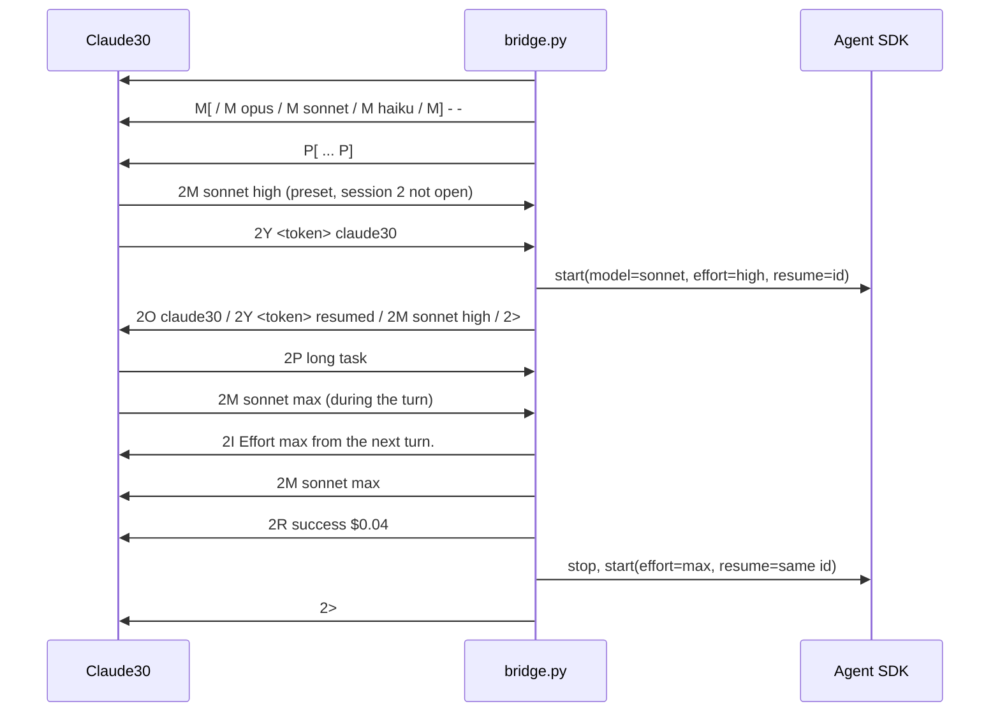
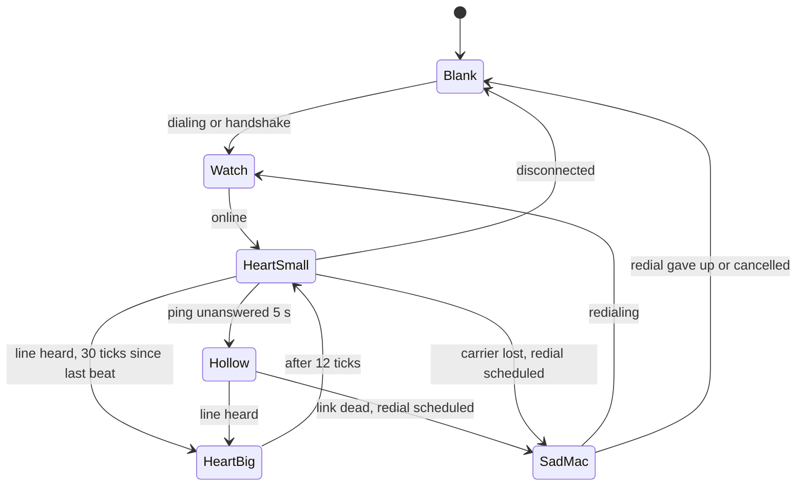

# Heartbeat Light and Per-Tab Model and Effort - Plan

## Goal Capsule

- **Objective:** From the SE/30 alone, the person can see at a glance whether the link to the host Mac is alive, waiting, or lost, and can give each tab its own Claude model and effort that stick across turns, redials and relaunches.
- **Means:** a tiny vintage compact Mac in the status line drawn from link timing the client core already keeps (KTD1, KTD2), plus a `models` capability in protocol v2 that lets the client preset and change each session's model and effort (KTD3 to KTD6).
- **Authority:** the person's confirmed scope in this plan's Product Contract wins, then `PROTOCOL.md`, then the KTDs. `CLAUDE.md` rules apply throughout: protocol compatibility, Toolbox calls named, tested and untested work stated.
- **Execution profile:** one pull request on `claude/project-thread-xl01cu`. Bridge, spec and client change together because the client feature depends on the new protocol lines and nothing here needs to ship ahead of the rest.
- **Stop conditions:** stop and ask if the Agent SDK in use cannot resume a conversation with a different effort (KTD5), or if the status line cannot fit a 16-pixel icon without breaking the 512x342 layout.
- **Who finishes:** the implementer builds, runs the host and bridge tests, refreshes `release/` in project files, and opens the PR. Running on Basilisk II or the real SE/30 is the person's step.

---

## Product Contract

### Summary

Claude30 gets a 16x16 compact-Mac indicator at the right end of the status line whose screen shows a heart that beats with link traffic, goes hollow while a heartbeat waits for its answer, and becomes a Sad Mac while a lost link is redialed. Each tab gets a model and an effort, picked from a Session menu dialog or typed as `/model` and `/effort`, applied by the bridge without losing the conversation, and remembered with the tab.

### Problem Frame

The Wi-Fi drop work (PR #9) added a `!PING`/`#PONG` heartbeat and dead-link detection, but it runs invisibly. The person only learns the link died when the status line switches to "Link lost", and has no way to tell a slow host from a dead one before that. The SE/30 stays a thin display with no network stack, so the link is the one thing the person cannot otherwise check.

Separately, every tab runs whatever model `bridge.py --model` was started with, at the CLI's default effort. Changing that means walking to the host Mac and restarting the bridge, which ends every tab's turn. The person wants quick questions on a cheap model and hard work on a strong model with high effort, side by side in different tabs.

### Requirements

**Heartbeat indicator**

- R1. While connected, the indicator's heart beats each time any line arrives from the bridge, `#PONG` included, at most about twice a second so a busy stream reads as a fast pulse rather than a solid heart.
- R2. When a heartbeat has gone unanswered for 5 seconds, the heart turns hollow until something arrives.
- R3. While a lost link is being redialed (from the dead-link detection or a dropped carrier), the indicator shows a Sad Mac; while dialing or waiting for the bridge's handshake, the screen shows the wristwatch.
- R4. When not connected and not redialing, the indicator shows the compact Mac with a blank screen.
- R5. The indicator lives at the right end of the status line, left of the reading-position field, and never covers status text; it works in full screen, compact input and hidden scroll bar layouts.
- R6. Against a bridge without the `ping` capability, the heart still beats on traffic and never turns hollow.

**Per-tab model and effort**

- R7. Each tab has a model, chosen from the list the bridge offers or "bridge default", and an effort of low, medium, high, xhigh, max or "bridge default".
- R8. The person changes the front tab's model and effort from a Session menu item, "Model and Effort...", while connected and the tab is open.
- R9. Typing `/model <name>` or `/effort <level>` in a tab does the same; with no argument each command shows the current value and the choices. Both commands also work in ZTerm (tty mode) and v1 app mode for the single conversation there.
- R10. A change keeps the conversation, its permissions given with "always", and its resume token; a change made during a turn takes effect when that turn ends, and the person is told so.
- R11. Each tab remembers its model and effort across redials and relaunches, and a tab reopened after a drop runs with them from its first turn.
- R12. When a remembered model is no longer offered by the bridge, the tab falls back to the bridge default and the transcript says so.
- R13. The status line shows a tab's model and effort whenever either is set to something other than "bridge default"; the dialog names the bridge's own default when the bridge was started with one (for example "Bridge default (opus)").
- R14. New tabs start at the bridge default.

**Compatibility**

- R15. Older bridges and older clients keep working unchanged: the new lines are behind a capability word, and protocol version 2 is not bumped.

### Scope Boundaries

- No per-tab permission mode, tool lists or system prompt. Only model and effort.
- No cost or token display beyond today's `R` line.
- No mascot change: the walking mascot stays a "Claude is working" cue in the input box.
- Clicking the indicator does nothing. Considered a "last heard N seconds ago" readout on click and left it out: nobody asked, and the beat already carries the signal. A request for it would change the call.
- No offline editing of model and effort: the dialog needs the bridge's model list, so it is available only while connected. Typed commands cover the same need once connected.
- No bridge-wide default effort flag. `-` leaves effort to the CLI default, and per-tab effort covers the request; a flag would be worth adding only if the person wants every tab to start at a non-default effort.
- The bridge does not store model and effort in its resume records. The client is the owner (KTD4); a bridge-side copy would be a second source of truth that drifts.

---

## Planning Contract

### Key Technical Decisions

- KTD1. **A portable `heartbeat` core module decides the picture; the Mac shell only draws it.** Mirrors `client/src/core/mascot.c`: plain C, host-tested, with 16x16 art as `#` strings. Input is a small struct the shell fills from `Proto` (`state`, `last_heard`, `ping_out`, `last_ping`, `ping_cap`) plus the redial flag from `modem.c`; output is a picture (blank, watch, heart big, heart small, heart hollow, Sad Mac). Keeping timing in the core matches the rule in `protocol.h` that all protocol timing lives there and can be tested on the host.
- KTD2. **The beat keys off `last_heard`, which `proto_feed` already updates for every received byte.** No new protocol state is needed. A beat starts when `last_heard` moves past the last beat's tick and at least 30 ticks have passed since the previous beat start; the big heart shows for 12 ticks. Hollow uses the existing `ping_out` and `last_ping` with a 5-second threshold (`HB_WAIT_TICKS`), well under `T_DEAD`, so the person sees trouble about 85 seconds before the link is declared dead.
- KTD3. **The bridge advertises its model list; the SE/30 hard-codes none.** A new `--models` flag (default `opus sonnet haiku`, the Agent SDK's stable aliases) sets the list, sent in the handshake as `M[`, `M <name>`, `M] <default model|-> <default effort|->` before the project list. The closing line names what "bridge default" means (`--model`, or `-` when the CLI decides), so the dialog can show it. Model names change faster than SE/30 releases, and "all intelligence lives in the bridge". Whether the CLI's initialize result exposes a model list worth using instead is deferred to implementation.
- KTD4. **The client owns each tab's settings and presets them before opening.** `<n>M <model> <effort>` (each value a name or `-` for the bridge default) is accepted for a session that is not open yet and applies to the next `<n>O` or `<n>Y` for that number. A preset lives until that session opens or the bridge connection ends, whichever comes first. This avoids starting Claude once with the wrong effort and again with the right one, which a post-open change would cost on every redial.
- KTD5. **Model changes use `ClaudeSDKClient.set_model`; effort changes restart the session's Claude resuming the same conversation.** claude-agent-sdk 0.2.172 exposes `ClaudeAgentOptions.effort` (`low` to `max`) but no runtime effort setter. The restart reuses `Channel._start`'s resume path (`cfg.resume = cfg.turns > 0`, same `claude_id`) and keeps the token, so no `<n>Y` is sent and the client sees no conversation change.
- KTD6. **Changes apply at the turn boundary.** The bridge records a pending change and applies it after a prompt is read and before its turn starts, never mid-turn; a change that arrives while the session is idle also wakes the prompt loop so it is applied at once and followed by a fresh `<n>>`, so a running turn, its permission prompt and its interrupt handler never see the session swapped underneath them. The bridge confirms every accepted or corrected setting at once with `<n>M <model> <effort>`, carrying the pending values when the change waits for the turn to end; applying it later sends nothing more. Typed commands produce the same line, so the client has one path to update its tab.
- KTD7. **Prefs version 6 appends per-tab model and effort after the resume tokens.** Same pattern as v4 to v5 in `client/src/mac/prefs.c` (size checks by `offsetof`); a v5 file loads with every tab at the bridge default.
- KTD8. **The status row grows to fit a 16x16 icon.** `layout()` in `client/src/mac/window.c` sets the status row to `gLineH + 5` pixels, about 16 with Monaco 9, which leaves no room for a 16-pixel icon and its frame line. The row becomes the larger of that and `MASCOT_H + 3`, costing the transcript about three pixels. A smaller icon was considered and rejected: a heart needs at least 5x5 pixels inside a recognisable compact Mac.
- KTD9. **The dialog uses two System 7 pop-up menu controls.** Standard `popupMenuProc` (CDEF 63, `procID` 1008) in a `DLOG`/`DITL` with `CNTL` and `MENU` resources; the model menu is filled at run time from the bridge's list. Pop-ups are in System 7.0 and later, which is the target.
- KTD10. **The demo session mentions model and effort only when they differ from the default.** `DemoSession.turn` text gains the values in that case, so tests can observe them while `client/tests/fixtures/demo_session.bin`, recorded with defaults, stays valid without re-recording.

### High-Level Technical Design

Opening a tab with remembered settings, then changing effort mid-conversation:



Indicator pictures (KTD1, KTD2):



Protocol additions, directional (the spec text in `PROTOCOL.md` is authoritative once written):

```text
#OK se30bridge 2 ... models          capability word
M[ / M <name> / M] <model|-> <eff|-> link-level, bridge -> client, before P[; M] names the defaults
<n>M <model|-> <effort|->            client -> bridge: preset (session not open) or change
<n>M <model|-> <effort|->            bridge -> client: the settings now in effect or pending
```

### Implementation Constraints

- Toolbox calls relied on: QuickDraw `CopyBits`, `EraseRect` for the icon (already used by the mascot); Dialog Manager `GetNewDialog`, `ModalDialog`, `GetDialogItem`; Control Manager `GetControlValue`, `SetControlValue`, `SetControlMaximum`; Menu Manager `GetMenuHandle`, `AppendMenu`, `SetMenuItemText` for the run-time model list; Resource Manager for prefs. Pop-up menu controls need System 7.0 or later. Nothing needs more memory than a few hundred bytes of art and a 16-entry model list.
- Session menu items after "Close Tab" shift by two (a new item and a separator). Update the `kSessionMenu` enable mask in `client/claude30.r` and the item constants in `client/src/mac/resources.h` together.
- Model names on the wire are bridge-chosen tokens without spaces; the client stores up to 31 bytes per tab.

### Sources & Research

- Heartbeat timing and fields: `client/src/core/protocol.h` (`T_PING`, `T_PING_WAIT`, `T_DEAD`, `last_heard`, `ping_out`), `client/src/core/protocol.c` (`proto_feed`, `proto_tick`, `link_dead`).
- Redial state: `gRedial` in `client/src/mac/modem.c`; status text in `update_status` and `front_status`.
- Drawing pattern: `mascot_tick`, `blit16` and `layout` in `client/src/mac/window.c`; art and view logic in `client/src/core/mascot.c`.
- Bridge session lifecycle: `SessionConfig`, `ClaudeSession.start`, `Channel._start`, `Channel._restart`, `Channel.run`, `V2.session_line`, `V2.run` in `bridge.py`.
- SDK surface checked in the installed claude-agent-sdk 0.2.172: `ClaudeAgentOptions.effort: Literal["low","medium","high","xhigh","max"]`, `ClaudeSDKClient.set_model()`, no effort setter.
- Prior plans: `docs/plans/2026-11-24-1740-feat-reconnect-resume-after-wifi-drop-plan.md` (heartbeat and resume), `docs/plans/2026-11-24-1825-feat-picker-fix-mascot-prompt-jump-plan.md` (mascot drawing).

### Deferred to Implementation

- Whether the CLI initialize result (`get_server_info`) lists models with display names worth sending instead of `--models` (KTD3).
- Exact art for the Sad Mac and hollow heart; the core test pins only that each picture differs and fits 16x16.
- Exact wording of transcript notes and the dialog's static text.

---

## Implementation Units

### U1. Bridge: per-session model and effort, model list, typed commands

- **Goal:** the bridge applies a model and effort per v2 session, advertises its model list, and accepts typed `/model` and `/effort` in every mode.
- **Requirements:** R7, R9, R10, R11, R12, R14, R15
- **Dependencies:** none
- **Files:** `bridge.py`, `PROTOCOL.md`, `README.md`, `tests/test_bridge_models.py` (new), `tests/v2client.py` (only if a helper is needed)
- **Approach:**
  1. `SessionConfig` gains `effort`; `ClaudeSession.start` passes it to `ClaudeAgentOptions.effort` when set; `ClaudeSession` and `DemoSession` gain a model-change method (SDK `set_model` for the real one, a recorded value for the demo).
  2. New flag `--models` (list, KTD3).
  3. `V2.run` adds `models` to the `#OK` words and sends `M[`/`M`/`M]` (with the defaults, KTD3) before `send_list`; the lines go out only together with that capability word.
  4. `V2` keeps preset settings per session number (KTD4); `V2.open` hands them to the new `Channel`, and `V2.session_line` routes `M` to an open channel or stores it as a preset.
  5. `Channel` validates values (unknown model: `<n>E` plus fallback to default, R12), records a pending change, and applies it between reading a prompt and starting its turn (KTD6), with `V2.session_line` waking an idle loop through the prompt queue: model via the session's model-change method, effort via a resume restart that keeps token, `claude_id`, `always` and `turns` (KTD5). It sends `<n>M` after `<n>Y` on open and after each accepted change.
  6. `/model` and `/effort` in `Channel.run` and in `main_async`'s tty/v1 loop share one parser; `HELP` lists them. The tty/v1 loop counts turns like `Channel.run` and, on an effort restart after a finished turn, resumes `cfg.claude_id` and keeps `cfg.always`, so R10 holds there too.
  7. `DemoSession.turn` names model and effort only when non-default (KTD10).
  8. `PROTOCOL.md` gets a "Model and effort (`models`)" section beside "Resume and heartbeat", with the lines, preset rule, turn-boundary rule and an example; `README.md` documents `--models`.
- **Patterns to follow:** how `/edits` restarts a session and how `Channel._take_record` sets up resume; how `resume ping` capability words were added without a version bump; `tests/test_bridge_resume.py` for test shape.
- **Test scenarios:**
  - Handshake: `#OK` carries `models`, and `M[`, one `M` per `--models` entry, `M] - -` arrive before `P[`; with `--model sonnet`, the closing line is `M] sonnet -`.
  - Preset `2M sonnet high` then `2O <project>`: the demo's first reply names sonnet and high, and `2M sonnet high` arrives after `2Y` and before `2>`.
  - No preset: no model or effort in the demo reply, and `2M - -` is sent on open.
  - Change while ready: `2M haiku -` gives `2M haiku -` and a fresh `2>` before any prompt, and the very next reply names haiku; the resume token in `sessions.json` is unchanged.
  - Effort change restarts and resumes: after one turn, `2M - max` keeps the token, sends no new `2Y`, and the next reply shows `turn 2`.
  - Change during a turn: the bridge sends an `I` note at once, the running turn finishes normally, and the next turn uses the new values.
  - Unknown model `2M gpt9 -`: `2E` names the problem, `2M - -` follows, and the session keeps working.
  - Invalid effort `2M - turbo`: same fallback for effort only.
  - Preset for a session that is never opened is dropped when the bridge connection ends and does not apply to an open of another number.
  - Change during a turn: `2M` with the pending values arrives right after the `I` note, and no second `2M` follows when it is applied.
  - Typed `/model` with no argument lists the models and marks the current one; `/model sonnet` sends `2M sonnet -`.
  - tty mode: after one prompt, `/effort high` then a prompt: the demo reply names high and shows `turn 2`.
  - Two sessions with different models stay independent.
  - Seam: these run `bridge.py --demo` over pipes, so they catch protocol and lifecycle bugs but not whether the real SDK honours effort on resume (see Risks).
- **Verification:** the new test module and the existing `tests/` suite pass; `PROTOCOL.md` describes every line the tests exercise.

### U2. Client core: model list and per-session settings

- **Goal:** the protocol core understands the `models` capability, keeps the model list, sends presets and changes, and reports confirmed settings.
- **Requirements:** R7, R11, R12, R15
- **Dependencies:** U1 (for the end-to-end test)
- **Files:** `client/src/core/protocol.h`, `client/src/core/protocol.c`, `client/tests/test_protocol.c`, `client/tests/test_bridge_session.c`
- **Approach:**
  1. `read_ok` sets a `models_cap`; `link_line` collects `M[`/`M`/`M]` into a small list like the project list (at most 16 names of 31 bytes).
  2. New call to set a session's model and effort: sends `<n>M` whether or not the session is open, and does nothing when the bridge lacks `models`.
  3. A session `M` line emits a new `EV_MODEL` event whose text is `<model> <effort>`.
  4. Accessors for the list count and names.
- **Patterns to follow:** the project list (`projects_reset`, `projects_add`, `proto_project`) and the `resume_cap` handling.
- **Test scenarios:**
  - `#OK ... models` plus an `M` list during the handshake fills the list in order; without `models` the list is empty and the set call sends nothing.
  - An `M` list longer than 16 entries keeps the first 16 and does not overflow.
  - Set call for an unopened session sends `3M sonnet high\r`; for an open one the same.
  - `2M sonnet high` from the bridge emits `EV_MODEL` for session 2 with that text; for a session that is not open it is ignored like other session lines.
  - Handshake lines the core does not know (as an older core sees `M` lines) are ignored without counting dropped lines or noise; the new core stores `M` lines only after `#OK ... models`.
  - `M] sonnet high` stores the bridge defaults for the dialog; `M] - -` stores none.
  - End to end against `bridge.py --demo`: preset, open, see `EV_MODEL`, send a prompt, see the model named in the reply.
- **Verification:** `ctest` passes, including `test_bridge_session`.

### U3. Client core: heartbeat picture logic and art

- **Goal:** a host-tested module that turns link timing into the picture to show.
- **Requirements:** R1, R2, R3, R4, R6
- **Dependencies:** none
- **Files:** `client/src/core/heartbeat.h` (new), `client/src/core/heartbeat.c` (new), `client/tests/test_heartbeat.c` (new), `client/tests/CMakeLists.txt`, `client/CMakeLists.txt`
- **Approach:** per KTD1 and KTD2. The small, big and hollow hearts share one outline: the big heart is one pixel larger all round, and the hollow heart keeps the small heart's outline with a clear interior. The view function keeps its own small state (last beat tick, last `last_heard` seen) in a struct the caller owns, so it stays pure apart from that struct. Art: compact-Mac outline shared by all pictures, screen contents per picture.
- **Patterns to follow:** `client/src/core/mascot.c` and `client/tests/test_mascot.c` (art as strings, `mascot_row` bit packing).
- **Test scenarios:**
  - Idle link, no redial: blank picture.
  - Dialing and handshake states: watch.
  - Online, `last_heard` advances: big heart for 12 ticks, then small.
  - `last_heard` advancing every 5 ticks: beats start no closer than 30 ticks apart.
  - `ping_out` set and `last_ping` 4 seconds ago: small heart; 5 seconds ago: hollow; a new byte heard returns to a beat.
  - `ping_cap` off with `ping_out` never set: never hollow, however long the silence.
  - Redial flag set while idle or hanging up: Sad Mac; redial dialing: watch.
  - Tick counter wrapping past `ULONG_MAX` does not freeze or flash the heart.
  - Every picture's rows are exactly 16 wide, and small, big and hollow hearts each differ from the others by at least 8 pixels.
- **Verification:** `test_heartbeat` passes under `-Wall -Wextra -Werror`.

### U4. Claude30: draw the indicator in the status line

- **Goal:** the indicator appears and animates in the window.
- **Requirements:** R1 to R6
- **Dependencies:** U3
- **Files:** `client/src/mac/window.c`, `client/src/mac/window.h`, `client/src/mac/modem.c`, `client/src/mac/modem.h`, `tools/emu/README.md`, `client/README.md`
- **Approach:**
  1. `layout()` grows the status row (KTD8), shrinks `gStatusRect` on the right by `MASCOT_W` plus a small gap, and puts the indicator rect in the freed space, so the `EraseRect` in `draw_status_pos` never touches the icon. `window_update` still redraws the icon for update events.
  2. `window_idle` calls a new heartbeat tick beside `mascot_tick`, redrawing only when the picture changes, using `blit16`.
  3. `modem.c` exposes whether a redial is pending (it already has `session_redial_pending`) and the shell fills the heartbeat input from `gProto`.
  4. `window_update` redraws the icon after updates; full screen and compact layouts reuse the same rect logic.
  5. Add indicator checks to the emulator checklist and a short description to `client/README.md`.
- **Patterns to follow:** `mascot_tick` redraw-on-change logic and `gMDrawn` bookkeeping.
- **Test scenarios:** Test expectation: none in host tests; drawing is Toolbox-only. Picture logic is covered by U3. Manual checks go in `tools/emu/README.md`: beat while idle (every ~30 s from `#PONG`), fast pulse while output streams, hollow after stopping the host bridge with SIGSTOP, Sad Mac after the dead-link timeout, watch while redialing, blank after Disconnect, no overlap with a long status message, all three layouts, and the three heart states told apart at 1:1 on the emulator screen.
- **Verification:** the 68k build succeeds with no new warnings; the emulator checklist exists for the person.

### U5. Claude30: per-tab model and effort

- **Goal:** the person sets, sees and keeps each tab's model and effort.
- **Requirements:** R7, R8, R10, R11, R12, R13, R14
- **Dependencies:** U2
- **Files:** `client/src/mac/tabs.h`, `client/src/mac/tabs.c`, `client/src/mac/prefs.h`, `client/src/mac/prefs.c`, `client/src/mac/modeldlg.c` (new), `client/src/mac/modeldlg.h` (new), `client/src/mac/modem.c`, `client/src/mac/main.c`, `client/src/mac/resources.h`, `client/claude30.r`, `client/CMakeLists.txt`, `client/README.md`, `tools/emu/README.md`
- **Approach:**
  1. `Tab` gains `model[32]` and `effort[8]` (empty means bridge default); new tabs start empty (R14).
  2. Prefs v6 (KTD7): `prefs_set_tabs` takes the settings with names and tokens; load restores them onto reopened tabs.
  3. `modem.c` sends the preset for each tab just before its `proto_open` or `proto_open_resume`, including on automatic redial (R11).
  4. `EV_MODEL` updates the tab, saves prefs, and adds a transcript note when the bridge corrected a value (R12).
  5. `front_status` appends `(model, effort)` when either is set (R13); the dialog's default items name the bridge defaults from `M]` when there are any.
  6. Session menu gets "Model and Effort..." after "Close Tab"; `main.c` enables it when online, the front tab's session is open and the bridge advertised `models`, and calls the dialog (KTD9). OK sends the change; Cancel sends nothing.
- **Patterns to follow:** `picker.c` and `opendlg.c` for modal dialog structure; the v4 to v5 prefs migration in `prefs.c`; token handling in `modem.c` for per-tab saved state.
- **Test scenarios:** Test expectation: none in host tests for the Toolbox shell; the wire behaviour is covered by U1 and U2. Manual checks go in `tools/emu/README.md`: pick sonnet/high in tab 1 and default in tab 2 and confirm replies differ in the demo; change effort during a turn and see the note; quit and relaunch and confirm both tabs keep their settings; drop the link and confirm the redialed tab still uses them; start the bridge with a shorter `--models` and confirm the fallback note; a v5 prefs file loads; the menu item is dimmed against a bridge that does not advertise `models`.
- **Verification:** the 68k build succeeds; the menu mask matches the item count; the emulator checklist covers each requirement above.

---

## Risks

- **Effort on resume is unverified against the real CLI.** The SDK accepts `effort` with `resume`, but no test here runs the real Claude. Mitigation: U1 keeps the demo tests; the person's first real run should change effort mid-conversation and confirm the next reply continues the conversation.
- **`set_model` during an idle streaming connection** is documented as supported; if it fails at runtime, the fallback is the same resume restart used for effort, which the implementer may switch to without changing the protocol.
- **Status row height** is computed from font metrics; if Monaco 9 on the real SE/30 differs from expectations, the icon rect must still sit inside the row. U4 derives it from `MASCOT_H` rather than a constant.

---

## Verification Contract

| Check | Command | Proves |
|---|---|---|
| Toolchain | `tools/setup-retro68.sh` | Prebuilt Retro68 from `/mnt/project-files/toolchain/` is installed; never build Retro68 by hand |
| 68k build | `cmake -S client -B build-68k -DCMAKE_TOOLCHAIN_FILE=/opt/Retro68-build/toolchain/m68k-apple-macos/cmake/retro68.toolchain.cmake && cmake --build build-68k` | U4, U5 compile for System 7 |
| Core tests | `cmake -S client/tests -B build-host && cmake --build build-host && ctest --test-dir build-host` | U2, U3, and the end-to-end bridge session |
| Bridge tests | `python3 -m unittest discover -s tests` | U1 and no regressions in v1, tty, files, resume and lifecycle |

The report must say plainly that nothing ran on Basilisk II or the real SE/30 unless it did.

---

## Definition of Done

- Every unit's verification holds and all four checks above pass.
- `PROTOCOL.md` documents the `models` capability, the `M` list, `<n>M` in both directions, the preset rule and the turn-boundary rule; v2 is not bumped.
- `release/Claude30.bin` and `release/Claude30.dsk` in project files are rebuilt from the final commit.
- `tools/emu/README.md` lists the manual indicator and model checks for the person.
- No leftover experimental code, debug output, or unused art from abandoned attempts remains in the diff.
