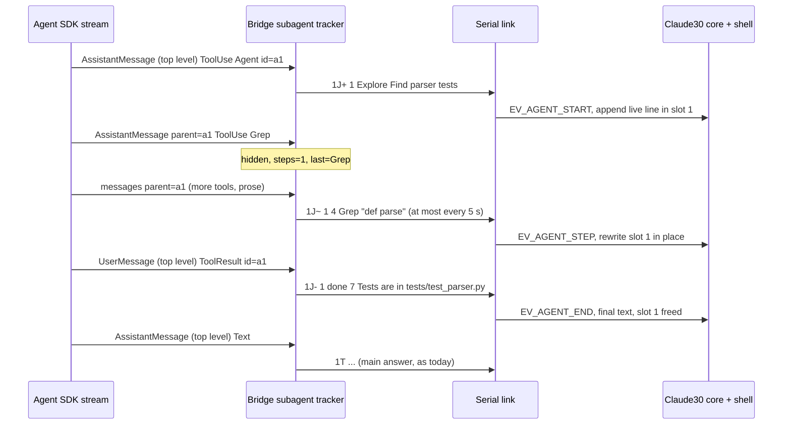
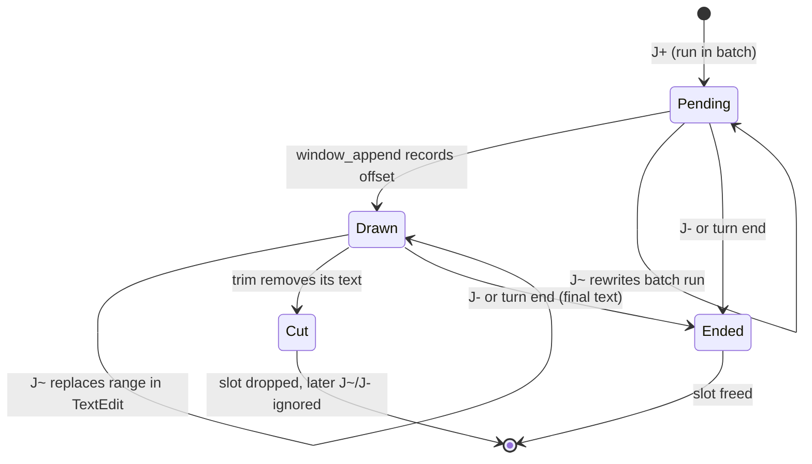

# Show Subagents as Collapsed Lines - Plan

## Goal Capsule

- **Objective:** On the SE/30, the person can see at a glance when Claude has handed work to a subagent, what that subagent is doing, and what it came back with, without the subagent's own output filling the transcript. They can also list which subagents a project offers.
- **Means:** The bridge tracks each subagent from the main conversation's Agent tool call to its result, stops forwarding the subagent's own text and tool lines, and sends a compact start, progress and end record instead (KTD1, KTD2). Claude30 draws each subagent as one indented line that it rewrites in place (KTD6). Other clients get plain start and end lines (KTD3).
- **Product authority:** This Product Contract. PROTOCOL.md v2 is extended with a capability word and a client opt-in, with no version bump (KTD2).
- **Execution profile:** One pull request to `schreibaer/claude30` touching bridge, protocol spec, client and docs. Build order U1, U2, U3, U4, U5, U6.
- **Stop conditions:** Stop and ask if the spike in U1 shows that the Agent SDK does not stream a subagent's messages with `parent_tool_use_id`, so the bridge cannot tell them apart from the main conversation.
- **Who finishes:** An implementing agent builds the app with the shared Retro68 toolchain cache (`tools/setup-retro68.sh`), runs the bridge and host tests and the emulator rows, and refreshes the release files. The person runs the hardware rows on the real SE/30.
- **Coordination:** The heartbeat and per-tab model plan (`docs/plans/2026-11-25-1627-feat-heartbeat-light-per-tab-model-plan.md`, branch `claude/project-thread-xl01cu`) also extends PROTOCOL v2. It takes the `models` capability, `M` lines, `/model` and `/effort`, prefs version 6 and a Session menu item. This plan takes none of those. Whichever lands second merges PROTOCOL.md, `HELP` and the `#OK` word list by hand.
- **Open blockers:** None.

---

## Product Contract

### Summary

Each subagent Claude starts appears in Claude30's transcript as one indented line, such as "» Explore: Find the parser tests · Grep · 6 tools". The line updates every few seconds while the subagent works. When the subagent finishes, the line becomes a one-line summary of what it found.
The subagent's own prose, tool lines and tool errors no longer reach the SE/30.
`/agents` lists the subagents the tab's project offers. ZTerm and older Claude30 builds see a plain line when a subagent starts and another when it ends.

### Problem Frame

The bridge already loads project and user subagents, because it starts Claude Code with `setting_sources=["user", "project", "local"]` (`bridge.py`, `ClaudeSession.start`). Claude can start one through its Agent tool at any time.
But `ClaudeSession.turn` forwards every `AssistantMessage` and every tool error it receives, and it doesn't check whether they came from the main conversation or from a subagent.
A subagent's reasoning, its dozens of tool calls and its final report therefore land in the transcript as if the main Claude had said them. That uses up Claude30's 28 KB transcript budget (`client/src/core/batch.h`, `TRIM_AT_BYTES`), costs serial time at 57,600 baud or less, and hides what the main Claude is doing.
The person also has no way to see from the SE/30 which subagents a project defines. They need that before they ask Claude to use one or decide to write a new one with Open Project File.

### Key Decisions

- **Collapsed lines, not a tab per subagent.** A tab per subagent would show the full output the 28 KB transcript can't hold, and it would compete with the six project tabs. Governs R1, R2.
- **The subagent's own output is never sent to the SE/30.** The main Claude reports what matters. The person can still read the full transcript on the host. Governs R3.
- **Permission prompts from subagents still appear and are labelled.** Hiding them would block the turn, and answering for the person would bypass their control. Governs R5.
- **New subagents are files, not an in-app editor.** The person asks Claude to write one or edits `.claude/agents/*.md` with Open Project File. `/agents` lists them. Governs R7.

### Requirements

**Seeing subagents in Claude30**

- R1. When Claude starts a subagent, Claude30 shows one indented line in that tab's transcript with the subagent's type and Claude's short description of the task.
- R2. While the subagent runs, that same line shows its latest tool and how many tools it has used. It updates at most every 5 seconds, and only when something has changed.
- R3. A subagent's own prose, tool lines and tool errors are not shown on the SE/30 in any client or mode.
- R4. When the subagent ends, its line shows the outcome (done, failed, or stopped) and the first line of its result, cut to fit one line.
- R5. A permission request raised inside a subagent shows the normal dialog, with the subagent's type at the start of the summary.
- R6. Several subagents running at once each get their own line. A turn that ends or is stopped while a subagent's line is still open turns that line into "stopped".

**Listing subagents**

- R7. `/agents` lists the subagents available in the current tab's project, each once, with where it is defined (built in, project or user). Project and user agents also show a one-line description from their file; built-in agents show only their name, since the SDK gives no description for them. It works in Claude30 and in ZTerm, and it says that new or changed agent files take effect in a new conversation.

**Other clients**

- R8. ZTerm, the v1 app and Claude30 builds without this feature see one plain tool line when a subagent starts and one when it ends, and nothing in between.

**Compatibility**

- R9. Existing clients keep working unchanged: an old Claude30 with a new bridge, and a new Claude30 with an old bridge.

### Acceptance Examples

- AE1. The person asks "use a subagent to find where the parser is tested". The transcript shows their prompt, then "» Explore: Find parser tests" updating to "· Grep · 4 tools", then "» Explore: done · 7 tools · Tests are in tests/test_parser.py and…", then the main Claude's answer. No Grep or Read lines from the subagent appear.
- AE2. A subagent wants to run `git log`. The permission dialog reads "Bash (general-purpose) git log -5" and answering y lets the subagent continue.
- AE3. The person presses Cmd-. while two subagents run. Both lines end as "stopped" and the turn ends.
- AE4. In ZTerm the same prompt as AE1 prints `  [Agent] Explore: Find parser tests` and later `  [Agent] Explore done: Tests are in tests/test_parser.py and…`.
- AE5. `/agents` in a project with `.claude/agents/reviewer.md` lists `reviewer (project): Reviews diffs for bugs` together with the built-in agents.

### Open Questions

- Q1 (deferred, not blocking). Today every subagent start asks permission, because `Agent` is not in the bridge's `allowed_tools`. This plan keeps that. The tools a subagent uses still ask on their own, so allowing `Agent` without a prompt would be safe and save a keystroke per subagent. The person can ask for that as a one-line follow-up.

### Scope Boundaries

- A read-only tab or window per subagent with its full output.
- Creating or editing subagents through a dedicated dialog in Claude30. Open Project File already covers it.
- Choosing a model or effort per subagent. Agent files can set that themselves, and the per-tab model work is in its own plan.
- Tracking background subagents after their Agent call returns. Their line ends as `done` with the handle text, and Claude reports their results in a later turn.
- A separate line for a subagent that another subagent starts. It counts as one tool step of its parent.

**Considered and not built**

- A client opt-in on every protocol line or a protocol version 3. Capability words plus one opt-in line already keep old and new clients working (KTD2). Revisit only if a later feature needs the client to describe more of itself.
- Logging subagent output to the tab's log file on the SE/30. The log only keeps what the transcript showed, and the full record already exists on the host.

### Sources / Research

- `bridge.py`: `ClaudeSession.start` (`setting_sources`, `allowed_tools`), `ClaudeSession.turn` (message loop), `_can_use_tool`, `describe_tool` (already maps `Task`/`Agent` to the description), `Channel` (v2 tags), `Terminal.tool` (tty and v1), `DemoSession`, the v2 and v1 command loops.
- `claude-agent-sdk` 0.2.172 (`claude_agent_sdk/types.py`): `AssistantMessage.parent_tool_use_id` and `UserMessage.parent_tool_use_id`; `ToolResultBlock.tool_use_id`; `TaskStartedMessage`, `TaskProgressMessage` (`usage.tool_uses`, `last_tool_name`), `TaskNotificationMessage` (`status`, `summary`), `TaskUpdatedMessage`; `ToolPermissionContext.agent_id` and `tool_use_id`; `SystemMessage` with `subtype == "init"` carrying `agents` (names).
- `client/src/core/protocol.c` `session_line` (ignores unknown session tags), `link_line`, the handshake's capability parsing for `resume` and `ping`; `client/src/core/batch.[ch]` (runs and styles); `client/src/mac/window.c` `window_append`, `trim`, `insert_run`; `client/src/core/promptmarks.[ch]` (offsets that shift on trim); `client/src/mac/modem.c` `tab_event` and the status text built from `last_tool`.
- PROTOCOL.md v2 "Resume and heartbeat": the capability-word pattern this plan follows, and the rule that the bridge ignores link-level lines it does not know.
- `docs/plans/2026-11-24-1740-feat-reconnect-resume-after-wifi-drop-plan.md`: the earlier extension of v2 done the same way.
- No external research. The SDK source in the installed package is the authority for message shapes. The U1 spike checks how the CLI actually streams them.

---

## Planning Contract

Product Contract preservation: new plan; no earlier contract.

### Key Technical Decisions

- KTD1. **The main conversation's Agent tool call frames each subagent.** A `ToolUseBlock` named `Agent` or `Task` in an `AssistantMessage` with no `parent_tool_use_id` starts a subagent. Its type is `input["subagent_type"]` (default `general-purpose`), which is what the SE/30 shows as the subagent's name, and its task is `input["description"]`. The `ToolResultBlock` with the same `tool_use_id` in a top-level `UserMessage` ends it. Its summary is the first non-empty line of the result text, and `is_error` makes it `failed`, except after the person asked to stop the turn: the CLI then usually answers pending tool calls with an "interrupted" error, so an `is_error` result that arrives after an interrupt request ends the line as `stopped`. Every message whose `parent_tool_use_id` names a running subagent is that subagent's own work. The bridge counts its `ToolUseBlock`s as steps, keeps the last one's `describe_tool` summary, and forwards none of it. Messages whose `parent_tool_use_id` names something that isn't a known subagent are hidden too, because they aren't the main conversation. `Task*` system messages, when they arrive, only fill gaps. A `TaskNotificationMessage` summary is used when the tool result has no text, and a terminal status ends a line whose result never came. A background subagent's Agent call returns at once with a handle; its line ends as `done` with that handle text as the summary, and nothing after that is tracked. These framing messages are the core of the subagent stream, so if they don't arrive the feature can't work (Goal Capsule stop condition). Governs R1 to R4, R6.
- KTD2. **Wire format: capability `agents`, client opt-in `!AGENTS`, session tags `J+`, `J~`, `J-`.** The bridge adds `agents` to the `#OK` words. A client that understands it sends the link-level line `!AGENTS` once after the handshake, and again after each redial. A bridge that doesn't know the line ignores it, as PROTOCOL v2 already requires. Only after the opt-in does the bridge send these, in place of the plain lines in KTD3:
  - `<n>J+ <k> <type> <task>`: subagent `<k>` started.
  - `<n>J~ <k> <steps> <tool> 
`: progress, where `<tool>` is the last tool name and `
` its `describe_tool` summary.
  - `<n>J- <k> <status> <steps> 
`: ended. `<status>` is `done`, `failed` or `stopped`.

  `<k>` is a number from 1 to 99 that the session assigns and reuses once a line has ended. Types never contain spaces, and the free text comes last and is clipped to 120 bytes. All three tags are counted in flow control like any other session line. An old client ignores the tags, but it never opts in, so it never receives them. Governs R1, R2, R4, R9.
- KTD3. **Plain start and end lines for everyone else.** Without the opt-in, which covers ZTerm, the v1 app and older Claude30 builds, the start sends `U Agent <type>: <task>` and the end sends `U Agent <type> <status>: 
`, through the existing `tool()` path. In tty mode that path prints `  [Agent] …`. This replaces today's single `U Agent <description>` line that the main conversation's tool call produces. Nothing is sent in between. Governs R3, R8.
- KTD4. **Progress is throttled per subagent.** The tracker sends `J~` for subagent `<k>` only if at least 5 seconds have passed since that subagent's last line and its step count or last tool has changed. On a link with no opt-in, no progress lines go out at all. Governs R2.
- KTD5. **Permission prompts name the subagent in the summary text.** When `context.agent_id` is None the request comes from the main conversation and gets no label. Otherwise `_can_use_tool` looks up the subagent from `context.agent_id` (or `tool_use_id`) when the U1 spike shows a usable mapping, and if it can't, uses the only running subagent, or "subagent" when several run. The label goes in front of the summary of the `Q` line (`Q 3 Bash (general-purpose) git log -5`) and of the tty prompt. The protocol is unchanged, so every client shows it. Governs R5.
- KTD6. **Claude30 rewrites a live line in place.** The protocol core turns `J+`, `J~` and `J-` into `EV_AGENT_START`, `EV_AGENT_STEP` and `EV_AGENT_END` for that session, with the payload unchanged. The portable `agentline.c` parses the payloads, composes the text and keeps the slot table. The shell keeps up to 8 live-line slots per tab, each holding `<k>`, the composed text and its offset and length in the transcript. Batch learns a run that belongs to a slot (new style `RS_AGENT` in `kStyles`; the face is settled on the real screen). TextEdit has no paragraph indent, so the indent is two leading spaces written by the composer. `window_append` records where that run lands, after the run's leading line break, as it already does for prompt marks, so the replaced range never includes the CR before it. An update replaces the slot's range with `TESetSelect` and `TEDelete`, then `TEStyleInsert`, or rewrites the run if it hasn't been drawn yet. The edit runs under an empty clip for every record, as `trim()` does, followed by `InvalRect` of the transcript view for the front tab, because `quiet_begin`/`quiet_end` only quiet background tabs. The person's selection in the transcript is saved first and restored afterwards, shifted by the length change, or cleared if it overlapped the line. `trim` shifts slot offsets the way `pm_cut` shifts prompt marks, and drops a slot only when the cut passes its offset. The client composes the visible text from the fields (`  » type: task · tool · N tools`, `  » type: done · N tools · summary`), so the bridge never sends Mac-specific characters. The shell cuts the composed text with an ellipsis to the transcript's width, measured with `TextWidth` in the `RS_AGENT` font, so it stays one line and a rewrite never changes the line count. On a 1-bit screen the outcome word (done, failed, stopped) carries the state. Toolbox: TextEdit (`TESetSelect`, `TEDelete`, `TEStyleInsert`) and QuickDraw (`TextWidth`, `ClipRect`, `InvalRect`), all available in System 7. Governs R1, R2, R4, R6.
- KTD7. **Turn end closes open lines on both sides.** When a turn ends (`ResultMessage`, an exception, or an interrupt), the bridge ends every open subagent as `stopped`. The client also finalizes any slot still open when its session's `>` arrives, so a lost `J-` can't leave a line that says "running" forever. Governs R6.
- KTD8. **`/agents` is a bridge command.** It works in the v2 session loop, the v1 and tty loop, and `HELP`. It lists:
  - agent names from the newest `init` system message the session has seen, when there is one, marked `built in` only when no project or user file below defines that name;
  - `<project>/.claude/agents/*.md`, marked `project`;
  - `~/.claude/agents/*.md`, marked `user`.

  The name and a one-line description come from each file's frontmatter (`name`, `description`), and the file name stands in when `name` is missing. Each name appears once. Output goes out as `I` lines, so no new tag is needed. It ends with "New or changed agent files apply after /new." File reading uses the same size cap and Mac Roman transliteration as other bridge text, and it never follows a symlink out of the agents folder. Governs R7.
- KTD9. **The demo session gets a scripted subagent.** In `--demo` mode, a prompt containing the word `agents` runs two overlapping fake subagents. Each takes a few steps, one of them asks permission, and both end with summaries. The default demo turn doesn't change, so existing tests and the C session test keep their expectations. Governs R1 to R6 (testability).

### High-Level Technical Design

How one subagent travels from the SDK to the SE/30:

A live line's lifecycle in the client:

How the bridge decides what to send for a subagent:

| Client | Start | Progress | End |
|---|---|---|---|
| Claude30 that sent `!AGENTS` | `J+` | `J~`, throttled | `J-` |
| v2 client without opt-in, v1 app | `U Agent type: task` | none | `U Agent type status: summary` |
| ZTerm (tty) | `  [Agent] type: task` | none | `  [Agent] type status: summary` |

### Risks & Dependencies

- **SDK stream shape.** KTD1 assumes subagent messages carry `parent_tool_use_id` and that the Agent tool's result arrives as a top-level `UserMessage`. The U1 spike checks this against the real CLI before anything else is built (Goal Capsule stop condition).
- **Agent tool name and input.** Recent CLIs call the tool `Agent` and older ones `Task`. `describe_tool` already accepts both. The `subagent_type` and `description` input keys are checked in the spike.
- **In-place TextEdit edits on a 68030.** Each rewrite reflows the transcript from that line down. Throttling (KTD4) limits this to a few rewrites per subagent per minute. Editing under an empty clip and invalidating once, as `trim()` does, avoids a double redraw on the visible tab (KTD6).
- **Protocol merge with the heartbeat and model work.** Both plans add `#OK` words and `HELP` lines (Goal Capsule, Coordination).

---

## Implementation Units

### U1. Subagent tracker in the bridge: hide subagent output, plain start and end lines

- **Goal:** Subagent output stops reaching the SE/30, every client sees plain start and end lines, and permission prompts name the subagent.
- **Requirements:** R3, R5, R6, R8.
- **Dependencies:** None.
- **Files:** `bridge.py`, `tests/test_bridge_agents.py` (new).
- **Approach:**
  1. Spike against the real CLI first (a throwaway script, not committed). Ask for an Explore subagent in a scratch project, once to completion and once interrupted mid-way, log every message type with its `parent_tool_use_id`, any `Task*` system messages, and the `agent_id` and `tool_use_id` that `can_use_tool` receives for a subagent's Bash call. Record the findings in the PR description. If KTD1's assumption fails, stop.
  2. Add a small `AgentTracker` owned by `ClaudeSession`. It holds running subagents keyed by tool-use id, each with `<k>`, name, task, steps, last tool and last-sent time. It exposes `start`, `step`, `end`, `close_all` and `label_for(context)`.
  3. In `ClaudeSession.turn`, route each message by KTD1: a top-level Agent tool use calls `start`, a message parented to a subagent calls `step` and is not forwarded, a top-level result for a subagent calls `end`, and everything else behaves as today. Close all open subagents in a `finally` (KTD7).
  4. Output goes through two new semantic methods on `Terminal` and `Channel`, `agent_start` and `agent_end`, which fall back to `tool("Agent", …)` (KTD3). U2 adds the J-line branch.
  5. `_can_use_tool` prefixes the summary with the subagent label (KTD5).
- **Patterns to follow:** The `describe_tool` summaries, the `Terminal` and `Channel` pair of semantic output methods, and `_perm_lock` in `_can_use_tool`.
- **Test scenarios:** Feed `ClaudeSession.turn` a scripted message stream through a stub client (construct the SDK dataclasses directly) and capture the output calls.
  - A top-level Agent tool use, three parented assistant messages (text plus Grep and Read tool uses), then a top-level result: output is exactly one start line and one end line with summary "first line", and no text or tool lines from the subagent.
  - A parented tool result with `is_error` produces no `E` line.
  - A top-level result with `is_error` true ends the line as `failed`.
  - Two subagents interleaved end in reverse order, and each end line carries its own name.
  - The turn raises in the middle of a subagent: the subagent ends as `stopped`, and the error notice still appears.
  - An interrupted `ResultMessage` while a subagent runs ends it as `stopped`.
  - After an interrupt request, an `is_error` Agent result ends the line as `stopped`, not `failed`.
  - A message parented to an unknown id is hidden.
  - A main-conversation tool use and text with no subagents produce the same output as today (regression).
  - `label_for` with `agent_id` None gives no prefix even while a subagent runs, with an unmappable `agent_id` and one running subagent gives its type, with two gives "subagent".
  - Covers AE4. In tty mode the start and end print `  [Agent] Explore: …` and `  [Agent] Explore done: …`.
- **Verification:** New tests and the existing `tests/` suite pass, and the spike findings are written down.

### U2. Wire format, throttled progress and the demo subagent

- **Goal:** Clients that opt in get `J+`, `J~` and `J-` lines, and the demo bridge can drive them.
- **Requirements:** R1, R2, R4, R6, R9.
- **Dependencies:** U1.
- **Files:** `bridge.py`, `tests/test_bridge_agents.py`, `tests/v2client.py`.
- **Approach:**
  1. Add `agents` to the `#OK se30bridge 2` words.
  2. Handle the `!AGENTS` link line in the v2 dispatch next to `!PING`, by setting a per-link flag (KTD2).
  3. `Channel.agent_start`, `agent_step` and `agent_end` send J lines when the flag is set, and the U1 fallback otherwise. Free text is clipped and transliterated like other payloads.
  4. The tracker throttles `step` output (KTD4).
  5. `DemoSession` gets the scripted subagent turn (KTD9). It goes through the same channel methods, and its permission request carries the label.
  6. `v2client` learns to send `!AGENTS` and parse J lines for tests.
- **Patterns to follow:** The `resume` and `ping` capability handling and the `!PING` dispatch branch; `Channel.tag`.
- **Test scenarios:**
  - `#OK` contains `agents`, and existing words are unchanged.
  - Without `!AGENTS`, the demo `agents` turn yields only `U Agent …` start and end lines and no J lines.
  - With `!AGENTS`, the same turn yields `J+ 1`, `J+ 2`, at least one `J~` each, a `Q` whose summary starts with the subagent name, and `J- 1 done` and `J- 2 done` with summaries, before `R` and `>`.
  - Throttle: steps arriving every 0.5 s for 6 s produce no more than two `J~` lines for that subagent, using an injectable clock.
  - No `J~` is sent when the step count and the tool haven't changed since the last one.
  - `!STOP` during the demo subagent turn yields `J- <k> stopped` for each open subagent, then `R interrupted`.
  - Slot numbers are reused: a second `agents` turn starts at `J+ 1` again.
  - Payloads with non-ASCII text are transliterated, and a 300-byte task is clipped to 120 bytes.
  - An old bridge (simulated by not advertising `agents`) never receives `!AGENTS` from the test client (client-side rule, mirrored in U4).
- **Verification:** Bridge tests pass, and `run.sh --demo` with the v2 test client shows the sequence above.

### U3. `/agents`

- **Goal:** The person can list a project's subagents from Claude30 or ZTerm.
- **Requirements:** R7.
- **Dependencies:** U1 (the session keeps the latest `init` message).
- **Files:** `bridge.py`, `tests/test_bridge_agents.py`.
- **Approach:** KTD8.
  1. `ClaudeSession` remembers `agents` from the newest `SystemMessage` whose subtype is `init`.
  2. Add a helper that reads agent files from the project and user folders: frontmatter only, the first 4 KB of each file, at most 50 files, no symlinks out of the folder.
  3. Wire `/agents` into the v2 session command loop, the v1 and tty loop and `HELP`. `DemoSession` returns a fixed built-in list.
- **Patterns to follow:** The `/help` branch in both loops; `FileService`'s path safety rules for not following links out of the project.
- **Test scenarios:**
  - Covers AE5. A project with `.claude/agents/reviewer.md` (frontmatter `name: reviewer`, `description: Reviews diffs for bugs`) lists `reviewer (project): Reviews diffs for bugs`.
  - A file without `name` is listed under its file name, and one without `description` shows "(no description)".
  - A file with broken frontmatter is listed with "(unreadable)" and doesn't stop the list.
  - A symlinked agents file pointing outside the project is skipped.
  - Names from a recorded `init` message are listed as `built in` unless a project or user file defines them, in which case they appear once under that file, and before any turn the list says built-in agents appear after the first reply.
  - The output ends with the note about `/new`.
  - In tty mode the lines print as plain text, and in v2 they go out as `<n>I` lines on that session only.
- **Verification:** Bridge tests pass, and `/agents` in `run.sh --demo` from ZTerm-style tty mode prints the list.

### U4. Protocol core: opt-in, J lines, agent events

- **Goal:** The portable client core understands `agents` and delivers subagent events to the shell.
- **Requirements:** R1, R2, R4, R6, R9.
- **Dependencies:** U2 (for the session test against the demo bridge).
- **Files:** `client/src/core/protocol.h`, `client/src/core/protocol.c`, `client/tests/test_protocol.c`, `client/tests/test_bridge_session.c`.
- **Approach:**
  1. Parse `agents` from `#OK` into `agents_cap`, like `resume_cap`.
  2. After `P]` completes the handshake, send `!AGENTS` when the cap is present. Redials go through the same handshake.
  3. In `session_line`, map `J+`, `J~` and `J-` to `EV_AGENT_START`, `EV_AGENT_STEP` and `EV_AGENT_END`, passing the payload unchanged; `agentline.c` (U5) parses it. Add the event kinds before `EV_LIST_BEGIN`, so the `on_event` range checks for list and file events still hold.
  4. On a session's `>`, emit `EV_AGENT_END` with text `* stopped` (KTD7). The shell treats `*` as "every open slot" and ignores it when none are open.
- **Patterns to follow:** The `resume` and `ping` capability parsing; the `Y` tag branch.
- **Test scenarios:**
  - `#OK se30bridge 2 files=rw resume ping agents` sets the cap, and `!AGENTS` is sent once after `P]`.
  - Without `agents`, `!AGENTS` is never sent.
  - After a drop and redial, `!AGENTS` is sent again.
  - `1J+ 1 Explore Find tests`, `1J~ 1 3 Grep foo`, `1J- 1 done 3 found it` give the three events for session 1 with the payload intact.
  - A J line for a session that isn't open counts as dropped, like other lines.
  - `1>` after a `J+` with no `J-` emits the `* stopped` end event before `EV_READY`.
  - Unknown future tags such as `1J? x` are still ignored.
  - Session test against `bridge.py --demo`: the `agents` prompt produces start, step and end events for two subagents and a permission request, then ready.
- **Verification:** Host tests pass (`ctest`).

### U5. Live lines in the Claude30 window

- **Goal:** Each subagent shows as one indented transcript line that updates in place and ends with a summary.
- **Requirements:** R1, R2, R4, R6.
- **Dependencies:** U4.
- **Files:** `client/src/core/batch.h`, `client/src/core/batch.c`, `client/src/core/agentline.h` (new), `client/src/core/agentline.c` (new), `client/src/mac/tabs.h`, `client/src/mac/modem.c`, `client/src/mac/window.c`, `client/src/mac/window.h`, `client/tests/test_agentline.c` (new), `client/tests/test_batch.c`, `client/tests/CMakeLists.txt`, `client/CMakeLists.txt`.
- **Approach:** KTD6.
  1. Put the portable parts in `agentline.c`: parsing the three payloads, composing the visible text in Mac Roman, and the slot table (find, add, end, and shift or drop on cut). Toolbox-free and host-tested, like `promptmarks.c`.
  2. Batch gets `RS_AGENT` and a way to tag a run with a slot, so `window_append` can report the offset where it landed.
  3. `Tab` holds the slot table. `tab_event` in `modem.c` handles the three events. It also sets `last_tool` to `name: tool`, so the status line reads "project: working: Explore: Grep".
  4. `window.c` gains `window_agent_update(Tab*, slot)`, which replaces a drawn line's range under an empty clip and restores the selection (KTD6), cuts the text to the view width, keeps the view pinned when the line is above the visible area, and follows the bottom when the user is at the bottom. Prompt marks after the line shift by the length change.
  5. `trim` calls the slot shift next to `pm_cut`.
- **Patterns to follow:** `promptmarks.[ch]` for offsets that move on trim; `insert_run` and `kStyles` for styled inserts; `quiet_begin` and `quiet_end`.
- **Test scenarios:** Host tests for `agentline.c` and `batch.c`, and emulator rows E1 to E4 for the TextEdit side.
  - Composing `J+` text gives `  » Explore: Find tests`, `J~` gives `  » Explore: Find tests · Grep · 3 tools`, and `J- done` gives `  » Explore: done · 3 tools · found it`.
  - The cut-to-width helper, given a width function and a budget, cuts the free-text tail with an ellipsis and keeps the prefix, type and status. 160 bytes stays only as the buffer bound.
  - Characters outside Mac Roman can't appear, because the payload is already Mac Roman from the bridge.
  - Slot table: adding beyond 8 open slots reuses the oldest ended one, and if all 8 are still open the new line is appended as a plain tool line rather than dropped. A later `J-` for that unslotted `<k>` is appended as a plain end line, and its `J~` is ignored.
  - Shifting: a cut before a slot moves its offset, a cut that removes exactly the slot's leading line break shifts it without dropping it, and a cut past its offset drops it, so a later update for that `<k>` is ignored.
  - A replacement that changes the line's length shifts later slots and prompt marks by the difference.
  - A `* stopped` end closes every open slot, and with none open does nothing.
  - Batch: an agent run tagged with a slot keeps its style and slot through `batch_clear`.
- **Verification:** Host tests pass, the 68k build is clean with no new warnings, and emulator rows E1 to E4 pass.

### U6. Docs, emulator rows and release files

- **Goal:** The protocol, the person's guide and the release files describe and ship the feature.
- **Requirements:** R7, R8, R9.
- **Dependencies:** U1 to U5.
- **Files:** `PROTOCOL.md`, `README.md`, `client/README.md`, `tools/emu/README.md`, `/mnt/project-files/release/Claude30.bin` and `Claude30.dsk` (rebuilt, outside the repo).
- **Approach:**
  1. PROTOCOL.md v2 gets a "Subagents" section with the capability, the opt-in line, the three tags and their fields, the plain-line fallback, and the rule that subagent output is never forwarded. v1 and tty sections only gain the `[Agent]` line examples and `/agents`.
  2. `client/README.md` explains the transcript lines, `/agents` and how to make a subagent with Open Project File.
  3. `tools/emu/README.md` gains rows E1 to E5.
  4. Rebuild the release files from the merged build.
- **Patterns to follow:** The "Resume and heartbeat" section of PROTOCOL.md.
- **Test expectation:** none, because this is documentation and packaging. The release build is checked by the Verification Contract's 68k build.
- **Verification:** PROTOCOL.md names every new line, and the release files open in the emulator.

---

## Verification Contract

- **Bridge tests:** `python3 -m unittest discover tests`. All existing tests plus `tests/test_bridge_agents.py` pass.
- **Host tests:** `cmake -S client/tests -B build-host && cmake --build build-host && ctest --test-dir build-host`, including `test_agentline.c`, the new `test_protocol.c` and `test_batch.c` cases, and the `agents` case in `test_bridge_session.c`.
- **68k build:** `tools/setup-retro68.sh`, then the build in `CLAUDE.md`, with no new warnings.
- **Real-CLI check:** One turn against the real Claude CLI that starts an Explore subagent, run through the v2 test client with `!AGENTS`. The output has J lines and no subagent prose. A second turn is interrupted while the subagent runs and its line ends as stopped. This is the U1 spike repeated against the finished code.
- **Emulator rows** (Basilisk II, tcpser and `run.sh --demo`, as `tools/emu/README.md` describes):
  - E1. Type a prompt containing `agents`. Two indented lines appear, update a few times, one triggers a permission dialog naming its subagent, and both end with summaries (AE1, AE2 in demo form).
  - E2. Same prompt, then Cmd-. during the subagents. Both lines end as "stopped" (AE3).
  - E3. Run the `agents` prompt several times until the transcript trims. No line updates the wrong place, and nothing crashes.
  - E4. Scroll up while a subagent line updates. The view stays put, and returning to the bottom shows the updated line. Select some earlier transcript text while a line updates: the selection survives and Copy copies it.
  - E6. Watch the front tab while a line updates: no visible flicker of the lines below it, and the line never wraps.
  - E5. The app from the current release against the new bridge: the `agents` prompt shows two plain `Agent` tool lines at start and two at end, and tabs, files and permissions work as before (R9).
- **Hardware rows (the person):**
  - H1. On the real SE/30, ask Claude to use a subagent for a search in a real project. The line updates, the summary appears, and no line noise appears at the link speed in use.
  - H2. `/agents` in a project with a custom agent file lists it.

## Definition of Done

- R1 to R9 hold, shown by the tests and rows above.
- U1 to U6 merged in one pull request, with release files rebuilt from it.
- PROTOCOL.md describes every new line and the capability, and old clients and bridges keep working (E5, and the new client against a bridge without `agents` in host tests).
- The U1 spike findings and what was tested in the emulator, on the host and on hardware, and what was not, are stated in the PR.
- No leftover spike scripts or dead code paths from approaches that were abandoned.

### Deferred to Implementation

- The exact mapping from `ToolPermissionContext.agent_id` to a running subagent (KTD5), which the spike decides.
- Whether the CLI picks up a new agent file without `/new`. If it does, the `/agents` note changes to say so.
- The exact `RS_AGENT` face (italic or plain) after seeing it on the 1-bit screen.
- What text the CLI returns for a background subagent's Agent call (KTD1).
