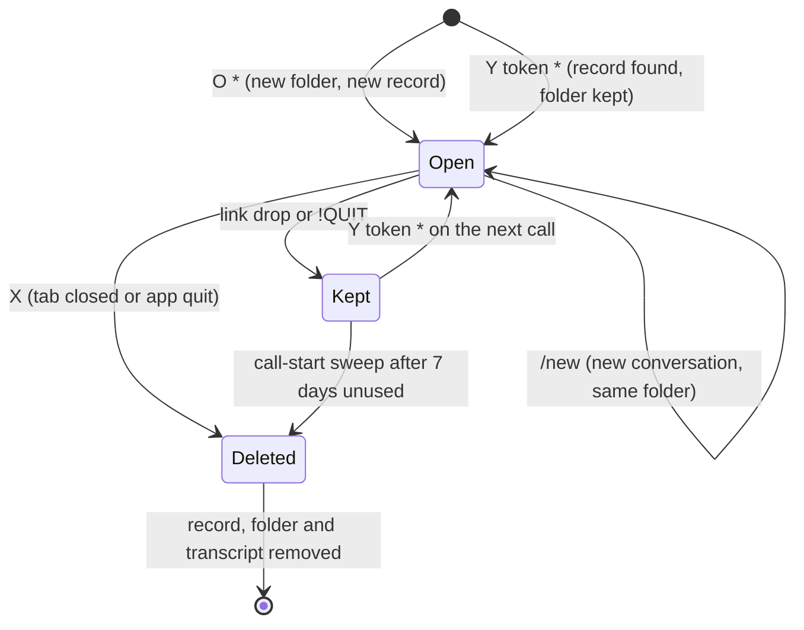

# Casual Chat Tabs - Plan

## Goal Capsule

- **Objective:** From the SE/30, the person can open a tab for an ordinary conversation with Claude that has nothing to do with any project, keep it through Wi-Fi drops, and have it disappear completely once they close it or quit Claude30.
- **Means:** A chat is a v2 session opened with a reserved project name, run by the bridge in a throwaway folder with only the web tools and a short chat prompt, and cleaned up on close (KTD1, KTD2, KTD3, KTD4). Claude30 adds a New Chat button and menu item and treats chat tabs as unsaved (KTD5, KTD6).
- **Product authority:** This Product Contract. PROTOCOL.md v2 is extended with one capability word and no version bump (KTD1).
- **Execution profile:** One pull request to `schreibaer/claude30` touching bridge, protocol spec, client and docs. Build order U1, U2, U3, U4, U5.
- **Stop conditions:** Stop and ask if the Agent SDK cannot start a session with only `WebSearch` and `WebFetch` available and a plain string system prompt, or if resuming a chat in its folder fails on the real CLI, or if the spike finds no `<claude_id>.jsonl` under `~/.claude/projects/` after a chat turn (U1 spike).
- **Who finishes:** An implementing agent builds the app with the shared Retro68 toolchain cache (`tools/setup-retro68.sh`), runs the bridge and host tests and the emulator rows, and refreshes `release/` in the project files. The person runs the hardware rows on the real SE/30.

---

## Product Contract

### Summary

Claude30 gets a second kind of tab: a chat. It opens from the New Tab dialog or Session > New Chat without picking a project. The bridge runs it in an empty scratch folder with no file or shell tools and a short chat prompt, so turns are cheap. A chat resumes after a link drop or Disconnect like a project tab, and is deleted on the host when its tab closes or the app quits while online; anything left behind is swept later.

### Problem Frame

Every tab today is a Claude Code session in a project folder from the bridge's list. A quick general question ("what's the capital of Burkina Faso", "explain this error message I saw elsewhere") means opening some project first. That conversation then carries the full Claude Code system prompt, the project's CLAUDE.md and settings, and file and shell tools that ask for permission, all paid for in tokens on every turn and in screen space at 57,600 baud. The conversation also lingers as a resumable project session and a log file on the Mac. The person wants a light, disposable conversation alongside their project work.

### Requirements

**Opening a chat**

- R1. The person can open a chat tab from the New Tab dialog or with Session > New Chat (Cmd-N) without choosing a project, whenever the bridge offers chats and fewer than six tabs are open, including when the bridge lists no projects.
- R2. Several chats can be open at once. They are labelled "Chat", "Chat 2", "Chat 3" by the lowest free number, and never collide with a project that happens to be called "Chat".
- R3. Project tabs, the project list and everything they do are unchanged.

**What Claude can do in a chat**

- R4. In a chat Claude has no tools that read or write host files or run commands. It can use web search and web fetch, and each use asks permission through the usual dialog, including "always".
- R5. A chat loads no CLAUDE.md, settings, memory, skills, MCP servers or subagents, and uses a short chat system prompt that keeps the SE/30 formatting rules (narrow screen, plain ASCII, short replies).
- R6. Per-tab model and effort work in chat tabs exactly as in project tabs. `/new` starts a fresh chat in the same tab. `/edits` and `/agents` answer that they do not apply in a chat.

**Lifetime**

- R7. A chat survives a link drop and redial, and a Disconnect followed by Connect, by resuming its conversation the same way project tabs do, as long as it was used within the last 7 days.
- R8. Closing a chat tab, or quitting Claude30 while online, ends the chat for good: it is not reopened at the next launch, and the bridge deletes its folder, its resume record and Claude's saved transcript of it at once. A quit while offline also drops the tab at once, and the host side follows under R10.
- R9. Chat tabs write no transcript log file on the Mac, and File > Open Project File is unavailable in them.
- R10. A chat the app could not close (crash, quit while offline, power off) is deleted by the bridge, with its transcript, at the first call that starts more than 7 days after the chat was last used.

**Compatibility**

- R11. PROTOCOL.md v2 gains a `chat` capability word with no version bump. Older apps against the new bridge and the new app against older bridges keep working, the latter without New Chat. tty mode is unchanged.

### Acceptance Examples

- AE1. **Covers R1, R2.** Given two project tabs and one chat open, when the person chooses New Chat, a tab labelled "Chat 2" opens and is ready for a prompt. When they close "Chat" and open another, the new one is labelled "Chat".
- AE2. **Covers R4.** Given a chat, when the person asks "what's in my home folder?", Claude answers that it can't see files. When they ask for today's news, a permission dialog for a web search appears.
- AE3. **Covers R7.** Given a chat with two turns, when the Wi-Fi drops and the app redials, the tab reopens and Claude remembers the earlier turns.
- AE4. **Covers R8.** Given an open chat, when the person quits Claude30 while online and relaunches, no chat tab comes back, and on the host the chat's folder under `~/.se30bridge/chats/` is gone.
- AE5. **Covers R10.** Given a chat whose app crashed, when a call starts more than 7 days after the chat was last used, the bridge deletes that chat's record, folder and transcript before opening any session.

### Scope Boundaries

- No list of past chats, no saving a chat as a file, and no way to turn a chat into a project tab.
- No chat in tty mode or ZTerm: tty mode stays one conversation in `--cwd`.
- No bridge option to choose a separate default model for chats. The per-tab model choice covers it.
- Considered and not built: a host setting to give chats more tools (Read, Bash). It would undo the point of a project-free conversation. Build it only if the person asks.
- Considered and not built: a confirmation before closing a chat tab. Closing a project tab does not ask either, and the transcript is still on screen until the tab closes.

---

## Planning Contract

### Key Technical Decisions

- KTD1. **A chat is opened with the reserved project name `*` on the existing `<n>O` and `<n>Y` lines, offered with the capability word `chat` in `#OK`.** The bridge echoes `<n>O *` and answers with the same refusals as a project. Reusing the open and resume lines keeps every client and bridge path (refusals, `<n>Y` tokens, `<n>M` presets, redial) unchanged. A new tag was rejected because resume would need its own variant too. `list_projects` skips any folder literally named `*` with a log line, so the name can never mean a real project. A client sends `*` only after seeing `chat`.
- KTD2. **Each chat runs in its own folder, `<state_dir>/chats/<16 hex>/` (mode 0700), named in the chat's resume record as `cwd` with `project: "*"`.** Claude Code stores a session's transcript by working folder, so resume needs the same folder, which a per-open temporary folder would not give. `/new` keeps the folder and only replaces the conversation. A resume whose folder has gone missing recreates it and starts a new conversation, reported as `<n>Y <token> new`. The `Channel` learns its folder from the record (resume) or creates it (new), so the folder is set in `_start`, not in `__init__`.
- KTD3. **Chat sessions start with `tools=["WebSearch", "WebFetch"]`, no `allowed_tools`, `setting_sources=[]`, `strict_mcp_config=True` and a plain-string system prompt `CHAT_PROMPT`.** `tools` removes every other built-in from the model's context, including Bash, Read, Edit and the Agent tool, so no subagents can start (claude-agent-sdk 0.2.172 `ClaudeAgentOptions.tools`, passed as `--tools`). Leaving `allowed_tools` empty sends each web call through `_can_use_tool`, which already describes both tools. `CHAT_PROMPT` is a few sentences: a general assistant on a 1989 Macintosh SE/30, then the formatting rules from `SYSTEM_APPEND`. Replacing the `claude_code` preset is where the token saving comes from.
- KTD4. **Chat cleanup is owned by the bridge and has three triggers.** On `<n>X` for a chat, after the session stops, it deletes the record, the folder and Claude's transcripts of it. On a link drop or `!QUIT` it keeps all three, so the chat resumes (R7). At call start, right after the call lock is taken, it sweeps: chat records whose `used` time is more than `CHAT_MAX_AGE` (7 days) old are dropped, and every folder under `chats/` that no remaining record names is deleted. "Used" is the record's existing `used` stamp, refreshed by every turn and every resume, so an idle open tab only loses its chat if it sits unused for a week and then has to redial. Seven days rather than one keeps R7's promise for a chat left open overnight or over a weekend. A transcript is found by the conversation's id, not by guessing Claude Code's folder-name encoding: the bridge deletes `<claude_id>.jsonl` from whichever direct child of `~/.claude/projects/` holds it, then that child if it is now empty. Records keep every `claude_id` the chat has used (one per `/new`) so all of them are removed. Nothing outside `~/.claude/projects/` is touched, a symlink is never followed, and a miss is logged, not raised.
- KTD5. **In Claude30 a chat tab is a `Tab` with a `chat` flag, its display label in `project`, and `*` on the wire.** `tabs_by_project` ignores chat tabs, so the picker's "(open)" marks and project opens never confuse a chat with a project called "Chat". The label is "Chat" or "Chat <k>" with the lowest free k, chosen when the tab is made. Chat tabs draw their label in italic in the tab strip and the Window menu, so a chat and a project tab that are both called "Chat" can be told apart. `open_tab` and the redial path send `*` for chat tabs through the existing `proto_open` and `proto_open_resume`.
- KTD6. **Chat tabs are never written to the preferences, get no log file, and are closed with `<n>X` when the app quits online.** `remember_tabs` skips them, so a relaunch cannot bring them back. `quit_app` sends `<n>X` for each chat tab just before `session_disconnect`, and the bridge finishes those closes before it exits on `!QUIT` (U2), so the chats are deleted at once. Disconnect does not close them. A quit while offline leaves the host side to the sweep (R10).

### High-Level Technical Design

A chat's life on the bridge, from open to deletion:

---

## Implementation Units

### U1. Bridge: open and run chat sessions

- **Goal:** `<n>O *` and `<n>Y <token> *` open a chat that runs with the KTD3 options in its own folder, resumes across calls, and refuses file requests.
- **Requirements:** R1, R4, R5, R6, R7, R11
- **Dependencies:** none
- **Files:** `bridge.py`, `tests/test_bridge_chat.py`, `tests/v2client.py`
- **Approach:**
  1. Start with a spike against the real CLI: one chat turn with the KTD3 options, a second call resuming it, and a check that the turn left `<claude_id>.jsonl` in a direct child of `~/.claude/projects/` (KTD4). Record the results for the PR.
  2. Add `chat` to the `#OK` words. In `V2.open`, accept the name `*` without consulting `list_projects`, and make `list_projects` skip a folder named `*` (KTD1).
  3. Give `SessionConfig` a `chat` flag. In `ClaudeSession.start`, build the KTD3 options when it is set. `DemoSession` needs no change beyond running in the chat folder.
  4. In `Channel`, create or recover the chat folder in `_start` and save `cwd` in the record (KTD2). `ResumeStore.get` matches chat records by `project == "*"`. A chat's `/new` goes through `_restart`, which deletes the old record, so carry the folder and the list of earlier `claude_id`s into the new record (KTD4).
  5. Build the chat's `FileService` with mode `off` so file tags are refused as under `files=off`.
  6. Add a chat help text and answer `/edits` and `/agents` in a chat with one notice line (R6).
- **Patterns to follow:** `_take_record` and `_new_conversation` for the record shape; `check_settings` presets for model and effort; `test_bridge_resume.py` for two-call tests through `v2client.py`.
- **Test scenarios** (`tests/test_bridge_chat.py`, demo session and a fake SDK client; catches wire and lifecycle behavior, misses the real CLI's tool filtering, which the spike and the Real-CLI check cover):
  - `#OK` carries `chat`; `1O *` is answered `1O *`, `1Y <token> new`, `1M - -`, `1>`.
  - Two chats `1O *` and `2O *` get different folders under `chats/`, both existing with mode 0700.
  - The options a chat passes to the SDK client: `tools` is exactly WebSearch and WebFetch, `allowed_tools` is empty, `setting_sources` is empty, `strict_mcp_config` is true, `system_prompt` is a string containing "SE/30".
  - A project tab opened in the same call still gets the `claude_code` preset and its project folder.
  - A folder named `*` under a `--projects` root is not in the `P` list and `1O *` still opens a chat.
  - A web tool call in a chat produces a `Q` permission request; answering `a` covers the next identical call.
  - `1L .` in a chat is refused the way it is under `files=off`.
  - `/edits on` and `/agents` in a chat each give one `I` line and do not restart the conversation; `/new` gives a new token and keeps the folder.
  - Second call: `1Y <token> *` resumes with `resumed` and the same folder; with the folder deleted in between it answers `new` and recreates it.
  - `1Y <token> *` with a project's token, and `1Y <token> proj` with a chat's token, both start new conversations.
- **Verification:** The new tests and every existing bridge test pass, and the spike shows a real chat turn and resume.

### U2. Bridge: delete chats

- **Goal:** Closed and abandoned chats leave nothing behind on the host (KTD4).
- **Requirements:** R8, R10
- **Dependencies:** U1
- **Files:** `bridge.py`, `tests/test_bridge_chat.py`
- **Approach:**
  1. In `V2.close`, delete a chat's record, folder and transcripts right after `shutdown`, before it sends `<n>X closed`: on the quit path the link is often gone by then and that send raises `EOFError`.
  2. Leave chats alone on EOF and `!QUIT`; only `close` deletes. `V2.run` today starts each close as a background task and its `!QUIT` path shuts the remaining channels down without waiting, so keep the close tasks and await them before that shutdown; an app that sends `<n>X` and then `!QUIT` must still get its chats deleted.
  3. Add the call-start sweep to `V2.__init__` after `ResumeStore` loads, which runs while the call lock is held.
  4. Put transcript-folder resolution in one helper that refuses anything that is not a direct child of `~/.claude/projects/` with the expected encoded name, and logs instead of raising.
- **Patterns to follow:** `ResumeStore.delete`; `take_call_lock` for the guarantee that one bridge writes at a time.
- **Test scenarios** (same file, with `HOME` and `--state-dir` pointed at temporary folders):
  - `1X` on a chat answers `1X closed` and removes its record, its folder, and a fake `<claude_id>.jsonl` (and its then-empty parent) under a temporary `~/.claude/projects/`.
  - After `/new` in a chat, `1X` removes the transcripts of both conversations.
  - `1X` on a project tab still keeps no chat state and leaves project transcripts alone.
  - A dropped call (EOF) and a `!QUIT` both keep the chat's record and folder.
  - `1X` immediately followed by `!QUIT` still deletes chat 1's record and folder before the bridge exits, also when the link reaches EOF straight after `!QUIT`.
  - Startup with a chat record last used 8 days ago removes it, its folder and its transcript; one used 6 days ago is kept and still resumes.
  - Startup with a stray folder under `chats/` and no record removes it.
  - Project records older than 7 days are not touched by the sweep.
  - A symlink named `<claude_id>.jsonl`, or a child of `~/.claude/projects/` that is a symlink to elsewhere, is not followed or deleted, and a log line is written.
- **Verification:** After the tests, the temporary state folder holds no chat folders that a record does not name.

### U3. Protocol and docs

- **Goal:** The spec and READMEs describe chats so other clients can use them.
- **Requirements:** R11
- **Dependencies:** U1, U2
- **Files:** `PROTOCOL.md`, `README.md`, `client/README.md`
- **Approach:**
  1. In PROTOCOL.md v2: the `chat` word in `#OK`, the reserved name `*` on `<n>O` and `<n>Y`, what a chat session can do, and when the bridge deletes it (cite KTD4's three triggers in prose).
  2. In README.md: chats in the feature list, the `~/.se30bridge/chats/` folder, and that chats use only web tools.
  3. In client/README.md: New Chat, Cmd-N, and that chat tabs are not remembered or logged.
- **Test expectation:** none -- documentation only.
- **Verification:** Every line and rule from U1 and U2 is in PROTOCOL.md, and the v2 typical exchange still reads correctly.

### U4. Client core: the chat capability

- **Goal:** The portable protocol core knows whether the bridge offers chats.
- **Requirements:** R1, R11
- **Dependencies:** U1
- **Files:** `client/src/core/protocol.c`, `client/src/core/protocol.h`, `client/tests/test_protocol.c`, `client/tests/test_bridge_session.c`
- **Approach:** Parse `chat` from the `#OK` words alongside `models` and `agents`, and expose it as `proto_chat_cap`. `proto_open` and `proto_open_resume` already take any name, so `*` needs no new call.
- **Patterns to follow:** `agents_cap` and `proto_models_cap`.
- **Test scenarios:**
  - `#OK se30bridge 2 files=rw resume ping models agents chat` sets the chat capability; the same line without `chat` leaves it off.
  - `proto_open(p, 3, "*")` sends `3O *`, and `3O *` from the bridge moves session 3 to opening.
  - `test_bridge_session.c`: against the real bridge in demo mode, a chat opens, takes a prompt, closes with `X closed`, and its folder is gone afterwards.
- **Verification:** Host tests pass, including the new cases.

### U5. Client Mac: chat tabs

- **Goal:** The person can open, use, close and quit chat tabs as R1, R2, R6, R7, R8 and R9 describe.
- **Requirements:** R1, R2, R3, R6, R7, R8, R9
- **Dependencies:** U4
- **Files:** `client/src/mac/tabs.c`, `client/src/mac/tabs.h`, `client/src/mac/picker.c`, `client/src/mac/picker.h`, `client/src/mac/modem.c`, `client/src/mac/main.c`, `client/src/mac/resources.h`, `client/claude30.r`
- **Approach:**
  1. `Tab` gets `chat`; a `tabs_add_chat` helper picks the label; `tabs_by_project` skips chat tabs (KTD5).
  2. Add a "New Chat" button to the picker dialog at the bottom left, enabled when `proto_chat_cap` is set and fewer than six tabs are open. `picker_run` reports which was chosen. Open stays the default button, and a list selection is ignored when New Chat is clicked. Messages: with chats offered and no project to open, "No projects to open. You can start a chat."; with six tabs open, the existing "Six tabs are open. Close one first." and New Chat disabled; with a bridge without `chat`, today's messages and New Chat hidden.
  3. Add Session > New Chat (Cmd-N) after New Tab, enabled under the same condition. Shift the Session item numbers in `resources.h` and rewrite the Session MENU enable mask in `claude30.r` (today `0x7FFFF5B7`) so the separators stay disabled at their new positions.
  4. In `modem.c`, `open_tab` and the redial path send `*` for chat tabs; `remember_tabs` skips them; `log_new_session` is not called for them, and `log_append` treats a chat tab's trimmed text as written and discarded, because `window.c` keeps text it could not log and so would never trim a chat transcript otherwise.
  5. In `main.c`, disable File > Open Project File for a chat tab and close chat tabs with `<n>X` in `quit_app` before `session_disconnect` (KTD6).
- **Patterns to follow:** `session_new_tab` for tab creation; `gOpenShown` handling for the File menu; `from_picker` for refused opens.
- **Toolbox calls:** Dialog Manager (`GetDialogItem`, `HiliteControl`), Menu Manager (`EnableItem`, `SetItemStyle`), QuickDraw `TextFace` for the italic tab label, List Manager as today. Nothing needs a newer System than 7.0, and memory use grows by one flag per tab.
- **Test scenarios:** The Mac layer has no host tests; the emulator rows below cover it. Label choice is pure logic: if it lands in `tabs.c` without Toolbox calls, add a host test for "lowest free number" (Chat, Chat 2, close Chat, next is Chat).
- **Verification:** The 68k build has no new warnings, and emulator rows E1 to E6 pass.

---

## Verification Contract

- **Bridge tests:** `python3 -m unittest discover tests`. All existing tests plus `tests/test_bridge_chat.py` pass.
- **Host tests:** `cmake -S client/tests -B build-host && cmake --build build-host && ctest --test-dir build-host`, including the new `test_protocol.c` and `test_bridge_session.c` cases.
- **68k build:** `tools/setup-retro68.sh`, then the build in `CLAUDE.md`, with no new warnings.
- **Real-CLI check:** Through `tests/v2client.py` against the real Claude CLI: a chat answers a general question, a request to list files gets no tool call, a news question raises a WebSearch permission request, and a second call resumes the chat. This repeats the U1 spike against the finished code.
- **Emulator rows** (Basilisk II, tcpser and `run.sh --demo`, as `tools/emu/README.md` describes):
  - E1. New Tab dialog, New Chat: a "Chat" tab opens and answers. Cmd-N opens "Chat 2" (AE1).
  - E2. Close "Chat", open another chat: it is labelled "Chat". A project called "Chat" in `--projects` opens as its own tab alongside, and the chat's label is italic in the strip and the Window menu. Every Session menu item still enables and disables as before, and no separator can be chosen.
  - E3. Kill tcpser mid-conversation and restart it: the app redials and the chat tab resumes (AE3). Disconnect and Connect: the same.
  - E4. Quit while online and relaunch: no chat tab returns, and `~/.se30bridge/chats/` is empty (AE4).
  - E5. In a chat tab, File > Open Project File is disabled and no log file appears next to the app.
  - E6. The app from the current release against the new bridge: tabs, files, models and subagent lines work as before, and no New Chat appears in the old app (R11).
- **Hardware rows (the person):**
  - H1. On the real SE/30, open a chat, ask a general question and a web question, close it. The reply is short and plain, and closing removes the folder on the host.

## Definition of Done

- R1 to R11 hold, shown by the tests and rows above.
- U1 to U5 merged in one pull request, with `release/` rebuilt from it.
- PROTOCOL.md describes the `chat` word, the `*` name and chat deletion, and old clients and bridges keep working (E6, and the new client against a bridge without `chat` in host tests).
- The PR states the U1 spike findings, whether transcript deletion is active, and what was tested in the emulator, on the host and on hardware, and what was not.
- No leftover spike scripts or dead code paths from abandoned approaches.

### Deferred to Implementation

- The exact wording of `CHAT_PROMPT` and the chat help text.
- Whether the label helper lives in `tabs.c` (host-testable) or `modem.c`.
- Where the New Chat button sits if the picker's existing buttons need to move for it to fit at 300 pixels wide.

## Sources

- `bridge.py`: `list_projects`, `V2.open` and `session_line`, `Channel._start`, `_take_record`, `ResumeStore`, `ClaudeSession.start`, `SYSTEM_APPEND`, `HELP`, `FileService`.
- `client/src/mac/modem.c`: `session_new_tab`, `session_init`, `remember_tabs`; `client/src/mac/main.c`: `quit_app`; `client/src/mac/picker.c`; `client/claude30.r` picker DITL and Session menu.
- claude-agent-sdk 0.2.172 `types.py`: `ClaudeAgentOptions.tools`, `strict_mcp_config`, `setting_sources`, `system_prompt`.
- Prior plans: `docs/plans/2026-11-24-1408-feat-project-tabs-plan.md` (v2 sessions), `docs/plans/2026-11-24-1740-feat-reconnect-resume-after-wifi-drop-plan.md` (resume records and call lock).
