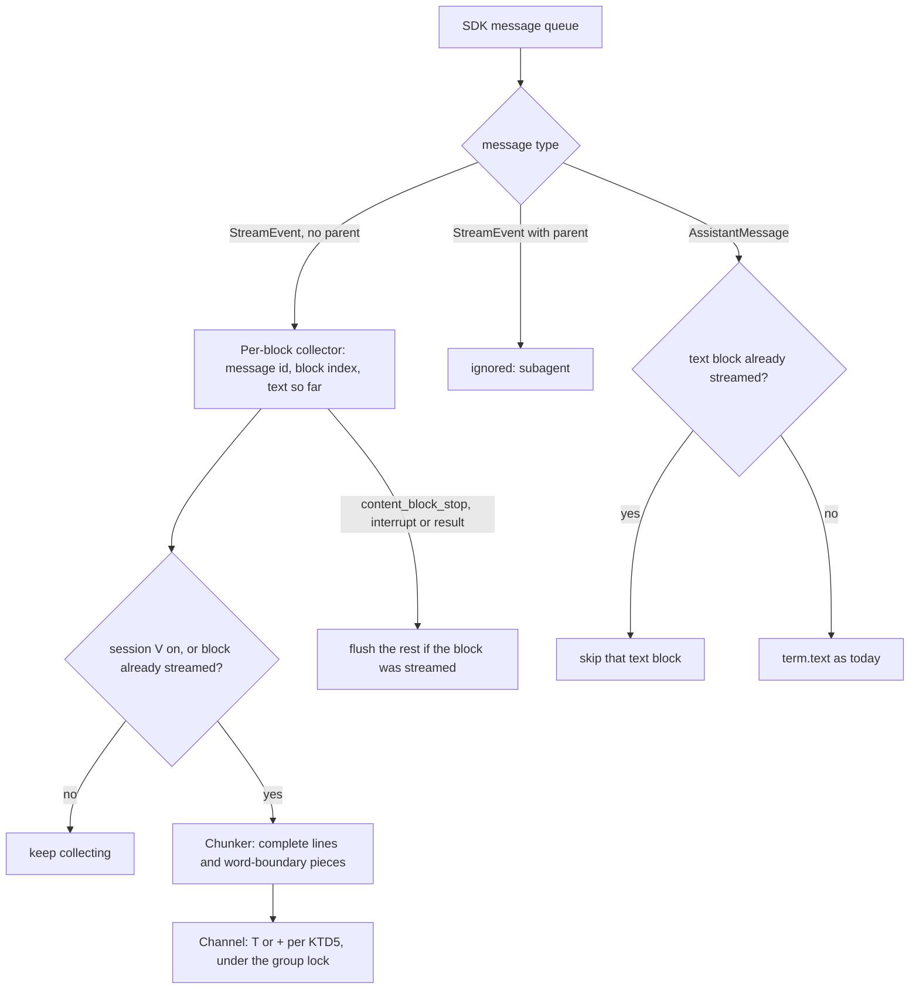

# Stream Answers Per Tab - Plan

## Goal Capsule

- **Objective:** In any Claude30 tab where the person turns on "Stream Answers", Claude's prose appears on the SE/30 a few words at a time while Claude is still writing it. Tabs with the switch off behave exactly as today.
- **Means:** The bridge asks the Agent SDK for partial messages and turns text deltas into word-boundary `T`/`+` chunks for sessions whose stream switch is on (KTD1, KTD2, KTD3). Claude30 keeps one switch per tab, shown as a checked Session menu item, and sends it as a new `<n>V` session line behind a `stream` capability word (KTD4, KTD6).
- **Product authority:** This Product Contract. PROTOCOL.md v2 gains one capability word and one session line, with no version bump (KTD4).
- **Execution profile:** One pull request to `schreibaer/claude30` touching bridge, protocol spec, client core, client Mac code and docs. Build order U1, U2, U3, U4, U5.
- **Stop conditions:** Stop and ask if the real Claude CLI under SDK 0.2.172 sends no `text_delta` stream events with `include_partial_messages`, or if its assistant messages cannot be matched to the streamed blocks well enough to avoid printing text twice (U2 spike).
- **Who finishes:** An implementing agent builds the app with the shared Retro68 toolchain cache (`tools/setup-retro68.sh`), runs the bridge and host tests and the emulator rows where an emulator is available, and refreshes `release/` in the project files. The person runs the hardware rows on the real SE/30.

---

## Product Contract

### Summary

Each Claude30 tab gets a "Stream Answers" switch in the Session menu. With it on, the bridge sends Claude's prose as it is generated, in chunks of a few words, through the `T` and `+` lines the app already draws. With it off, nothing changes. Claude30 remembers the switch with each saved tab, and new tabs and chats start with it off.

### Problem Frame

The bridge prints Claude's prose only when a whole text block is finished (`ClaudeSession._handle` in `bridge.py` acts on the complete `AssistantMessage`). A long answer therefore leaves the SE/30 blank for 20 to 30 seconds, then delivers everything at once at 57,600 baud. The person cannot tell whether Claude is writing or stuck, and cannot start reading early. Tabs differ in what the person wants: a quick question in one tab benefits from streaming, while another tab doing heavy tool work may be better left quiet.

### Requirements

**The switch**

- R1. Each tab has its own "Stream Answers" setting, shown as a checkmarked item in the Session menu that applies to the front tab.
- R2. A new tab or chat starts with streaming off.
- R3. A project tab's setting is remembered in Claude30's prefs with the tab, and survives quitting, Disconnect/Connect, redials after a Wi-Fi drop, and resumed conversations. A chat tab keeps its setting for as long as the tab exists, since chats are not saved.
- R4. Changing the setting takes effect right away for that tab only, including partway through an answer. Other tabs are not affected.
- R5. The item is disabled when the app is connected to a bridge that does not offer streaming. Settings gets no new checkbox.

**What streaming shows**

- R6. With streaming on, Claude's prose appears in chunks of a few words while Claude writes it. The finished text matches what the same answer looks like with streaming off: same paragraphs, same blank lines, same bold markers removed.
- R7. Code blocks still appear one complete line at a time.
- R8. A subagent's own prose stays hidden, as today.
- R9. Tool lines, permission requests, subagent lines, folds, the heartbeat and file windows keep working while a tab streams.
- R10. With streaming off, the lines the bridge sends are the same as today.

**Compatibility**

- R11. An older bridge and the new app work together as before, with the item disabled. The new bridge and an older app work together as before, with nothing streamed.
- R12. ZTerm (tty mode) and v1 app mode are unchanged.

### Acceptance Examples

- AE1. **Covers R4.** Given tab 1 streaming and tab 2 not, when both answer at once, tab 1 fills in a few words at a time and tab 2 shows each finished paragraph at once.
- AE2. **Covers R4, R6.** Given a long answer streaming in tab 1, when the person turns Stream Answers off mid-paragraph, the rest of that text block arrives when the block finishes, and the next block arrives whole. Turning it back on mid-block sends what Claude has written so far at once, then continues in chunks.
- AE3. **Covers R3.** Given a project tab with streaming on, when Wi-Fi drops and the app redials, the tab resumes and still streams.
- AE4. **Covers R9.** Given a streaming paragraph, when a background subagent's line arrives in the middle of it, the subagent line is drawn on its own line and the paragraph continues on the next line, not glued to the subagent line.

### Scope Boundaries

- No ZTerm `/stream` command and no v1 app mode streaming (R12).
- No token-by-token display. Chunks are a few words, for link and 68030 cost (KTD2).
- No streaming of a code line before it is complete (R7).
- No change to how tool output, permission requests or subagents are reported.
- Considered and not built: a bridge confirmation line echoing `<n>V`. The app owns the setting and the bridge applies it silently. A confirmation only matters if the app ever needs to show "the bridge refused", which no case here produces.
- Considered and not built: a typed `/stream` command in v2. The menu item is the only control the person asked for. A bug report about testing streaming from `tests/v2client.py` without the app would change this.

#### Deferred to Follow-Up Work

- `/stream on|off` for ZTerm, streaming complete wrapped lines into the tty pager, if the person wants it later.

---

## Planning Contract

### Key Technical Decisions

- KTD1. **The bridge always asks for partial messages in v2 sessions and decides per text block whether to use them.** `include_partial_messages` is a start-up option, so turning it on only when a tab streams would mean restarting Claude on every toggle, which breaks R4. With it always on, a delta for a session whose switch is off is collected and dropped, costing host CPU only. A text block becomes "streamed" once any chunk of it has been sent. A streamed block finishes through the stream path. An unstreamed block is printed from the `AssistantMessage` exactly as today, which is what keeps R10 true. Turning the switch on mid-block sends what has been collected for that block as soon as the `<n>V on` line arrives, without waiting for the next delta. Turning it off mid-block leaves the block in the stream path, so its rest is sent when the block ends (AE2). tty and v1 sessions leave the option off. It is not a Claude API call: the CLI already receives the stream and only forwards it.
- KTD2. **Chunks break at word boundaries, roughly a line at a time.** A chunk goes out when a line completes, when at least about 100 bytes of complete words are waiting, or when at least about 0.5 seconds have passed since the last chunk and one complete word is waiting. The check runs on each delta, so no timer task is needed, and the clock is injectable for tests, as `AgentTracker` does. A word longer than 200 bytes is cut at 200 like `split_payload`. A trailing `*` or `_` is held back until the next delta, so a `**` split across deltas is still removed. Rationale: every bridge line counts toward the 8-line `W`/`!ACK` window and costs a TextEdit append on a 68030. Claude writes a few hundred bytes a second, so line-sized chunks keep the text flowing while adding about one extra line per 100 bytes of prose.
- KTD3. **Streaming reuses `T` and `+`, with a fence-aware line splitter that matches `app_text_lines`.** Complete lines go through the same rules as `app_text_lines`: fences become `C[`/`C]`, lines in a fence become `C`, and the rest becomes `T`. A partial line outside a fence goes out as a `T` chunk, then `+` chunks, which the app joins with one space, so chunks must split at a space and drop that space. Outside a fence, a partial line is held only while its text, ignoring leading whitespace, is empty or still a prefix of three backticks. Once it clearly is not a fence opener, it streams like other prose, so a paragraph that opens with inline code is not held back. Inside a fence, a partial line is held until its newline. This settles both fence detection and R7. The client needs no new tag.
- KTD4. **Wire: capability word `stream` and session line `<n>V on|off`, client to bridge only, no version bump.** It follows the precedent of `models`, `agents` and `chat`: a client that does not see `stream` never sends `<n>V`, and a bridge without it ignores the unknown session tag. `V` is unused in v1 and v2 in both directions. Like `<n>M`, a `<n>V` for a session that is not open yet is a preset applied to its next `<n>O` or `<n>Y` and dropped when the call ends. The client sends its tabs' switches again after every redial, since the bridge keeps nothing in its resume records. `S` was not an option because file saves use it.
- KTD5. **A `+` chunk is sent only when the session's previous line was that same paragraph.** The app routes `+` by the session's last `T`, `C` or `B` line and ignores `U` and `J` lines when it decides (`protocol.c`, `last_kind`). File `B` lines and background subagent lines can come from other tasks between two chunks. `Channel` therefore records whether its last line was an open streamed paragraph. Every other line it sends (`tag`, `send_split`) clears that record, and the next chunk then opens a fresh `T`. This splits that paragraph into two lines on screen (AE4) instead of joining text to the wrong line, and covers old apps too. It only covers lines the bridge sends. The app also draws markers of its own between bridge lines, such as the line-noise and "Some output was lost" notes, and `batch.c` appends an `EV_TEXT_CONT` to whatever came last. Streaming spreads a paragraph over seconds, so U3 makes a continuation that follows anything other than prose start a new line.
- KTD6. **Per-tab state in the app follows the per-tab model.** `Tab` gains a stream flag and prefs go to version 7 with one byte per saved tab. Version 6 prefs load with every tab off. `open_tab` sends `<n>V on` before `<n>O`/`<n>Y` when the flag is set, right after the model preset. The menu item toggles the front tab's flag, saves prefs and, when online, sends `<n>V` at once. Chat tabs carry the flag in `Tab` only, matching how chats are kept out of prefs.

### High-Level Technical Design

Directional sketch of the bridge path, not an implementation specification:



The wire for one streamed paragraph, with a subagent line arriving mid-way (AE4):

```text
C: 1V on
C: 1P explain the parser
B: 1T The parser reads tokens one at a time and keeps
B: 1+ a small stack of open brackets, so it can report
B: 1J~ 1 3 Grep def parse
B: 1T the line of an unmatched bracket.
B: 1R success $0.0110
B: 1>
```

### Assumptions

- With `include_partial_messages`, the CLI sends `stream_event` messages carrying the API's `message_start`, `content_block_start`, `content_block_delta` (`text_delta`) and `content_block_stop` events before the matching `AssistantMessage`, and the `AssistantMessage` carries the same `message_id`. U2 starts with a spike that confirms this against the real CLI. How many `AssistantMessage`s the CLI sends per API message decides the exact matching key, which is left to implementation.

### System-Wide Impact

- **Link load:** streamed prose uses about twice as many lines as today's 200-byte splits, so a streaming tab triggers `W`/`!ACK` about twice as often. Total bytes barely change.
- **Between-turn output:** `ClaudeSession.follow` decides that Claude started a turn of its own when it sees a top-level `AssistantMessage`, `UserMessage` or `ResultMessage`. A top-level `StreamEvent` must count too, or the first chunks of a self-started turn would be handled outside that turn (U2).
- **Effort changes** restart Claude through resume. The restarted session gets the same options, so streaming survives an effort change.

### Risks & Dependencies

- **Partial-message format drift:** the bridge reads raw API stream events through the SDK. If a CLI update changes them, a block may never count as streamed and falls back to whole-block printing, which is safe. The matching in KTD1 must fail toward printing text once rather than dropping it.
- **Interrupt:** after `!STOP` the CLI may send neither `content_block_stop` nor the `AssistantMessage`. A streamed block's collected text is flushed when the `ResultMessage` arrives. Today's behavior for unstreamed blocks is kept.

---

## Implementation Units

### U1. Protocol spec and docs

- **Goal:** Document the `stream` capability and the `<n>V` line.
- **Requirements:** R4, R5, R11, R12
- **Dependencies:** none
- **Files:** `PROTOCOL.md`, `README.md`, `client/README.md`
- **Approach:**
  1. Add a "Streaming answers (`stream`)" section to PROTOCOL.md after "Chats", stating KTD4's wire rules, KTD3's chunking contract (a streamed paragraph is a `T` followed by `+` pieces split at spaces, possibly re-opened with a fresh `T` per KTD5), and that tty and v1 are unchanged.
  2. Add `stream` to the `#OK` examples and the session-line tables (`<n>V` client to bridge).
  3. Mention the Session menu item in `client/README.md` and the bridge feature in `README.md`.
- **Patterns to follow:** the "Model and effort (`models`)" and "Chats" sections of `PROTOCOL.md`.
- **Test expectation:** none -- documentation only. U2 and U3 test the behavior it describes.
- **Verification:** A reader of PROTOCOL.md alone can implement a client that streams, and an older client is unaffected.

### U2. Bridge: partial messages, chunking and the `V` line

- **Goal:** Stream a session's prose when its switch is on, and send exactly today's lines when it is off.
- **Requirements:** R4, R6, R7, R8, R9, R10, R11, R12
- **Dependencies:** U1
- **Files:** `bridge.py`, `tests/test_bridge_stream.py` (new), `tests/v2client.py`
- **Approach:**
  1. Spike first: run one real-CLI turn with `include_partial_messages` and record the order and contents of stream events and assistant messages, settling the Assumptions entry and the matching key.
  2. A chunker that takes deltas for one text block and emits `(tag, payload)` pieces per KTD2 and KTD3, holding its fence state on the channel like `app_text_lines` does.
  3. `SessionConfig` gains a partial-messages flag that `Channel` sets. `ClaudeSession.options` passes `include_partial_messages` when it is set (KTD1).
  4. `ClaudeSession._handle` collects top-level stream events per block, streams per KTD1, skips streamed text blocks in `AssistantMessage`, and flushes streamed blocks at `content_block_stop` and at `ResultMessage`. Stream events with `parent_tool_use_id` are ignored (R8). `follow` treats a top-level `StreamEvent` as the start of a self-started turn.
  5. `Channel` gains the stream switch (a `V on` arriving mid-block flushes the collected text at once, per KTD1), the open-paragraph record and the methods that send chunks under its `group` lock (KTD5). `tag` and `send_split` clear the record.
  6. `V2.run` adds `stream` to `#OK`. `V2.session_line` handles `V on`/`V off` for open sessions and keeps presets for unopened ones, applied in `V2.open`, and ignores any other payload (KTD4).
  7. `DemoSession` gets a prompt word `long` that produces a few paragraphs and a code block, sent through the same chunker in small slices with short sleeps when the switch is on, and as whole blocks after the same delay when it is off, so the emulator and wire tests can see streaming without Claude.
  8. `tests/v2client.py` gains a helper to send `<n>V` and to join `T`/`+` lines the way the app does.
- **Patterns to follow:** `AgentTracker` (injectable clock, throttling), `split_payload`/`app_text_lines`, the `<n>M` preset handling in `V2.session_line` and `V2.open`, the `StubClient` scripted streams in `tests/test_bridge_agents.py`.
- **Execution note:** Write the equivalence test in the first scenario group first. It is the check that streamed output renders like today's output.
- **Test scenarios:**
  - **Chunker.** Joining the chunker's pieces the way the app does (`T` starts a paragraph, `+` adds a space and the text) gives the same rendering as `app_text_lines` on the whole text. This holds for prose, lists, blank lines, `**bold**`, fenced code and a fence at the very start, with the text split into deltas at every position, including inside `**` and inside a fence marker.
  - **Chunker.** With a fake clock, 300 bytes of prose arriving in 5-byte deltas within 0.1 s go out as a `T` and `+` pieces of about 100 bytes, each ending at a word boundary and none starting with a space.
  - **Chunker.** One word arriving, then 0.6 s with no delta, then the next delta: the first word goes out with that delta. A single half word never goes out before the block ends.
  - **Chunker.** A 250-byte word with no spaces goes out as a 200-byte piece and the rest.
  - **Chunker.** A partial line inside a fence, and a partial line outside one that is still a prefix of three backticks (including after leading spaces), emit nothing until the newline or until they stop matching. A finished fence line emits `C` or `C[`.
  - **Chunker.** A paragraph that opens with inline code ("`parse()` reads ...") streams in chunks like other prose, and an indented fence inside a list item still renders as code, both split at every delta position.
  - **Session, StubClient.** Switch on: stream events for one text block, then the matching `AssistantMessage`, then `ResultMessage`. The text is sent once, as chunks, before the result.
  - **Session, StubClient.** Switch off: the same script produces exactly the calls today's code makes, with one `text` call for the block (R10).
  - **Session, StubClient.** Switch turned on after half the deltas: the collected half goes out when the `V on` arrives, before any further delta, the rest follows in chunks, and the `AssistantMessage` text is not repeated (AE2).
  - **Session, StubClient.** Switch turned off mid-block: no more chunks until `content_block_stop`, then the rest at once. The next block arrives whole from its `AssistantMessage` (AE2).
  - **Session, StubClient.** Stream events with a `parent_tool_use_id` produce no text (R8).
  - **Session, StubClient.** Interrupt mid-block: no `content_block_stop` or `AssistantMessage` arrives. The collected text of the streamed block is sent before the `interrupted` result.
  - **Session, StubClient.** An `AssistantMessage` whose text block never had stream events, with the switch on, is printed whole (fallback).
  - **Session, StubClient.** Claude starts a turn by itself between turns with stream events first: `follow` treats it as one turn and its text arrives inside it.
  - **Channel.** Chunk, then a `J~` line, then another chunk: the second chunk goes out as `T`, not `+` (AE4). The same holds for a file `B` line sent through `send_split`.
  - **Wire, `bridge.py --demo`.** `#OK` carries `stream`. `1V on` before `1O`, then a `long` prompt: the session shows `1T` followed by `1+` lines, and the joined text equals the switch-off run of the same prompt.
  - **Wire, demo.** Two sessions, one with `V on` and one without, run `long` at once: the first sends prose as `+` pieces of about 100 bytes ending at word boundaries, the second splits lines only at 200 bytes as `split_payload` does today, and both finish (AE1).
  - **Wire, demo.** `1V maybe` is ignored, and `3V on` for a session that never opens leaves no effect on a later call.
  - **Wire, demo.** v1 app mode and tty mode output for a `long` prompt is unchanged (R12).
- **Verification:** All bridge tests pass, the new file included. A real-CLI turn through `tests/v2client.py` with `V on` shows chunked prose and no repeated text.

### U3. Client core: the `stream` capability

- **Goal:** Let the app know whether the bridge streams, send `<n>V`, and keep streamed paragraphs off the app's own marker lines.
- **Requirements:** R4, R5, R11
- **Dependencies:** U1
- **Files:** `client/src/core/protocol.h`, `client/src/core/protocol.c`, `client/src/core/batch.h`, `client/src/core/batch.c`, `client/tests/test_protocol.c`, `client/tests/test_batch.c`, `client/tests/test_bridge_session.c`
- **Approach:**
  1. Parse `stream` in the `#OK` words into a capability flag, next to `models` and `chat`, and expose it with an accessor.
  2. Add a call that sends `<n>V on` or `<n>V off` for a session, refusing (returns 0) when not online or without the capability, like `proto_set_model`.
  3. `Batch` remembers whether the last thing it put was prose. Any other block, a marker (`batch_marker`) or a cleared transcript resets that, and an `EV_TEXT_CONT` that does not follow prose starts a new line first (KTD5).
- **Patterns to follow:** `proto_set_model`, `models_cap` and `chat_cap` in `protocol.c`.
- **Test scenarios:**
  - `#OK se30bridge 2 files=rw stream` sets the capability. An `#OK` without the word leaves it clear.
  - Online with the capability, setting session 2 on sends `2V on` CR, and off sends `2V off` CR.
  - Offline, or online without the capability, the call returns 0 and sends nothing.
  - Batch: `T`, then a line-noise marker, then `+`: the continuation starts on a new line after the marker, not on the marker's line.
  - Batch: `T`, then `+` in the next batch after the first was drawn and cleared: the continuation joins the paragraph with one space, as today.
  - Against `bridge.py --demo` with `V on` for one session and a `long` prompt, the core emits `EV_TEXT` then `EV_TEXT_CONT` events, and the joined text matches the same prompt with streaming off.
- **Verification:** Host tests pass, including the new cases.

### U4. Client Mac: the per-tab switch

- **Goal:** Give each tab a "Stream Answers" menu item, remember it, and send it.
- **Requirements:** R1, R2, R3, R4, R5, R9, R11
- **Dependencies:** U3
- **Files:** `client/claude30.r`, `client/src/mac/resources.h`, `client/src/mac/main.c`, `client/src/mac/tabs.h`, `client/src/mac/modem.c`, `client/src/mac/prefs.h`, `client/src/mac/prefs.c`
- **Approach:**
  1. Add "Stream Answers" to the Session menu after "Model and Effort…" and update the menu's enable-flags mask and item numbers in `resources.h`.
  2. In the menu-update code in `main.c`, check the item with `CheckItem` from the front tab's flag. Enable it when there is a front tab and the app is offline, or online with the capability. Online without the capability, it is disabled and shown unchecked, and the flag stays in prefs for the next bridge that streams (R5).
  3. Add a stream flag to `Tab`, cleared for new tabs and chats (R2).
  4. In `modem.c`, `open_tab` sends `<n>V on` after the model preset when the flag is set and the bridge has the capability. A new toggle function flips the front tab's flag and saves the tabs to prefs. It sends `<n>V` at once only when the tab's session is open, with the same session-state checks as `session_model_available`; otherwise `open_tab` sends it later. This keeps a stale preset from reaching a new tab that reuses the session number (R2, R4, KTD6).
  5. Prefs version 7 adds one byte per saved tab, and `prefs_set_tabs` takes the flags. Version 6 loads with every tab off. `session_init` restores the flags with the tabs (R3).
- **Toolbox calls:** Menu Manager (`CheckItem`, `EnableItem`, `DisableItem`) and Resource Manager through the existing prefs code. All are in System 6 and later, so nothing new is required of System 7.5.5. Memory grows by one byte per tab in prefs and one flag per tab.
- **Patterns to follow:** the Model and Effort item (`kModelItem`, `session_model_available`, `session_model_dialog`), the version 5 to 6 prefs upgrade in `prefs.c`, the `CheckItem` use for Compact Input in `main.c`.
- **Test scenarios:**
  - Test expectation for automated tests: the Mac UI has no host test seam. The protocol side is covered in U3. The behaviors below are emulator rows in the Verification Contract.
- **Verification:** The 68k build has no new warnings, and the emulator rows pass where an emulator is available.

### U5. Release files

- **Goal:** Make the new app available to the person.
- **Requirements:** R1
- **Dependencies:** U2, U3, U4
- **Files:** `release/Claude30.bin` and `release/Claude30.dsk` in the project files (outside the repository)
- **Approach:** Rebuild and copy the app as earlier threads did, after the PR's checks pass.
- **Test expectation:** none -- packaging. The 68k build in U4 checks it.
- **Verification:** The release files' dates match the merged build.

---

## Verification Contract

- **Bridge tests:** `python3 -m unittest discover -s tests`. All existing tests plus `tests/test_bridge_stream.py` pass.
- **Host tests:** `cmake -S client/tests -B build-host && cmake --build build-host && ctest --test-dir build-host`, including the new `test_protocol.c` and `test_bridge_session.c` cases.
- **68k build:** `tools/setup-retro68.sh`, then the build in `CLAUDE.md`, with no new warnings.
- **Real-CLI check:** Through `tests/v2client.py` against the real Claude CLI, a session with `V on` asked for a long explanation sends `T` and `+` chunks while Claude writes, the joined text has no repeated passage, and the same prompt with `V off` sends today's lines. This repeats the U2 spike against the finished code.
- **Emulator rows** (Basilisk II, tcpser and `run.sh --demo`, as `tools/emu/README.md` describes):
  - E1. In one tab, Session > Stream Answers and a `long` prompt: the item is checked and text fills in a few words at a time. A second tab without it shows each paragraph whole (AE1).
  - E2. Toggle the item off and on during a `long` reply: the reply finishes correctly in both cases (AE2).
  - E3. Quit and relaunch with a streaming project tab: the item is still checked for that tab. A chat tab that streamed is gone, and a new chat starts unchecked (R2, R3).
  - E4. Kill tcpser during a streamed reply and restart it: the app redials and the tab still streams (AE3).
  - E5. A streamed reply with a fold, a permission request and a file window open: all keep working, and the heartbeat beats (R9).
  - E6. The current release app against the new bridge, and the new app against the previous bridge: everything works as before, and in the second case the item is disabled once connected (R11).
- **Hardware rows (the person):**
  - H1. On the real SE/30, turn on Stream Answers in one tab and ask for a long answer. Text arrives steadily, the window stays responsive, and no "damaged output" mark appears.

## Definition of Done

- Every requirement R1 to R12 is met, and every test and check in the Verification Contract passes, except emulator or hardware rows that could not be run, which are reported as not run.
- PROTOCOL.md describes exactly what the bridge and app do.
- No code from abandoned attempts, including the U2 spike script, is left in the diff.
- The PR description says what was tested and what was not, as `CLAUDE.md` requires.

### Deferred to Implementation

- The exact key that matches `AssistantMessage` text blocks to streamed blocks (message id plus block order, or text comparison), decided by the U2 spike.
- Exact helper and method names, and the precise byte and time thresholds within KTD2's ranges if the emulator shows a better value.

## Sources

- `bridge.py`: `split_payload`, `app_text_lines`, `ClaudeSession.options`, `ClaudeSession._handle`, `ClaudeSession.follow`, `Channel.tag`, `Channel.send_split`, `V2.session_line`, `V2.open`, `DemoSession`.
- `client/src/core/protocol.c`: `#OK` word parsing, `proto_set_model`, the `+` routing by `last_kind`.
- `client/src/core/batch.c`: `EV_TEXT_CONT` joins with one space.
- `client/src/mac/modem.c`: `open_tab`, `session_model_dialog`. `client/src/mac/prefs.c`: versioned prefs loading.
- Agent SDK 0.2.172: `ClaudeAgentOptions.include_partial_messages`, `StreamEvent` (raw API events), `AssistantMessage.message_id`.
- Prior plans: `docs/plans/2026-11-25-1627-feat-heartbeat-light-per-tab-model-plan.md` (per-tab settings), `docs/plans/2026-11-25-2247-feat-casual-chat-tabs-plan.md` (capability words without a version bump).
