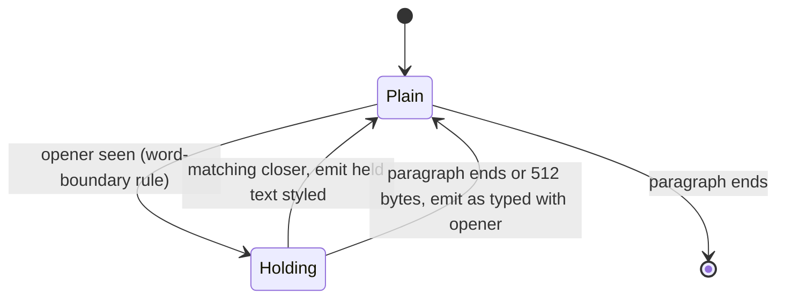

# Rich Transcript Styles - Plan

## Goal Capsule

- **Objective:** Claude's answers in a Claude30 tab read the way Claude formatted them. Bold, italics, inline code, headings, lists, quotes, rules, tables and links show as styles and glyphs instead of raw Markdown marks, using only what a 1-bit SE/30 screen and styled TextEdit can draw.
- **Means:** The bridge keeps `**`/`__` in prose for an app that opts in with a new `md` capability (KTD2). Claude30 turns Markdown into styled runs in a new portable core module the batcher calls for prose (KTD1, KTD4, KTD5), and the window maps those runs to Geneva or Monaco faces at the transcript's one fixed size (KTD3).
- **Product authority:** This Product Contract. PROTOCOL.md v2 gains one capability word and one link-level line, with no version bump (KTD2).
- **Execution profile:** One pull request to `schreibaer/claude30` touching bridge, protocol spec, client core, client Mac code and docs. Build order U1, U2, U3, U4, U5, U6.
- **Stop conditions:** Stop and ask if the emulator shows that a face this plan picks (KTD7) changes the line height measured by `measure_fonts`, or if styled inserts make a long answer visibly slower to draw than today in the emulator (see Risks).
- **Who finishes:** An implementing agent builds the app with the shared Retro68 toolchain cache (`tools/setup-retro68.sh`), runs the bridge and host tests and the emulator rows where an emulator is available, and refreshes `release/` in the project files. The person runs the hardware row on the real SE/30.

---

## Product Contract

### Summary

Claude30 renders the Markdown in Claude's prose. Emphasis becomes bold and italic, inline code switches to Monaco, headings lose their `#` and take heading faces, list dashes become bullets, quotes get a bar, `---` becomes a rule, tables switch to Monaco and links show their text underlined. Everything stays at 9 pt on one line height. A Settings checkbox turns it off. ZTerm and older builds see exactly what they see today.

### Problem Frame

Claude writes Markdown, and the SE/30 shows it raw. The bridge removes `**` and `__` from prose before sending it (`app_text_lines` and `StreamChunker._plain` in `bridge.py`), so bold text arrives as plain words with no emphasis at all. Everything else arrives with its marks intact. Headings start with `##`, lists with `- `, inline code is wrapped in backticks, italics in asterisks, and tables are pipes in a proportional font whose columns never line up. Claude30 already draws a styled TextEdit transcript (`TEStyleNew` in `client/src/mac/window.c`) with a font and face per kind of line, so the machine can show emphasis. It just never applies any to Claude's prose, which is drawn as one plain Geneva run (`RS_PROSE`).

What the SE/30 can show, from System 7.5.5's QuickDraw and styled TextEdit on a 1-bit screen:

| Capability | Available | Notes for this plan |
|---|---|---|
| Faces | bold, italic, underline, outline, shadow, condense, extend | Outline and shadow smear at 9 pt and add height. The plan uses bold, italic, underline and extend (KTD3, KTD7). |
| Fonts | Geneva and Monaco as crisp 9 pt bitmaps (also Chicago 12, New York, Times, Helvetica, Courier) | Geneva and Monaco are already measured for the line height. No other font is added (KTD3). |
| Size | any, but every transcript line must share one height | Stays 9 pt (KTD3). |
| Color, shading, strikethrough | no | `~~` stays as typed (R7). |
| Glyphs | Mac Roman: • – — √ » · … and others | Used for bullets and rules (KTD6). |

### Requirements

**Inline styles in prose**

- R1. `**text**` and `__text__` show bold, `*text*` and `_text_` italic, and `***text***` bold italic, with the marks removed.
- R2. `` `text` `` shows in Monaco with the backticks removed, and nothing inside it is read as Markdown. Runs of two or three backticks work the same way.
- R3. `[text](url)` shows the text underlined and drops the address. `<https://…>` and bare `http://`/`https://` addresses show underlined.
- R4. A backslash before a Markdown mark (`\*`, `\_`, `` \` ``, `\#`, `\|`, `\[`) shows the mark itself and drops the backslash.

**Line styles in prose**

- R5. Headings lose their `#` marks and show by level: level 1 bold, extended and underlined, level 2 bold and extended, levels 3 to 6 bold.
- R6. Bulleted list items start with a bullet (•) in place of `-`, `*` or `+`, and nested items with an en dash (–), keeping their indent. Numbered items keep their numbers. Inline styles apply inside both.
- R7. Text that is not well-formed Markdown shows exactly as typed: a mark with no closing partner on the same line, underscores inside words (`snake_case`), a lone `*` between spaces (`2 * 3`), `~~strikethrough~~`, and HTML tags.
- R8. A quote line (`> text`) shows as `| text` in italics. A line that is only three or more of one of `-`, `*` or `_`, with spaces allowed between them, shows as a rule across the transcript.
- R9. Table rows (lines starting with `|`) show in Monaco exactly as Claude wrote them, so columns Claude padded line up. The separator row (`|---|:---:|`) shows as a line of dashes and plus signs of the same width.

**What stays as it is**

- R10. Code blocks (except that they now keep `__init__` and `**kwargs` intact, per KTD2), the user's prompts, tool lines, bridge notes, errors, turn results, subagent lines, folds and the permission dialog look and behave as today.
- R11. Every transcript line keeps the same height, so scrolling, the position strip, Cmd-arrow prompt jumps, folds and trimming behave as today.

**Streaming and settings**

- R12. With Stream Answers on, a finished answer looks the same as with it off. A styled phrase appears once its closing mark arrives.
- R13. Settings gets a "Style answers" checkbox, on by default and remembered in prefs. Off, new prose looks as it does today: `**` and `__` removed, every other mark shown as typed. The change applies to text that arrives after it.

**Compatibility**

- R14. The bridge keeps `**` and `__` only for an app that asks for them. ZTerm (tty mode), v1 app mode and older Claude30 builds get exactly today's lines.
- R15. The new app against an older bridge styles everything in R1 to R9 except what that bridge has already removed: bold shows plain, `***text***` arrives as `*text*` and shows italic, and a `***` or `___` rule arrives as a lone `*` or `_` and shows as typed.

### Acceptance Examples

- AE1. **Covers R1, R2, R7.** Given the prose line ``Call `parse_line()` on **each** row; snake_case and 2 * 3 stay``, the transcript shows `parse_line()` in Monaco, `each` in bold, and `snake_case` and `2 * 3` unchanged, with no backticks or asterisks left.
- AE2. **Covers R7.** Given `*Note: this asterisk never closes`, the line shows exactly as typed, asterisk included, and nothing on it is italic.
- AE3. **Covers R12.** Given Stream Answers on and the pieces `T The **quick brown` and `+ fox** jumps`, the transcript shows `The quick brown fox jumps` with `quick brown fox` in bold, once `fox**` arrives. `The ` may appear before it.
- AE4. **Covers R5, R6.** Given `## Setup`, `- install it` and `  - then run it`, the transcript shows `Setup` in bold extended Geneva, `• install it`, and `  – then run it`.
- AE5. **Covers R14, R15.** Given the new app and a bridge that leaves `md` out of `#OK`, `**done**` arrives as `done` and shows plain, while `` `x` `` still shows in Monaco. Given an older app and the new bridge, the lines are byte-for-byte today's.

### Scope Boundaries

- Font sizes larger than 9 pt for headings. Every line must keep one height (R11). Revisit only if the transcript's scroll and trim code moves to variable line heights.
- Color, shading, strikethrough and background boxes for code. The SE/30 screen and QuickDraw faces cannot draw them.
- Outline and shadow faces. They are hard to read at 9 pt on a 1-bit screen and change the line height.
- Re-aligning table columns that Claude did not pad. The rows show as written (R9).
- Keeping wide table rows on one line. About 80 Monaco columns fit the transcript, so a wider row soft-wraps to the left margin and its columns stop lining up. Rows over 200 bytes also arrive as `+` pieces, which join as usual. Considered and not built: truncating or scrolling sideways would hide text. Frequent wide tables in real answers would change this.
- Hanging indents for wrapped list items. TextEdit has no paragraph indents, so a wrapped list line starts at the left margin.
- Styling inside code blocks (syntax colouring) and in the permission dialog.
- Showing the code fence's language name.
- Keeping link addresses on screen. Considered and not built: addresses are long, rarely usable on the SE/30, and push prose off the screen. A request to type a URL on another machine would change this.
- Markdown in the log file. The log gets the text as shown, without marks (see System-Wide Impact). Considered and not built: the transcript TextEdit is the log's source and holds only the rendered text. A need to re-read answers as Markdown later would change this.

#### Deferred to Follow-Up Work

- One `TEStyleInsert` per batch with a multi-style scrap, if styled inserts prove slow on the real SE/30 (see Risks).
- Mac Roman glyphs for `≤ ≥ ≠`, which the bridge's `_COMMON` table still spells as `<= >= !=` even though Mac Roman has them.

---

## Planning Contract

### Key Technical Decisions

- KTD1. **The app parses the Markdown, in portable core code.** A new module in `client/src/core/` turns prose into styled runs, called by `batch.c` for `EV_TEXT` and `EV_TEXT_CONT`, and host-tested like `fold.c` and `permsum.c`. Rejected: the bridge parsing Markdown and sending style codes. That needs a new inline encoding on the wire for every tab and still needs per-paragraph state across `T`/`+` pieces, which the batcher already keeps (`prose_open`). The project's own README says the Mac does its own formatting.
- KTD2. **Bold marks reach the app through an opt-in.** The bridge adds the word `md` to `#OK`. An app that sees it sends the link-level line `!MD` once, right after the handshake, like `!AGENTS`. From then on the bridge stops removing `**` and `__` on that link, in both `app_text_lines` and `StreamChunker`, for prose and for code lines alike. Today the removal runs before fences are found, so code blocks lose `__init__` and `**kwargs`; the app shows code verbatim, so an opted-in link gets code as written. Nothing else changes. A bridge without the word ignores `!MD` like any unknown line, so PROTOCOL.md stays at version 2. tty and v1 always strip, as today.
- KTD3. **One size, two fonts, four faces.** All prose stays 9 pt, in Geneva or Monaco, using bold, italic, underline and extend in combinations. `measure_fonts` already measures both fonts at bold italic, and `window.c` relies on every line being `gLineH` tall for scrolling, prompt jumps and fold edits (`line_of`, `scroll_to_px`, `fold_replace_cb`). `measure_fonts` must also cover every combination this plan draws, so a face that turns out taller raises the shared height instead of breaking it.
- KTD4. **Runs carry a small face mask on top of their kind.** `Run` gains a byte of portable flags (bold, italic, underline, extend, mono). Prose stays `RS_PROSE`, and inline code is `RS_PROSE` with the mono flag, never `RS_CODE`, because `fold.c` folds `RS_CODE` runs as code blocks and numbers their lines. `put_byte` starts a new run when the kind or the flags change. `insert_at` in `window.c` maps the flags to a Toolbox `Style` OR'd onto `kStyles[style].face`, and to Monaco when mono is set. Marker lines and every other kind keep flags at zero.
- KTD5. **A styled span is held until it closes.** When a span opener arrives (`*`, `_`, `**`, `__`, a backtick run, `[`), the styler holds the text after it instead of emitting it. A `[` hold is released as typed as soon as its `]` is followed by anything but `(`, so `[x]`, `[1]` and `[WARN]` never stall a streamed paragraph. When the matching closer arrives, the held text goes out styled and the marks are dropped. When the paragraph ends first, or the held text passes 512 bytes, it goes out as typed, opener included (R7). Openers and closers follow word-boundary rules: an opener must be followed by a non-space and preceded by the line start, a space or punctuation, and a closer the reverse. That keeps `snake_case`, `2 * 3` and `a*b*c` literal. A paragraph ends at the next block (`block()` in `batch.c`), which every non-prose event already calls. The hold state lives in `Batch` and survives `batch_clear`, like `prose_open`, so a span can cross `T`/`+` pieces and draw passes. Streamed pieces joined with a space (`EV_TEXT_CONT`) add that space to the held text.
- KTD6. **Line kind is decided at the start of each `T`.** A `T` payload starts a Markdown line, but with Stream Answers on its start can arrive alone: `BlockStream` feeds a block's first delta with `force=True`, and the chunker's half-second rule sends any whole word, so `## Setup` can arrive as `T ##` then `+ Setup`. When a `T` payload is only optional indent plus a possible marker (`#` to `######`, `-`, `*`, `+`, `>`, or a number and `.`), the styler holds it and decides the line kind when the first `+` arrives, which the batcher joins with exactly one space, so it sees the same bytes as an unstreamed line. A paragraph that ends first is emitted as typed. The fix lives in the app, so it also covers older bridges. Otherwise the styler reads the first bytes for a heading (`#` to `######` and a space), a bullet (`-`, `*`, `+` and a space, after optional indent), a quote (`> `), a rule (the whole payload is three or more of one of `-*_`, spaces allowed), or a table row (first non-space byte `|`). It rewrites the marker (bullet to Mac Roman 0xA5, nested bullet to en dash 0xD0, quote to `| `) and sets the line's base flags. A `+` continues the line kind of its `T`. A rule line that later gets a `+` simply continues as prose.
- KTD7. **The style map.** Headings level 1: bold, extend, underline. Level 2: bold, extend. Levels 3 to 6: bold. Quote: italic. Link text and URLs: underline. Table rows: mono, no inline parsing. Inline flags OR onto the line's base flags (bold inside a heading stays bold). Today's per-kind faces in `kStyles` are untouched (R10). These pairings keep headings distinct from the divider (`RS_DIVIDER`, bold underline) and turn result (`RS_RESULT`, underline) lines, which also carry their own leading marks. Faces within this map may be adjusted after the emulator check, as long as KTD3 holds.
- KTD8. **Tables are shown verbatim.** A table row keeps every byte, inside and out, in Monaco, so padding Claude added lines up in a 6-pixel-wide font. Inline marks inside rows are left as typed, because bold widens Monaco glyphs by a pixel and removing marks would shift Claude's padding. The separator row is redrawn with the same length: `|` between cells becomes `+`, `:` becomes `-`.
- KTD9. **The rule is sized by the window, not the core.** `Batch` gets a rule length that `window.c` sets from the transcript width divided by the width of an em dash in Geneva 9, on open and on resize (the way `fold_ops` sets `width`). The core emits that many em dashes (0xD1). A rule already drawn is not refitted after a resize. This keeps `core/` free of QuickDraw.
- KTD10. **The setting switches the styler to strip-only.** With "Style answers" off, the styler removes `**` and `__` and passes every other byte through unchanged, which is exactly what the bridge does today, so an opted-in link still looks like today. The flag is one global pref (prefs version 8, version 7 loads with it on) passed to each tab's `Batch`. It is global, not per tab, because it guards against misrendering, not a per-conversation choice.

### High-Level Technical Design

Where Markdown flows and what changes at each stage:

```mermaid
flowchart LR
    A[Claude prose<br/>Markdown] --> B[bridge.py<br/>app_text_lines / StreamChunker]
    B -- "T / + lines<br/>** kept if !MD (KTD2)" --> C[core/protocol.c<br/>EV_TEXT / EV_TEXT_CONT]
    C --> D[core/batch.c<br/>block, put, Run + flags (KTD4)]
    D <--> E[core md styler<br/>line kind (KTD6), span hold (KTD5)]
    D -- "runs: kind + flags" --> F[mac/window.c insert_at<br/>flags to font + Style (KTD3, KTD7)]
    F --> G[styled TextEdit transcript]
    G -- "trim" --> H[log file<br/>rendered text]
```

The span hold per paragraph, directional only:



Inside a held span, nested emphasis (`**bold *and italic***`) is resolved when the outer span closes: the styler re-scans the held bytes with the outer flags set, so it needs no second hold buffer. A backtick span ignores every other mark until its closing run.

### System-Wide Impact

- **Log file and Copy.** The transcript TextEdit holds rendered text, so the log file (written from it at trim, `fold_log`) gets text without Markdown marks, with bullets and rules as glyphs. Cmd-C from the transcript copies styles as a `styl` scrap along with the text, so a paste into SimpleText keeps them.
- **Folds.** Prose runs, styled or not, end tool runs and code folds exactly as an `RS_PROSE` run does today (`fold_append`), because inline code is not `RS_CODE` (KTD4).
- **Memory.** A styled TextEdit keeps one style table entry per distinct font and face pair (fewer than 20 here) and one run entry per style change in the text. Both shrink when old text is trimmed. Batch hold buffer: 512 bytes per tab at most.
- **Serial bandwidth.** Keeping `**` and `__` adds 4 bytes per bold phrase on the wire.

### Risks & Dependencies

| Risk | Mitigation |
|---|---|
| More `TEStyleInsert` calls per paragraph slow drawing on a 16 MHz 68030. Each call recalculates line breaks from the insertion point. | Emulator check with a long styled answer against today's build. If slower in a way the person would notice, build the deferred multi-style scrap insert before shipping. |
| A face pairing reads poorly at 9 pt on 1-bit, especially extended bold. | Emulator screenshots of the `styles` demo answer. Adjust faces within KTD7. |
| The styler misreads prose that was not meant as Markdown. | Word-boundary rules and hold-until-closed (KTD5) make a misfire fall back to the typed text. The Settings switch (R13) turns styling off without a new build. |
| A span that never closes holds up to 512 bytes of streamed text until the paragraph ends. | Rare in Claude's output. The text appears at paragraph end, never lost. |
| When another line goes out between two streamed pieces, the bridge sends the next piece as a fresh `T` (`Channel.stream_pieces`), so a mid-line fragment that happens to start with `- ` or `# ` reads as a new list item or heading. | Rare, and the bridge already shows that fragment on a new line. The look matches what the transcript shows today. |
| An emphasis span crossing a line break is not styled, because the bridge sends each Markdown line as its own `T`. | Shows as typed (R7). Claude rarely wraps emphasis across lines. |

---

## Implementation Units

### U1. Protocol spec and docs

- **Goal:** Document the `md` capability, `!MD`, and what the transcript now shows.
- **Requirements:** R13, R14, R15
- **Dependencies:** none
- **Files:** `PROTOCOL.md`, `README.md`, `client/README.md`
- **Approach:**
  1. Add a "Markdown prose (`md`)" section to PROTOCOL.md after "Streaming answers", stating KTD2's wire rules: the word, `!MD`, what changes in `T`, `+` and `C` payloads, that a streamed `T` may be only a line marker, and that tty, v1 and apps that never send `!MD` are unchanged. Add `md` to the `#OK` example and `!MD` to the link-level client table.
  2. In `client/README.md`, describe the styles with a short table taken from KTD7 and R5 to R9, the "Style answers" checkbox, and the Toolbox calls (TextEdit `TEStyleInsert`, QuickDraw `TextWidth`, faces `bold`, `italic`, `underline`, `extend`). Note that it needs no newer System and no notable memory.
  3. One line in `README.md`'s feature list.
- **Patterns to follow:** the "Streaming answers (`stream`)" and "Subagents" sections of `PROTOCOL.md`.
- **Test expectation:** none -- documentation only. U2 and U3 test what it describes.
- **Verification:** A reader of PROTOCOL.md alone can tell which bytes change on the wire after `!MD` and that an older client is unaffected.

### U2. Bridge: the `md` word and `!MD`

- **Goal:** Keep `**` and `__` in prose for a link whose app sent `!MD`, and send exactly today's lines otherwise.
- **Requirements:** R12, R14, R15
- **Dependencies:** U1
- **Files:** `bridge.py`, `tests/test_bridge_md.py` (new), `tests/v2client.py`
- **Approach:**
  1. `V2.run` adds `md` to the `#OK` words. The link-level line handler sets a flag on `!MD`, next to `agents_optin` (KTD2).
  2. `app_text_lines` and `StreamChunker` take a keep-bold switch. The `Channel` passes it from the link's flag. tty `text()` is untouched.
  3. `DemoSession` answers a prompt containing the word `styles` with one answer that uses every element in R1 to R9, including an unclosed `*`, `snake_case`, a table and a nested list, so the emulator and wire tests can see styling without Claude. With Stream Answers on it streams through the same chunker as `streaming`.
  4. `tests/v2client.py` gains a way to send `!MD` after `#OK`.
  5. A `--no-md` bridge option leaves `md` out of `#OK`, so tests and the emulator can stand in for an older bridge.
- **Patterns to follow:** `agents_optin` and the `!AGENTS` handling in `V2`, the `streaming` demo word, `tests/test_bridge_stream.py`'s equivalence checks.
- **Test scenarios:**
  - `#OK` carries `md`.
  - Without `!MD`, a demo `styles` answer's `T`/`+` lines are byte-for-byte what `app_text_lines` produced before this change (R14).
  - After `!MD`, the same answer's lines keep `**` and `__` and differ from the stripped lines only by those marks.
  - After `!MD` with Stream Answers on, joining the `T` and `+` pieces the way the app does gives the same text as the unstreamed `!MD` answer, with the text split into deltas at every position, including inside `**` (R12).
  - After `!MD`, a fenced block containing `def __init__(self, **kwargs):` arrives as `C` lines with the marks intact. Without `!MD` it arrives stripped, as today.
  - v1 app mode and tty mode output for a `styles` prompt is unchanged, and `!MD` sent in v1 is ignored.
  - `!MD` sent before `#OK`, or twice, does no harm: the second is ignored and the first applies once `#OK` is out.
- **Verification:** All bridge tests pass, the new file included.

### U3. Client core: the Markdown styler and the batcher

- **Goal:** Turn prose into styled runs per KTD4 to KTD9, with a strip-only mode per KTD10.
- **Requirements:** R1, R2, R3, R4, R5, R6, R7, R8, R9, R10, R12, R13
- **Dependencies:** none (U4 lets it see bold from the bridge, but the styler is testable without it)
- **Files:** `client/src/core/mdstyle.h` (new), `client/src/core/mdstyle.c` (new), `client/src/core/batch.h`, `client/src/core/batch.c`, `client/tests/test_mdstyle.c` (new), `client/tests/test_batch.c`, `client/tests/CMakeLists.txt`, `client/CMakeLists.txt`
- **Approach:**
  1. The styler module owns the per-paragraph state (line kind, base flags, span stack, hold buffer of 512 bytes) and an entry point that takes prose bytes and a "new line" or "continuation" mark and hands styled pieces back to the batcher through a small callback, so it does not depend on `Batch`'s internals.
  2. Line-kind detection per KTD6 runs on the first bytes of a new line. Marker rewrites use Mac Roman bytes, like `MR_BULLET` in `batch.c`.
  3. Inline parsing per KTD5 handles emphasis, backtick runs of one to three, links, autolinks, bare URLs and backslash escapes. Table rows skip it (KTD8).
  4. `Run` gains the flags byte. `put_byte` splits runs on a flags change. `EV_TEXT` and `EV_TEXT_CONT` call the styler instead of `put`. `block()` and `batch_marker` flush the styler first so held text lands before the next block.
  5. `Batch` gains the rule length (KTD9) and the strip-only switch (KTD10), both set by the window.
- **Execution note:** Write the `test_mdstyle.c` cases from the Acceptance Examples first. The styler is the part most likely to misread real prose.
- **Patterns to follow:** `permsum.c` and `agentline.c` for portable parsing with host tests, `fold.c`'s callback struct (`FoldOps`) for keeping the core free of window code, `test_batch.c` for checking runs and their styles.
- **Test scenarios:**
  - Covers AE1. The AE1 line gives runs: plain `Call `, mono `parse_line()`, plain ` on `, bold `each`, plain rest, with no backticks or asterisks in the text.
  - `***both***` gives one bold italic run. `**bold *and italic***` gives bold, then bold italic.
  - `__x__` bold, `_x_` italic, ``` ``a ` b`` ``` mono `a ` b`, and `` `**x**` `` mono `**x**` with the asterisks kept.
  - Covers AE2. `*Note: this asterisk never closes` gives one plain run equal to the input.
  - `snake_case_name`, `2 * 3 * 4`, `a*b*c`, `~~gone~~` and `<br>` each give one plain run equal to the input (R7).
  - `\*not italic\*` gives `*not italic*` plain.
  - `[docs](https://example.com/x)` gives underlined `docs` and no address. `<https://a.b/c>` gives underlined `https://a.b/c`. `see https://a.b/c.` underlines `https://a.b/c` and not the final period.
  - `# Title`, `## Sub` and `#### Deep` give runs with the KTD7 flags and no `#`. `#hashtag` (no space) stays plain.
  - Covers AE4. `- a`, `* b`, `+ c` give `• a`, `• b`, `• c`. `  - nested` gives `  – nested`. `1. first **one**` keeps `1. ` and bolds `one`.
  - `> quoted *word*` gives `| quoted ` italic and `word` italic, with no `>`.
  - Text event `##`, then continuation `Setup`, gives a level 2 heading run `Setup`, the same as `## Setup` in one event. `  -` then `then run it` gives `  – then run it`. `-` with no continuation before a tool event shows as typed.
  - `[x] done **now`, streamed as `[x] done` then `**now** ok`: `[x] done` is emitted before the second piece arrives.
  - `---`, `***`, `___` and `- - -` alone give the rule of the configured length. `--- text` stays plain.
  - `| a | **b** |` gives one mono run equal to the input. `|---|:---:|` gives `|---+-----|`, same length, mono.
  - Covers AE3. Text event `The **quick brown`, then continuation `fox** jumps`: the runs, joined, read `The quick brown fox jumps` with `quick brown fox` bold. Before the continuation arrives, only `The ` has been emitted.
  - The same split across two batches with `batch_clear` between them gives the same runs.
  - An unclosed `**` followed by a tool event: the held text is emitted as typed, `**` included, before the tool line's block.
  - A held span that grows past 512 bytes is emitted as typed at that point and the rest of the paragraph continues unstyled.
  - Strip-only mode: `**a** *b* \`c\` # d` gives one plain run `a *b* \`c\` # d`, matching what the bridge produced before `!MD` (R13).
  - Line noise marker between `T` and `+` (the existing streaming case in `test_batch.c`) still starts the continuation on a new line, and a span held across it is flushed before the marker.
  - Existing `test_batch.c` and `test_fold.c` cases pass unchanged, so code, tool and prompt runs keep flags at zero (R10).
- **Verification:** Host tests pass, including the new file and cases.

### U4. Client core: the `md` capability

- **Goal:** Send `!MD` when the bridge offers `md`.
- **Requirements:** R14, R15
- **Dependencies:** U2 (for the end-to-end check)
- **Files:** `client/src/core/protocol.h`, `client/src/core/protocol.c`, `client/tests/test_protocol.c`, `client/tests/test_bridge_session.c`
- **Approach:**
  1. Parse `md` among the `#OK` words into a capability flag, reset with the others on a new call.
  2. After the handshake, send `!MD` when the flag is set, next to `!AGENTS`.
- **Patterns to follow:** `agents_cap` and the `!AGENTS` send in `protocol.c`.
- **Test scenarios:**
  - `#OK se30bridge 2 files=rw md` sets the flag and the core sends `!MD` CR once after the handshake. An `#OK` without `md` sends no `!MD`.
  - A redial after a drop sends `!MD` again on the new call.
  - Against `bridge.py --demo`, a `styles` prompt delivers text events that contain `**`. Without the word (an older-bridge stand-in), they do not.
- **Verification:** Host tests pass, including the new cases.

### U5. Client Mac: drawing the styles and the setting

- **Goal:** Draw runs with their flags, size the rule, and add the "Style answers" checkbox.
- **Requirements:** R1, R2, R3, R5, R6, R8, R9, R10, R11, R13
- **Dependencies:** U3, U4
- **Files:** `client/src/mac/window.c`, `client/src/mac/window.h`, `client/src/mac/modem.c`, `client/src/mac/tabs.c`, `client/src/mac/prefs.h`, `client/src/mac/prefs.c`, `client/src/mac/resources.h`, `client/claude30.r`
- **Approach:**
  1. `insert_at` takes the run's flags and sets `scrpFont` to Monaco for mono and `scrpFace` to `kStyles[style].face` OR'd with the mapped faces (KTD4, KTD7). `fold_replace_cb` and the agent-line rewrite keep passing zero flags.
  2. `measure_fonts` measures every font and face pairing KTD7 draws and keeps the largest height and ascent (KTD3).
  3. On tab creation and on every `layout()`, set each tab's `Batch` rule length from the transcript width and `TextWidth` of an em dash in Geneva 9 (KTD9).
  4. Prefs version 8 adds a "style answers" short, defaulting on for version 7 and older. The Settings dialog gets a "Style answers" checkbox under "Hide scroll bar". OK copies it to every open tab's `Batch` strip-only switch (KTD10). New tabs read it in `tabs.c`.
- **Toolbox calls:** TextEdit (`TEStyleInsert` with `ScrpSTElement` font and face), QuickDraw (`TextFont`, `TextFace`, `TextSize`, `GetFontInfo`, `TextWidth`), Dialog Manager through the existing Settings code, Resource Manager through the existing prefs code. All are in System 7.0, so nothing new is needed on 7.5.5. Memory: one byte per run in the batch and a 512-byte hold buffer per tab.
- **Patterns to follow:** the "Hide scroll bar" checkbox (`kSetHideBar`, `set_check`, `prefs_dialog`), the version 6 to 7 prefs upgrade in `prefs.c`, `fold_ops` for passing the window width into the core.
- **Test scenarios:**
  - Test expectation for automated tests: the Mac drawing and dialog code has no host test seam. U3 covers what runs and flags reach the window. The behaviors here are emulator rows E1 to E6.
- **Verification:** The 68k build has no new warnings, and the emulator rows pass where an emulator is available.

### U6. Release files

- **Goal:** Make the new app available to the person.
- **Requirements:** R1
- **Dependencies:** U2, U3, U4, U5
- **Files:** `release/Claude30.bin` and `release/Claude30.dsk` in the project files (outside the repository)
- **Approach:** Rebuild and copy the app as earlier threads did, after the PR's checks pass.
- **Test expectation:** none -- packaging. The 68k build in U5 checks it.
- **Verification:** The release files' dates match the merged build.

---

## Verification Contract

- **Bridge tests:** `python3 -m unittest discover -s tests`. All existing tests plus `tests/test_bridge_md.py` pass.
- **Host tests:** `cmake -S client/tests -B build-host && cmake --build build-host && ctest --test-dir build-host`, including `test_mdstyle.c` and the new `test_batch.c`, `test_protocol.c` and `test_bridge_session.c` cases.
- **68k build:** `tools/setup-retro68.sh`, then the build in `CLAUDE.md`, with no new warnings.
- **Emulator rows** (Basilisk II, tcpser and `run.sh --demo`, as `tools/emu/README.md` describes):
  - E1. A `styles` prompt: every element in R1 to R9 shows as the KTD7 map says, and the unclosed `*`, `snake_case` and `2 * 3` show as typed. Take a screenshot for the PR.
  - E2. The same prompt with Stream Answers on: the finished answer matches E1 (R12, AE3).
  - E3. Settings, "Style answers" off, then `styles` again: the new answer looks like today's app (`**` removed, other marks shown). The E1 answer above it keeps its styles. Quit and relaunch: the box is still off (R13).
  - E4. Scroll through a transcript with styled answers, use Cmd-arrow prompt jumps, open and close a code fold, and fill the tab past 28 KB so it trims: lines stay evenly spaced, the view stays on the same text after a trim, and the log file has the trimmed text without marks (R10, R11).
  - E5. A long styled answer drawn by this build and by the current release: no drawing slowdown a person would notice (Risks).
  - E6. The current release app against the new bridge looks exactly as today. The new app against the new demo bridge with `md` left out of `#OK` (the same older-bridge stand-in U4 uses) shows the R15 result (R14, R15, AE5).
- **Hardware row (the person):**
  - H1. On the real SE/30, ask Claude for an answer with headings, a list, bold and inline code. It reads well on the screen and draws as fast as before.

## Definition of Done

- Every requirement R1 to R15 is met, and every test and check in the Verification Contract passes, except emulator or hardware rows that could not be run, which are reported as not run.
- PROTOCOL.md describes exactly what the bridge and app do.
- No code from abandoned attempts is left in the diff.
- The PR description says what was tested and what was not, as `CLAUDE.md` requires, and includes the E1 screenshot if an emulator was available.

### Deferred to Implementation

- The styler's exact function and type names and how it hands pieces back to the batcher.
- Whether bare URLs end before trailing `)` and `,` as well as `.`, decided from real Claude answers.
- Exact faces within KTD7 after the emulator screenshot.

## Sources

- `bridge.py`: `app_text_lines` and `StreamChunker._plain` (bold stripping), `split_payload`, `transliterate` and `_COMMON`, `agents_optin` and `!AGENTS` in `V2`, `DemoSession` prompt words.
- `client/src/core/batch.c`: `put_byte`, `block`, `EV_TEXT_CONT` joining with one space, `prose_open`, `MR_BULLET`.
- `client/src/core/fold.c`: `fold_append` treats `RS_CODE` runs as code and needs the bullet byte for tool runs.
- `client/src/mac/window.c`: `kStyles`, `measure_fonts`, `insert_at`, `fold_measure_cb`, `line_of` and the comment above it ("Every transcript line has the same height").
- `client/src/mac/prefs.c` and `client/claude30.r`: the Settings dialog and versioned prefs.
- Prior plans: `docs/plans/2026-11-26-1428-feat-stream-answers-per-tab-plan.md` (capability word without a version bump, `T`/`+` pieces), `docs/plans/2026-11-25-1755-feat-transcript-folding-permission-summary-plan.md` (fold rules this plan must not disturb).
