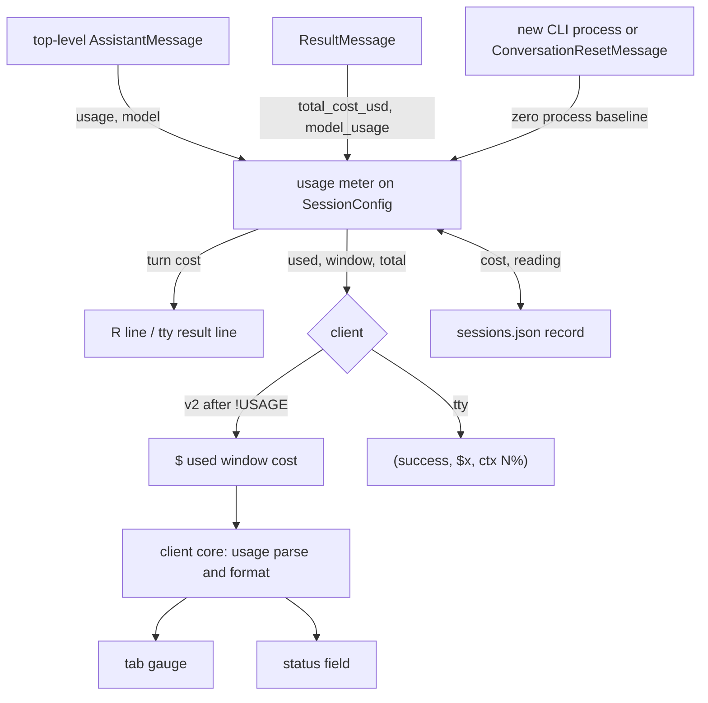

# Context and Cost Per Tab - Plan

## Goal Capsule

- **Objective:** At a glance at the tab strip, the person sees how full each tab's context is and what the front tab's conversation has cost so far, so they know when a tab needs `/new` or a cheaper model before compaction or a large bill surprises them.
- **Means:** The bridge reads context size from the usage Claude already reports with every answer and keeps each conversation's running cost across restarts (KTD1, KTD2, KTD3). It sends both as a new `<n>$` session line behind a `usage` capability word (KTD4). Claude30 draws a small gauge in each tab label and a "ctx 42% $0.31" field in the status line, with a Settings checkbox to hide cost (KTD6, KTD7, KTD8). A typed `/usage` prints a breakdown in every client (KTD5).
- **Product authority:** This Product Contract. PROTOCOL.md v2 gains one capability word, one link-level client line and one session line, with no version bump (KTD4).
- **Execution profile:** One pull request to `schreibaer/claude30` touching bridge, protocol spec, client core, client Mac code and docs. Build order U1, U2, U3, U4, U5.
- **Stop conditions:** Stop and ask if the U2 spike shows that `ResultMessage.total_cost_usd` is neither a per-process running total nor a per-turn cost, or that a resumed process starts `total_cost_usd` from an earlier saved value in a way the meter cannot tell apart from a turn's cost, or that main-thread `AssistantMessage.usage` is missing under SDK 0.2.172, so neither cost nor context can be read without an extra request to Claude.
- **Who finishes:** An implementing agent builds the app with the shared Retro68 toolchain cache (`tools/setup-retro68.sh`), runs the bridge and host tests and the emulator rows where an emulator is available, and refreshes `release/` in the project files. The person runs the hardware rows on the real SE/30.

---

## Product Contract

### Summary

Each Claude30 tab label carries a small gauge that fills as the tab's context fills, and turns solid black when the tab nears the point where Claude Code compacts it. The status line shows the front tab's context percentage and the running cost of its conversation, for example `ctx 42% $0.31`. The cost survives redials, resumes and model or effort changes, and starts again at zero with a new conversation. A Settings checkbox hides the dollar figure for people on a subscription. A typed `/usage` prints a short breakdown in Claude30, ZTerm and v1 app mode, and ZTerm's end-of-turn line gains the context percentage.

### Problem Frame

Today the only number the person sees is the `— success $0.0123` line at the end of each turn (`batch.c`, `EV_RESULT`). It scrolls away, it is per tab only by being in that tab's transcript, and its meaning is off: `ResultMessage.total_cost_usd` is a running total for the Claude CLI process (the SDK's `ConversationResetMessage` docstring says resets zero "the running totals reported on subsequent `ResultMessage` objects (e.g. `total_cost_usd`)"), so the number grows with every turn and drops back whenever the bridge restarts the CLI for a resume or an effort change. Nothing shows how full the context is. With up to six tabs on a 512 x 342 screen, the person finds out a tab is near compaction only when Claude compacts it, and cannot compare what tabs cost. The project description promises token thrift, so the display must not cost Claude calls of its own.

### Requirements

**What the person sees**

- R1. Each tab label in Claude30 shows a context gauge whose fill is the share of the model's context window the conversation uses after its latest turn.
- R2. When a tab's context reaches 80% of the window, its gauge changes from a gray fill to a solid black fill, so the person notices it from another tab.
- R3. The status line shows the front tab's context percentage and running conversation cost at its right end, next to the scroll position field, for example `ctx 42% $0.31`.
- R4. A Settings checkbox "Hide cost" removes the dollar figure from the status line. The gauge and percentage stay. The setting is saved in prefs.
- R5. A tab with no reading yet (a new conversation before its first turn, or a bridge that sends none) shows no fill and no status field, never a wrong number. A tab whose cost is known but whose context is not shows only the cost in the status field and an empty gauge.

**What the numbers mean**

- R6. The cost is the running total of the tab's conversation. It survives Disconnect/Connect, redials after a Wi-Fi drop, resumed conversations, and model and effort changes. It starts again at zero when the tab starts a new conversation (`/new`, `/edits`).
- R7. Each turn's result line shows that turn's own cost, not a running total.
- R8. Readings update at the end of every turn, including turns Claude starts by itself between prompts, and arrive straight after a tab opens or resumes when the bridge has a saved reading.
- R9. Reading context and cost adds no Claude API calls and spends no tokens. `/usage`, which the person asks for, may make one local request to the Claude CLI.

**Commands and other clients**

- R10. Typing `/usage` in any session (Claude30 project or chat tab, ZTerm, v1 app mode) prints the context used out of the window, the largest context categories, the conversation's cost and its number of turns.
- R11. ZTerm's end-of-turn line reads `(success, $0.0123, ctx 42%)` when a reading exists.
- R12. Chat tabs get the same gauge, status field and `/usage` as project tabs.

**Compatibility**

- R13. An older bridge and the new app work together as before, with no gauges and no status field. The new bridge and an older app work together as before, with no new lines sent to it; the one visible change is that its result lines now show each turn's own cost (R7).
- R14. The `R` line keeps its format, so older apps keep drawing it.

### Acceptance Examples

- AE1. **Covers R1, R2.** Given tab 1 at 30% in front and tab 2 at 85% behind it, the person sees a gray, one-third-filled gauge on tab 1 and a solid black, nearly full gauge on tab 2.
- AE2. **Covers R6, R8.** Given a project tab at `$0.42`, when Wi-Fi drops and the app redials and resumes the tab, the status line shows `$0.42` again as soon as the tab is open, and the next turn adds only that turn's cost.
- AE3. **Covers R6, R5.** Given a tab at `ctx 61% $1.20`, when the person types `/new`, the gauge empties, the status field disappears until the first turn, and that turn's reading starts the cost from `$0.00`.
- AE4. **Covers R6, R7.** Given a tab whose conversation has cost `$0.50`, when the person changes its effort (which restarts the Claude CLI) and runs one turn costing about `$0.02`, the result line says about `$0.02` and the status line about `$0.52`.
- AE5. **Covers R13.** Given the new app connected to the previous bridge, no tab shows a gauge and the status line looks as today.
- AE6. **Covers R10, R11.** Given ZTerm in a project, a turn ends with `(success, $0.0123, ctx 31%)`, and `/usage` prints a few lines with tokens used out of the window, the top categories and the conversation cost.

### Scope Boundaries

- No spending limits, budget warnings or stopping a tab at a cost.
- No breakdown window in Claude30. The breakdown is `/usage` text in the transcript.
- No usage history across days or totals across tabs or calls.
- `/usage` still shows cost when "Hide cost" is on, because the person asked for it by name and the bridge does not know the app's setting.
- Subagents' own context is not shown. The gauge is the main conversation's context, which is what compaction acts on.
- Considered and not built: a per-call total across all tabs in the status line. The person confirmed the per-conversation total instead.
- Considered and not built: asking the CLI for its context breakdown (`get_context_usage`) after every turn. It is a round trip to the CLI per turn, and it is not known whether the CLI counts tokens through the API to answer it. The usage that comes with every answer is free and good enough for a gauge (KTD1).

#### Deferred to Follow-Up Work

- A Session menu item that shows the breakdown in a dialog, if `/usage` text turns out to be awkward.
- A warning line in the transcript when a tab crosses 80%, if the gauge alone is missed.

---

## Planning Contract

### Key Technical Decisions

- KTD1. **Context comes from the last main-thread answer's own usage, not from a separate request.** Every top-level `AssistantMessage` carries `usage` for the API call that produced it. Its `input_tokens + cache_creation_input_tokens + cache_read_input_tokens + output_tokens` is the conversation's size after that call, which is what Claude Code's own status line uses. The window size comes from the matching entry of `ResultMessage.model_usage` (`contextWindow`), keyed by the `AssistantMessage.model` of that answer. Messages with a `parent_tool_use_id` belong to subagents and are skipped. This costs nothing and needs no request (R9). When a turn has no usable usage (an interrupted turn, an error), the previous reading is kept rather than replaced with a guess (R5).
- KTD2. **Cost is a per-conversation running total kept by the bridge.** A small pure class, a usage meter, holds the conversation's total, the CLI process's last `total_cost_usd`, and the last context reading. At each result the turn's cost is the process total minus the last one; a smaller value than before means the process was reset, and the whole value is the turn's cost. Each new CLI process (`ClaudeSession.start`) and each `ConversationResetMessage` zeroes the process baseline. The meter lives on `SessionConfig`, which survives `make_session` on restarts, so the total carries across effort changes and resumes (R6, R7). If the U2 spike shows `total_cost_usd` is already per turn, the meter adds it directly; the rest of the plan is unchanged.
- KTD3. **Readings are saved in the resume record.** `Channel._save` writes the conversation total, its turn count and the last context reading into `sessions.json` with the record. `_take_record` restores them, so a resumed tab gets its reading straight after `<n>Y` (R8, AE2). `_new_conversation` starts at zero with no reading (AE3). Records already on disk without these fields load as zero cost and no reading.
- KTD4. **Wire: capability word `usage`, link line `!USAGE`, session line `<n>$ <used> <window> <cost>`.** It follows `agents` and `md`: the bridge lists `usage` in `#OK`, a client that wants readings answers `!USAGE` once after the project list, and only then does the bridge send `$` lines. An older app therefore never sees them, and they cost it no window slots (R13). `<used>` and `<window>` are whole token counts or `-` when unknown; `<cost>` is dollars with four decimals (`0.4200`) or `-`. The bridge sends one after each turn's `R` line and before `>`, and after `<n>Y` when the record has a reading. After `/new` nothing is sent until the first new turn; the client clears its reading itself when `<n>Y ... new` arrives. `$` is unused as a tag in v1 and v2, and v2 tags may be any bytes up to the space. The `R` line's format is unchanged; its cost now means that turn's cost, which PROTOCOL.md states (R7, R14).
- KTD5. **`/usage` is a bridge command, the one place that asks the CLI.** It is handled where `/help` and `/agents` are, in `Channel.run` for v2 and in the tty/v1 command loop. It calls `ClaudeSDKClient.get_context_usage()` (SDK 0.2.172, a control request to the CLI) with a short timeout, prints `totalTokens` of `rawMaxTokens`, the four largest categories, then the meter's cost and turn count as `I` lines (tty: notices). If the call fails or times out, it prints the meter's own reading instead. The person asked for it, so R9 allows it. `HELP` and `CHAT_HELP` list it.
- KTD6. **The client keeps whole numbers and decides the look itself.** A portable core module parses the `$` payload into token counts and cost in hundredths of a cent, with no floating point, and answers: percentage (floor, clamped to 0..100), whether it is at or over 80% (R2), the gauge fill in pixels for a given height, and the status text (`ctx 42% $0.31`, `ctx 42%` with Hide cost, `$0.31` with no context reading). Costs under $10 show cents, $10 to $99.99 show cents, $100 and up show whole dollars. The threshold and formats live in this module so they are host-tested.
- KTD7. **The gauge is a 4 x 10 pixel upright bar at the right end of each tab label.** The tab strip is 16 pixels high with the label baseline 4 pixels from the bottom (`draw_tab` in `window.c`), so there is no row free above or below the text. An upright bar at the label's right fits beside it and costs the label 7 pixels, about one character of Monaco 9; `TruncString` already shortens long names. It is a framed rectangle filled from the bottom: gray pattern below 80%, black at or above. A tab with no reading draws the frame only; a tab on a bridge without `usage` draws nothing and keeps today's label width. An inverted label (waiting permission request) inverts the gauge with it, which stays legible. Chosen over a percentage in the label (too wide at six tabs on 508 pixels) and over a status-line-only display (no view of background tabs, which R2 needs).
- KTD8. **The status line gets a usage field to the left of the position field.** `draw_status_pos` already reserves `POS_FIELD_W` (30 pixels) at the right for `Top`, `End` or a scroll percentage, so the usage text carries the `ctx` prefix to avoid two bare percentages side by side. Its right edge is fixed at the status rectangle's right minus `POS_FIELD_W` minus 2, so it does not move while the position field changes between `Top`, `End` and percentages. Its width is measured with `TextWidth` at draw time (about 80 pixels for `ctx 42% $0.31`). The status rectangle is about 484 pixels, so the message keeps about 370 pixels (61 characters). `update_status` in `modem.c` appends ` [model, effort]`, ` (line noise seen)` and ` (log not saving)` to the end of the message, and today's tail-cutting would drop them first. When the message does not fit, its middle is cut instead (`TruncString` with `truncMiddle`, as `draw_tab` does), so those suffixes stay visible next to the cost. Prefs version 8 adds a `hide_cost` flag; version 7 prefs load with cost shown. The "Hide cost" checkbox sits beside "Hide scroll bar" in the Settings dialog.

### High-Level Technical Design

Directional sketch, not an implementation specification:



One turn in tab 2, then a redial that resumes it:

```text
B: #OK se30bridge 2 files=rw resume ping models agents chat stream md usage
   ... P list ...
C: !USAGE
C: 2P refactor the parser
B: 2R success $0.0214
B: 2$ 84112 200000 0.4414
B: 2>
   ... Wi-Fi drops, the app redials ...
C: !USAGE
C: 2Y 3f9a0c1d2e4b5a69 parser
B: 2Y 3f9a0c1d2e4b5a69 resumed
B: 2$ 84112 200000 0.4414
B: 2>
```

### Assumptions

- `ResultMessage.total_cost_usd` is a running total for the CLI process, reset by a conversation reset, as the SDK's `ConversationResetMessage` docstring says, and a new or resumed process starts it at zero. The CLI keeps a `lastCost` per project in its config; if a resumed process seeds its total from that, the first turn after a restart would count earlier cost twice. The U2 spike confirms the behavior with two turns and an effort-change restart against the real CLI, in two tabs of one project.
- Top-level `AssistantMessage.usage` carries the API usage fields named in KTD1, and `ResultMessage.model_usage` has an entry with `contextWindow` for the model the session runs, possibly under a provider-specific key with `canonicalModel` set. The spike records the exact keys.
- With a `[1m]` model, `contextWindow` reports the larger window, so the gauge scales to it.

### System-Wide Impact

- **Link load:** one extra `$` line of about 25 bytes per turn per tab, for apps that sent `!USAGE`. It counts toward the `W`/`!ACK` window like any line.
- **Resume records:** `sessions.json` records gain two fields. Older bridges reading a newer file ignore unknown keys, since records are plain dicts.
- **Effort and model changes:** `_resume_restart` and `set_model` keep the same `SessionConfig`, so the meter and its total survive. The window size may change with the model; the next reading uses the new one.
- **Demo mode:** `DemoSession` reports made-up readings so tests and the emulator see the gauge without Claude.
- **68030 cost:** one more short `DrawText` in the status line and one `FrameRect` plus `FillRect` per tab redraw. Tabs already redraw only when their state changes.

### Risks & Dependencies

- **CLI usage fields change:** if a CLI update drops or renames the usage fields, the meter keeps its last reading or none, which shows as an empty gauge, never a wrong one (R5).
- **Model key mismatch:** if `model_usage` keys do not match `AssistantMessage.model`, the window is unknown and the gauge stays empty (R5). The meter matches by the key the U2 spike records (the model id or `canonicalModel`). Fallbacks such as using the only entry or the last known window are built only if the spike shows the keys do not match.
- **Cost on a subscription:** the CLI reports API-equivalent dollars even on a Claude subscription. R4 covers this; the README says what the figure means.

---

## Implementation Units

### U1. Protocol spec and docs

- **Goal:** Document the `usage` capability, `!USAGE`, the `<n>$` line, the meaning of `R`'s cost, and `/usage`.
- **Requirements:** R7, R10, R11, R13, R14
- **Dependencies:** none
- **Files:** `PROTOCOL.md`, `README.md`, `client/README.md`
- **Approach:**
  1. Add a "Context and cost (`usage`)" section to PROTOCOL.md after "Markdown prose", stating KTD4's wire rules and when `$` is sent.
  2. Change the v1 `R` row (and say it applies to v2's `<n>R`) to say the cost is that turn's cost.
  3. Add `usage` to the `#OK` examples, `!USAGE` to the link-level client table, and `<n>$` to the session-line table.
  4. Add `/usage` to the tty mode description and the ZTerm result line format.
  5. In `README.md`, explain that the dollar figure is what the API would charge, also on a subscription, and mention Hide cost. In `client/README.md`, describe the gauge, the status field and the checkbox.
- **Patterns to follow:** the "Subagents" and "Markdown prose (`md`)" sections of `PROTOCOL.md`.
- **Test expectation:** none -- documentation only. U2 and U3 test the behavior it describes.
- **Verification:** A reader of PROTOCOL.md alone can implement a client that shows readings, and an older client is unaffected.

### U2. Bridge: usage meter, `$` lines, `/usage`

- **Goal:** Keep each conversation's context reading and running cost, send them to apps that ask, and print them on request.
- **Requirements:** R6, R7, R8, R9, R10, R11, R12, R13, R14
- **Dependencies:** U1
- **Files:** `bridge.py`, `tests/test_bridge_usage.py` (new), `tests/v2client.py`
- **Approach:**
  1. Spike first: two real-CLI turns, an effort change, and a third turn, recording `total_cost_usd`, `usage`, `model_usage` and `AssistantMessage.model` each time. This settles the Assumptions entries and KTD2's per-process versus per-turn branch. Run it with two tabs in the same project, so a resumed process that seeds its total from the CLI's saved per-project `lastCost` would show up as a jump on the first turn after a restart.
  2. A pure usage meter class per KTD1 and KTD2, with methods for a main-thread answer's usage, a result, a process start and a conversation reset, and read-only properties for the turn cost, total, turn count, used tokens and window. It carries a to-record and from-record pair for KTD3.
  3. `SessionConfig` owns a meter. `ClaudeSession.start` tells it a new process started. `_handle` feeds it top-level `AssistantMessage` usage and the `ResultMessage`, handles `ConversationResetMessage` when the SDK provides it, calls `term.result(status, turn_cost, meter)`, then a new `term.usage(meter)` hook. Passing the meter to `result` lets the tty line show this turn's reading while v2 keeps its `R`-before-`$` order. `follow` takes the same path, since it ends in `_handle` for a self-started turn.
  4. `Terminal.result` in tty mode appends `, ctx N%` from the meter it is given when that meter has a reading (R11). `Channel.result` ignores the extra argument. `Terminal.usage` sends nothing in tty or v1, whose `R` line stays as is. The tty/v1 helper `new_conversation(cfg)`, which `main_async` calls for `/new` and `/edits`, replaces `cfg`'s meter with a fresh one, so R6 and `/usage` hold outside Claude30 too.
  5. `Channel.usage` sends `<n>$` only when `V2` has seen `!USAGE`. `Channel._save` and `_take_record` write and read the meter's record fields. After `<n>Y` the channel sends its reading if the record had one (R8). `/new` and `/edits` start a fresh meter and send nothing until the first new turn (KTD4). `Channel.shutdown`, which already writes `always` back into the record, also writes the meter's fields, so the cost of a turn whose result arrived just before a link drop is not lost.
  6. `V2.run` adds `usage` to `#OK` and accepts `!USAGE`.
  7. `/usage` in `Channel.run` and the tty/v1 command loop, per KTD5, with the entry added to `HELP` and `CHAT_HELP`.
  8. `DemoSession` feeds its meter a made-up reading each turn: context grows by a fixed step, cost by `$0.0123`, and the prompt word `full` jumps context to 85% so R2 can be seen. Demo `/usage` prints the meter's reading with a fixed category list.
  9. `tests/v2client.py` sends `!USAGE` on request and collects `$` lines per session.
- **Patterns to follow:** `AgentTracker` (a small pure class driven by `_handle`), the `!AGENTS` and `!MD` handling in `V2.run`, `agents_lines` and the `/agents` command for printed command output, the `StubClient` scripted messages in `tests/test_bridge_agents.py`.
- **Execution note:** Write the meter's restart and reset scenarios first. They pin down the cost arithmetic that AE4 depends on.
- **Test scenarios:**
  - **Meter.** Process totals 0.01, 0.03, 0.06 give turn costs 0.01, 0.02, 0.03 and a total of 0.06.
  - **Meter.** After 0.06, a process start, then a process total of 0.02: turn cost 0.02, total 0.08 (AE4).
  - **Meter.** A process total smaller than the last one without a process start (a reset the bridge missed) counts the whole value as the turn cost and never subtracts.
  - **Meter.** A conversation reset zeroes the process baseline but keeps the total, since the tab still runs the same conversation from the person's view.
  - **Meter.** Usage `{input 1000, cache_creation 2000, cache_read 80000, output 1112}` with a `model_usage` window of 200000 for the answer's model gives used 84112, window 200000.
  - **Meter.** `model_usage` keyed the way the spike recorded finds the window. No matching key: used is known, window is unknown, and no window is guessed.
  - **Meter.** A subagent answer's usage (with `parent_tool_use_id`) never changes the reading. An interrupted turn with no usage keeps the previous reading.
  - **Meter.** Three results then to-record and from-record give the same total, turn count 3 and reading. A record without the fields gives zero cost, zero turns and no reading.
  - **Session, StubClient.** One scripted turn sends `R` with the turn cost, then `$`, then `>`, in that order.
  - **Session, StubClient.** A self-started turn after a background subagent sends its own `R` and `$`.
  - **Wire, `bridge.py --demo`.** `#OK` carries `usage`. Without `!USAGE` no `$` line is ever sent (R13). With it, each turn adds one `$` line whose cost grows by 0.0123.
  - **Wire, demo.** A tab that ran two turns is resumed on a second call with `<n>Y`: `$` with the saved total arrives straight after the `Y` line, before any turn (AE2).
  - **Wire, demo.** `/new` after two turns: the next `$` line, after the first new turn, shows 0.0123 (AE3).
  - **Wire, demo.** `/usage` in a project tab, a chat tab, v1 app mode and tty mode prints the reading and cost as notices (R10, R12).
  - **Wire, demo.** tty mode: two turns, `/new`, then `/usage` shows zero cost and zero turns. The same in v1 app mode.
  - **Wire, demo.** A turn's result arrives, then the link drops before the closing save: the next call's `<n>Y` resume reports a total that includes that turn.
  - **Wire, demo.** tty mode turn ends with `(success, $0.0123, ctx N%)` (R11). v1 app mode's `R` line format is unchanged (R14).
- **Verification:** All bridge tests pass, the new file included. A real-CLI session through `tests/v2client.py` with `!USAGE` shows `$` lines whose context grows turn by turn, and a cost that carries across an effort change.

### U3. Client core: the `usage` capability and readings

- **Goal:** Let the app ask for readings, parse `$` lines and produce the gauge and status values.
- **Requirements:** R1, R2, R3, R4, R5, R13
- **Dependencies:** U1, U2 (its demo-bridge test needs U2's `$` lines)
- **Files:** `client/src/core/usage.h` (new), `client/src/core/usage.c` (new), `client/src/core/protocol.h`, `client/src/core/protocol.c`, `client/tests/test_usage.c` (new), `client/tests/test_protocol.c`, `client/tests/test_bridge_session.c`, `client/tests/CMakeLists.txt`, `client/CMakeLists.txt`
- **Approach:**
  1. `usage.c` per KTD6: a reading struct (used, window, cost in hundredths of a cent, flags for unknown values), a parser for the `$` payload, and helpers for percentage, near-full, fill pixels and status text.
  2. In `protocol.c`, parse `usage` in the `#OK` words into a capability flag next to `md_cap`, send `!USAGE` after `P]` when it is set (as `!AGENTS` and `!MD` are sent), and turn a `<n>$` line into a new `EV_USAGE` event carrying its payload.
- **Patterns to follow:** `md_cap` and the `!MD` send in `link_line`, `heartbeat.c` and `chatlabel.c` as small host-tested modules.
- **Test scenarios:**
  - Parse `84112 200000 0.4414`: 42%, not near full, status `ctx 42% $0.44`; with Hide cost `ctx 42%`.
  - Parse `170000 200000 1.2000`: 85%, near full. Exactly 80% (160000 of 200000) is near full; 159999 is not.
  - Parse `- - 0.0123`: no percentage, no fill, status `$0.01`. Parse `- - -`: no status text at all (R5).
  - Used larger than window clamps to 100% and a full gauge. Window 0 counts as unknown.
  - Costs: `9.9949` shows `$9.99`, `12.5000` shows `$12.50`, `123.4567` shows `$123`. Malformed payloads (`abc`, an empty payload, one field) give no reading and no crash.
  - Fill pixels for 42% of 8 inner pixels is 3; 1% of a known reading still shows at least 1 pixel so a live tab never looks unknown.
  - `#OK ... usage` sets the capability and `P]` then sends `!USAGE` CR. Without the word, nothing is sent and `$` lines are still ignored safely.
  - `2$ 84112 200000 0.4414` emits `EV_USAGE` for session 2 with that payload. A `$` line for a session that is not open is dropped like other session lines.
  - Against `bridge.py --demo`, the core sends `!USAGE` and receives one `EV_USAGE` per turn.
- **Verification:** Host tests pass, including the new file.

### U4. Client Mac: gauges, status field, Hide cost

- **Goal:** Draw each tab's gauge and the front tab's status field, and add the Hide cost setting.
- **Requirements:** R1, R2, R3, R4, R5, R12, R13
- **Dependencies:** U3
- **Files:** `client/src/mac/tabs.h`, `client/src/mac/tabs.c`, `client/src/mac/modem.c`, `client/src/mac/window.c`, `client/src/mac/window.h`, `client/src/mac/prefs.h`, `client/src/mac/prefs.c`, `client/src/mac/resources.h`, `client/claude30.r`
- **Approach:**
  1. `Tab` gains a reading, cleared in `tabs_add` and when the tab starts a new conversation (`EV_RESUMED` with `new`), so a stale number never shows after `/new` (AE3).
  2. `modem.c` handles `EV_USAGE`: store the reading on the tab, redraw that tab's label, and redraw the status line when it is the front tab. Switching tabs already redraws the status line.
  3. `draw_tab` in `window.c` draws the gauge per KTD7 when the session has the capability, after `TruncString` with room reduced by the gauge width.
  4. `draw_status_pos` draws the usage field per KTD8 to the left of the position field, using the front tab's reading and `gPrefs.hide_cost`, and cuts the middle of the message when it does not fit, per KTD8.
  5. Prefs version 8 adds `hide_cost`; version 7 loads with it off. The Settings dialog gets a "Hide cost" checkbox beside "Hide scroll bar", and OK redraws the status line.
- **Toolbox calls:** QuickDraw `FrameRect`, `FillRect` with the `qd.gray` and `qd.black` patterns, `EraseRect`, `TextWidth`, `DrawText`; Dialog Manager and Control Manager through the existing Settings code. All are in System 6 and later, so nothing new is required of System 7.5.5. Memory grows by about 12 bytes per tab and 2 bytes of prefs.
- **Patterns to follow:** the heartbeat's status-line placement (`gHeartRect`, `draw_status_pos`), the fresh-output underline in `draw_tab`, the "Hide scroll bar" checkbox and the version 6 to 7 upgrade in `prefs.c`.
- **Test scenarios:**
  - Test expectation for automated tests: the Mac drawing has no host test seam. The numbers it draws come from U3's module, which is host-tested. The behaviors below are emulator rows in the Verification Contract.
- **Verification:** The 68k build has no new warnings, and the emulator rows pass where an emulator is available.

### U5. Release files

- **Goal:** Make the new app available to the person.
- **Requirements:** R1
- **Dependencies:** U2, U3, U4
- **Files:** `release/Claude30.bin` and `release/Claude30.dsk` in the project files (outside the repository)
- **Approach:** Rebuild and copy the app as earlier threads did, after the PR's checks pass.
- **Test expectation:** none -- packaging. The 68k build in U4 checks it.
- **Verification:** The release files' dates match the merged build.

---

## Verification Contract

- **Bridge tests:** `python3 -m unittest discover -s tests`. All existing tests plus `tests/test_bridge_usage.py` pass.
- **Host tests:** `cmake -S client/tests -B build-host && cmake --build build-host && ctest --test-dir build-host`, including `test_usage.c` and the new `test_protocol.c` and `test_bridge_session.c` cases.
- **68k build:** `tools/setup-retro68.sh`, then the build in `CLAUDE.md`, with no new warnings.
- **Real-CLI check:** Through `tests/v2client.py` against the real Claude CLI with `!USAGE`: three turns, an effort change between the second and third. Context grows each turn, each `R` cost is small and per turn, and the `$` total after the third turn equals the sum of the three `R` costs to within rounding. This repeats the U2 spike against the finished code.
- **Emulator rows** (Basilisk II, tcpser and `run.sh --demo`, as `tools/emu/README.md` describes):
  - E1. Two tabs, a few prompts each, then `full` in the second: the first tab's gauge is gray and partly filled, the second's is solid black, and the status line shows the front tab's `ctx` and cost (AE1).
  - E2. Six tabs with long project names: gauges fit, labels truncate, nothing overlaps.
  - E3. Kill tcpser after two turns and restart it: after the redial, the resumed tab shows the same cost before any new turn (AE2).
  - E4. `/new` in a tab: the gauge empties and the status field disappears until the next turn, which shows `$0.01` (AE3).
  - E5. Settings > Hide cost: the status line shows only `ctx N%`, and the setting survives a relaunch (R4).
  - E6. A permission request in a background tab: its inverted label still shows the gauge.
  - E6a. A front tab with a model and effort picked, a usage field and a long message (the no-output warning): the ` [model, effort]` bracket at the end stays visible and the usage field does not move while scrolling from `Top` to `End`.
  - E7. The current release app against the new bridge, and the new app against the previous bridge: everything works as before, with no gauges in the second case (AE5).
  - E8. ZTerm-style tty session against the demo bridge: the result line carries `ctx`, and `/usage` prints the breakdown (AE6).
- **Hardware rows (the person):**
  - H1. On the real SE/30 against the real bridge, work in two tabs for a while: gauges fill, the status line's cost grows by about each turn's `R` cost, and the window stays responsive.

## Definition of Done

- Every requirement R1 to R14 is met, and every test and check in the Verification Contract passes, except emulator or hardware rows that could not be run, which are reported as not run.
- PROTOCOL.md describes exactly what the bridge and app do.
- No code from abandoned attempts, including the U2 spike script, is left in the diff.
- The PR description says what was tested and what was not, as `CLAUDE.md` requires, and names the Toolbox calls from U4.

### Deferred to Implementation

- The exact `model_usage` key matching, settled by the U2 spike.
- Exact names, the `/usage` line wording and how many categories fit in 80 columns.
- The gauge's exact pixel position if the emulator shows the 4 x 10 bar reads better one pixel taller or narrower.

## Sources

- `bridge.py`: `ClaudeSession._handle`, `ClaudeSession.follow`, `ClaudeSession.start`, `SessionConfig`, `Terminal.result`, `Channel.result`, `Channel._save`, `Channel._take_record`, `Channel._new_conversation`, `Channel._resume_restart`, `Channel.run` (`/help`, `/agents`, `/new`), `V2.run` (`#OK` words, `!AGENTS`, `!MD`), `HELP`, `CHAT_HELP`, `DemoSession`.
- `client/src/core/protocol.c`: `#OK` word parsing, `link_line` (`!AGENTS`, `!MD` after `P]`), session tag dispatch. `client/src/core/batch.c`: `EV_RESULT` drawing.
- `client/src/mac/window.c`: `draw_tab`, `draw_status_pos`, `POS_FIELD_W`, `gHeartRect`, `TAB_H`. `client/src/mac/modem.c`: `front_status`, event handling. `client/src/mac/prefs.c`, `client/claude30.r`: Settings dialog and prefs versions.
- Agent SDK 0.2.172 (`claude_agent_sdk/types.py`, `client.py`): `ResultMessage.total_cost_usd`, `usage`, `model_usage` (`ModelUsage.contextWindow`, `canonicalModel`), `AssistantMessage.usage`, `.model`, `.parent_tool_use_id`, `ConversationResetMessage` (running totals reset), `ClaudeSDKClient.get_context_usage()` (`ContextUsageResponse`: `totalTokens`, `maxTokens`, `rawMaxTokens`, `categories`).
- Prior plans: `docs/plans/2026-11-25-1627-feat-heartbeat-light-per-tab-model-plan.md` (status line, per-tab settings), `docs/plans/2026-11-26-1428-feat-stream-answers-per-tab-plan.md` (capability words without a version bump), `docs/plans/2026-11-24-1740-feat-reconnect-resume-after-wifi-drop-plan.md` (resume records).
