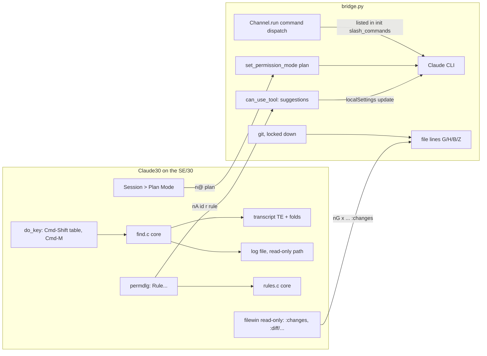

# Find, Command Pass-Through, Allow Rules, Changes Window - Plan

## Goal Capsule

- **Objective:** Make Claude30 a credible second console for agentic work. The person can find text in a long conversation, use Claude Code's own commands and plan mode, stop re-approving the same safe commands, and review the project's uncommitted changes in one place. Find, Full Screen and Model and Effort can be reached by keyboard in full screen, and plan mode by typing `/plan`. Command keys for Show Changes and the other key-less items are deferred.
- **Means:** Four phases, each shippable as its own pull request, in this order. (1) App only: Find on Cmd-F and Cmd-G over the transcript, its folds and the tab's log. Full Screen moves to Cmd-Shift-F and Model and Effort gets Cmd-M. (2) The bridge passes Claude Code's slash commands through and reports plan mode, behind the capability word `cmds`. (3) Permanent allow rules from the permission dialog, saved by the Claude CLI to `.claude/settings.local.json`, behind `rules`. The bridge offers `rules` only when the host starts it with `--allow-rules`. (4) A read-only Changes window served as virtual read-only files over the existing file-transfer lines, behind `changes`.
- **Product authority:** Issue #18 and the person's decisions in this session: Find is Cmd-F, Full Screen is Cmd-Shift-F, Model and Effort gets a Command key (Cmd-M), Find also searches the log, the order is smallest and safest first, and the Changes window is read-only. PROTOCOL.md v2 gains three capability words and no version bump.
- **Execution profile:** Four pull requests to `schreibaer/claude30`: Phase A (U1-U3), Phase B (U4-U5), Phase C (U6-U7), Phase D (U8-U9). Each refreshes docs and release files.
- **Stop conditions:** Stop and ask in these cases:
  - The U4 spike shows the Agent SDK does not run `/compact` or a project command sent as a prompt, or that the CLI rejects unlisted slash text even with a leading space.
  - The U6 spike shows `PermissionResultAllow.updated_permissions` with destination `localSettings` does not make the CLI write the rule.
  - A phase needs more than about 20 KB of extra heap per tab.
- **Who finishes:** An implementing agent runs `tools/setup-retro68.sh`, builds the 68k app, and runs the host tests (`client/tests`), the bridge tests (`tests/`) and the `./run.sh --demo` rows. The person runs the hardware rows on the real SE/30.

---

## Product Contract

### Summary

Phase A adds **Edit > Find...** (Cmd-F), **Find Again** (Cmd-G, older) and Cmd-Shift-G (newer). They search the front tab's transcript, including closed folds, and then that tab's log file. Full Screen moves to Cmd-Shift-F and Model and Effort gets Cmd-M.

Phase B passes `/compact`, `/clear` and the project's own commands and skills to Claude Code. It adds `/commands` and a plan mode the person can switch from the Session menu or `/plan`.

Phase C adds **Rule...** to the permission dialog. The person edits a suggested rule, and the CLI saves it to the project's `.claude/settings.local.json`. `/allow` lists and removes those rules.

Phase D adds **Session > Show Changes**: a read-only list of the project's git changes. Opening a line shows that file's diff.

### Problem Frame

A professional engineer wants to start long agentic turns from the SE/30 and come back to them. Four gaps get in the way:

- **No search.** A tab keeps only 20 to 28 KB on screen, and older output sits in the log, which can't be searched from the app.
- **Commands don't reach Claude Code.** The bridge's `/help` lists only seven commands, so there's no visible way to compact, plan or run project commands.
- **Repeated approvals.** "Always" lasts only for the session, and only Read, Glob, Grep and TodoWrite run without asking. Every `npm test` asks again in every new conversation.
- **No overview of changes.** Edits are approved one at a time, and nothing shows what is uncommitted in the project. On a clean tree that is exactly what the last turns changed.

Full screen hides the menu bar, so any feature without a Command key can't be reached there. Model and Effort is the one the person hits today.

### Requirements

**Keys (Phase A)**

- R1. Cmd-F opens Find in the main window and in a file window. Full Screen moves to Cmd-Shift-F and keeps its enable rule (off while a file window is open). The menu item reads "Full Screen (Cmd-Shift-F)", following the "Previous Prompt (Cmd-Up)" style.
- R2. Cmd-M opens Session > Model and Effort.... When the item is dimmed, Cmd-M beeps and the status line says why, so the person is not left guessing in full screen.

**Find (Phase A)**

- R3. Find asks for a string and searches the front tab's transcript upward (older) from the current view. Matching ignores letter case, including Mac Roman accented letters. The match is selected and scrolled into view.
- R4. **Find Again** (Cmd-G) repeats the search upward (older) and **Find Newer** (Cmd-Shift-G) downward. Both work after the Find dialog has closed, and from the input box. A new Find string, a scroll or a click in the transcript, or a new Find restarts the search from the current view.
- R5. A match inside a closed fold opens that fold and selects the match.
- R6. Past the top of the window, the status line says the text is not in the window and that Cmd-G searches the log. The next Cmd-G searches the tab's log file from its end backward and shows each match in a read-only Log window, with about 20 lines around it. The match is selected (inverted), and the window title shows how far into the log it is (for example `Log 62% - claude30-web 11-24 10.31.05 #2`). With the Log window in front, Cmd-G goes to older matches and Cmd-Shift-G to newer ones. Cmd-Shift-G past the newest log match brings the main window back to the front with a status message.
- R7. In a file window, Find searches that window's text, downward from the caret (Cmd-G) and upward with Cmd-Shift-G, since files are read top-down. For a read-only file loaded in pieces, it searches only the lines already loaded, and the status line says so.
- R8. A chat tab (no log) searches only its window.

**Commands (Phase B)**

- R9. A prompt whose first word is an allowed command (`/compact`, `/clear`, or a project or user command or skill the session offers) goes to Claude Code as a command, on its own. Any other text that starts with `/`, like `/usr/bin is missing`, still goes to Claude as a prompt.
- R10. `/commands` lists the commands and skills the session offers, with the bridge's own commands, as `I` lines.
- R11. `/clear` does what `/new` does.
- R12. Every other Claude Code built-in is refused with a notice, in particular those that change permissions, directories, hooks, MCP servers or memory (`/permissions`, `/add-dir`, `/hooks`, `/mcp`, `/memory`) and terminal-only ones (`/config`, `/login`, `/resume`). Where there is one, the notice names what to use instead.
- R13. `/compact` reports "Conversation compacted." when it finishes and sends a fresh context reading.
- R14. Plan mode is per tab. **Session > Plan Mode** (a checked item) and `/plan on|off` switch it. The status bracket shows `plan`, for example `[sonnet, high, plan]`. When the person approves Claude's plan (the ExitPlanMode request), the tab leaves plan mode at once, so Claude can carry out the plan in the same turn, and the checkmark follows. The approval dialog is titled "Approve plan", shows the whole plan in its scrolling body, and never offers Rule.... Plan mode survives a redial, a resume and every restart of the Claude CLI (effort change, `/edits`, `/allow remove`). The checkmark and bracket show only the mode the bridge confirmed. A switch requested during a turn shows "Plan mode changes after this turn" on the status line.
- R15. In a chat, plan mode and project commands answer "does not apply in a chat."

**Allow rules (Phase C)**

- R16. The permission dialog gets a fourth button, **Rule...** (Cmd-R). It opens a small dialog with the CLI's suggested rule for this request (for example `Bash(npm test:*)`) in an editable field. **Save Rule** allows this request and saves the rule to the project's `.claude/settings.local.json` under `permissions.allow`. The rule must cover this request: same tool, matching input, and no broader than the suggestion. This needs a bridge started with `--allow-rules`, because the link is unauthenticated and a saved rule outlives the conversation.
- R17. Rules that would allow too much are refused, both in the dialog (Save Rule stays dimmed and a line says why) and again by the bridge (the request is denied with a notice). The refused patterns are listed in KTD9.
- R18. `/allow` lists the project's local allow rules, numbered. `/allow remove N` deletes one, and the session picks up the change before its next turn.
- R19. The permission dialog keeps all its current safety rules: no default button, Return does nothing, early clicks are thrown away and the buttons ignore clicks for 0.75 seconds. Rule... and Save Rule follow the same rules. Key presses typed before the dialog opened are flushed.
- R20. Chats have no Rule... button. Their "always" still covers the chat.

**Changes window (Phase D)**

- R21. **Session > Show Changes** opens a read-only window for the front tab's project, listing each changed file against the last commit with its status and line counts. Staged, unstaged and untracked files are included, and the branch name goes on top. A clean tree shows "No changes since the last commit." A refusal or git failure shows its reason as the window's text. The bottom strip says the list is a snapshot and that Revert to Saved refreshes it.
- R22. A click or arrow key selects a whole line. Double-clicking a line, or Return, opens the diff of the file on the selected line in its own read-only window: `git diff HEAD`, the whole file for an untracked one, or the removed lines for a deleted one. On the branch line or a message line it beeps. Large diffs load in pieces, as large files do today.
- R23. **File > Revert to Saved** in a Changes or diff window reloads it.
- R24. Files hidden from Open Project File (secrets, `.git`, ignored files) never appear, and their diffs are refused.
- R25. A project that is not a git repository answers "not a git repository". There is no staging, committing or reverting from the Mac.

**Compatibility (all phases)**

- R26. Every bridge feature sits behind a capability word. An older app against a newer bridge sees nothing new. A newer app against an older bridge hides or dims the new menu items, and typed commands behave as today.
- R27. ZTerm, tty mode and v1 get `/commands`, `/compact`, `/clear`, `/plan` and `/allow` as working typed commands, as they got `/usage`. `/plan on` switches the mode there too, and confirms with a notice.

### Acceptance Examples

- AE1. **Covers R1, R2.** In full screen, Cmd-M opens the Model and Effort dialog. Cmd-Shift-F leaves full screen. Cmd-F opens Find, not full screen.
- AE2. **Covers R3, R5.** A tab whose transcript has a closed fold `[+] Code, 47 lines` containing `parse_header`: Find "PARSE_HEADER" opens the fold and selects the match.
- AE3. **Covers R6.** Find "migration" with the word only in the log: the first search reports "Not in window. Cmd-G searches the log". Cmd-G opens a Log window around the newest match in the log, and the next Cmd-G shows an older one.
- AE4. **Covers R9, R13.** `/compact` in a tab at 78% returns "Conversation compacted.", and the tab gauge drops. `/usr/bin is missing` reaches Claude as a prompt.
- AE5. **Covers R14.** With Plan Mode checked, Claude answers with a plan and asks to exit plan mode. Allowing it clears the checkmark and `plan` leaves the status bracket.
- AE6. **Covers R16, R18.** A request for `npm test -- --watch=false`: Rule... proposes `Bash(npm test:*)`, and Save Rule allows the request. The next `npm test` in a new conversation runs without asking. `/allow` shows the rule as 1, and `/allow remove 1` makes the next `npm test` ask again.
- AE7. **Covers R17.** Editing the rule to `Bash` or `Bash(sh:*)` dims Save Rule with a reason.
- AE8. **Covers R21, R22, R24.** After Claude edits `src/a.c` and creates `src/b.c`, and `.env` changed too: Show Changes lists `M  src/a.c +3 -1`, then `?? src/b.c +20`, and no `.env`. Opening `src/a.c` shows its diff.

### Scope Boundaries

- No regular expressions, whole-word or case-sensitive options in Find. No search across tabs. No replace in transcripts (file windows have Cut and Paste).
- Find in a read-only paged file does not fetch unloaded pieces.
- No new MCP or hook management from the Mac.
- Rules go only to the project's `.claude/settings.local.json`. User-wide or shared project settings are not written. No deny or ask rules.
- The Changes window does not stage, commit, revert, show history or compare against branches. Those stay with Claude, behind its prompts.
- No Command keys for the other key-less items (Settings, Stream Answers, Plan Mode, Show Changes) beyond R1 and R2.

#### Deferred to Follow-Up Work

- Command keys for the remaining key-less menu items, so all of them work in full screen. Candidates: Settings (Cmd-comma is not typeable through MenuKey on every layout, so pick a letter), Show Changes, and Plan Mode.
- Find over unloaded pieces of a read-only file (would need a bridge-side search line).
- A diff window that colors or bolds `+` and `-` lines.
- Per-turn changes on a tree that was already dirty (would need a snapshot taken when each turn starts).
- A busy cursor and Cmd-period for long log searches, a line in the Rule dialog saying the rule is permanent, and the other minor review notes, if testing shows they're needed.

---

## Planning Contract

### Key Technical Decisions

- KTD1. **Shifted keys are caught before `MenuKey`.** `MenuKey` ignores Shift and matches letters case-insensitively, so Cmd-Shift-F would hit Find's "F". `do_key` in `client/src/mac/main.c` already handles Cmd-period and Cmd-Backspace before the menus. It gains a small table of Cmd-Shift letters (F for Full Screen, G for Find Newer) checked on `ev->modifiers & (cmdKey|shiftKey)` with the character folded to lower case. A Cmd-Shift key runs the same menu command as its item, after `adjust_menus()`, and beeps when the item is disabled. The menu items show the Shift key in their text with no key equivalent, because the System 7 MDEF cannot draw a Shift glyph. Toolbox: `MenuKey`, `SysBeep`, all System 6 and later.
- KTD2. **Model and Effort is Cmd-M.** It is free in every menu, it's the obvious letter, and it doesn't clash with System 7 conventions (Cmd-M has no standard meaning before Mac OS 8). It's added as an ordinary key equivalent in `client/claude30.r`. When the item is dimmed, `do_menu` gets 0 from `MenuKey`. `do_key` then shows the reason on the status line: not connected, chat or tab not open, or a bridge without `models`.
- KTD3. **Search runs in a portable core module.** A new `client/src/core/find.c` holds a case-insensitive Mac Roman search, forward and backward over a byte buffer. It uses a 256-byte fold table (A-Z and the accented letters of Mac Roman) instead of the Script Manager's `UpperText`, so it is host-tested and behaves the same everywhere. It also handles searching a buffer read in chunks (a match that crosses chunk edges) for the log. The Mac side gives it the text from `TEGetText` (locked with `HLock`) and fold texts from `client/src/core/fold.c`.
- KTD4. **Find's order follows how a transcript is read.** The newest text is at the bottom and older text is above it, so Find and Cmd-G search upward from the top of the current view (or from the selection). Cmd-Shift-G searches downward. When the window runs out, the search moves into the log (older still). Find always restarts from the current view. Matches in TextEdit text and in closed folds are merged by position, so the nearest match in the search direction wins wherever it sits. File windows go the other way (KTD4 applies only to transcripts, see R7).
- KTD5. **The log is read through its own file reference, backward in 4 KB chunks.** The log stays open with `fsRdWrPerm` (`client/src/mac/log.c`). The search opens a second read-only path to the same file with `FSpOpenDF` and `fsRdPerm`, so the append position is never disturbed. It reads with `SetFPos` and `FSRead`, with an overlap of the pattern's length so no match is missed at a chunk edge. A match fills a read-only Log window (Monaco, TextEdit, at most about 4 KB of lines around the match), titled with the log's name. Heap: one 4 KB buffer during the search, plus the Log window's TextEdit record. Only one Log window is open at a time and it is reused. It counts against nothing else and closes with Cmd-W.
- KTD6. **Commands pass through on an allowlist.** Today an unknown `/word` falls through to `client.query(prompt)` unchanged (`Channel.run` in `bridge.py`, after the `/model` branch). The bridge keeps a per-session command list. It fills it from `ClaudeSDKClient.get_server_info()` (its `commands`) right after `connect()` in `ClaudeSession.start`, so it is ready before the first turn. It refreshes it from the init system message (`ClaudeSession._system`, where `agents` is already read): `slash_commands`, `skills` and `terminal_slash_commands`. Dispatch:
  - **Allowed:** `/compact` and Claude Code's custom commands and skills (project and user) are sent alone. Any pending edited-files note or cut note is not put in front of them. Those stay queued (`self.edited`, the cut flag) for the next ordinary prompt, so the CLI sees the command as the first text.
  - **Mapped:** `/clear` takes the bridge's `/new` path.
  - **Refused:** every other Claude Code built-in, including `terminal_slash_commands` and any that change permissions, directories, hooks, MCP servers or memory, gets the R12 notice. The allowlist widens only for commands the spike has confirmed.
  - **Plain text:** anything else starting with `/` is sent as a prompt with a single leading space, so the CLI can't read it as a command (R9). The U4 spike checks that the CLI treats it as text.
  - The U4 spike also confirms the CLI runs commands sent through the SDK's streaming input, that `/compact` ends with a `compact_boundary` system message, and what `get_server_info()` returns before the first turn.
- KTD7. **Plan mode uses the SDK's own permission mode.**
  - **Switching:** `ClaudeSDKClient.set_permission_mode("plan")` (SDK 0.2.189 offers it) switches with no restart. A `/plan` or `<n>@` switch requested during a turn waits for the turn to end.
  - **Leaving on approval:** when the person allows an `ExitPlanMode` request, the bridge returns `PermissionResultAllow` with `updated_permissions=[PermissionUpdate(type="setMode", mode=..., destination="session")]`. The mode is `default`, or `acceptEdits` under `/edits on`. This leaves plan mode inside the turn, so Claude's edits in the rest of that turn aren't blocked. The bridge then records the new mode and sends `<n>@ default`, which also covers acceptEdits, since `<n>@` reports only plan versus not plan.
  - **Restarts:** the mode is kept in the session config, and `ClaudeSession.options()` starts the CLI with `permission_mode="plan"` when it is set. So every restart path keeps it: effort change, `/edits`, `/allow remove` and resume. It's also saved in the resume record and sent after `<n>Y`.
  - **`/new` and `/clear`:** they reset the mode to default and send `<n>@ default`.
  - **Dialog:** `describe_tool` shows the plan text as the request body, and no `Q+` is ever sent for ExitPlanMode.
- KTD8. **Rules are saved by the Claude CLI, not by the bridge.** `can_use_tool` gets `context.suggestions`, the CLI's own `PermissionUpdate` proposals such as `addRules` with `Bash(npm test:*)`. The bridge sends the first `addRules` suggestion to the client as the proposed rule. In SDK 0.2.189 a rule is a `PermissionRuleValue(tool_name, rule_content)`. The bridge formats a suggestion as `Tool(content)`, or a bare `Tool` when `rule_content` is None. It parses the client's answer back by splitting at the first `(` and the final `)`, so MCP names and specifiers that hold parentheses survive. On a rule answer it checks three things before allowing:
  - KTD9 validation passes.
  - The rule's tool equals the pending request's tool, and the rule matches the request's input.
  - The rule equals the offered suggestion or is narrower than it.

  If any check fails, the request is denied with a notice. Otherwise it returns `PermissionResultAllow(updated_permissions=[PermissionUpdate(type="addRules", behavior="allow", rules=[...], destination="localSettings")])`. Claude Code then writes `.claude/settings.local.json` in its own format, and the bridge never writes that file on the allow path. The SDK drops an update list it can't serialize with only a log warning and still allows the call. So after the allow, the bridge checks that the rule appeared in the file, and sends `<n>I Rule not saved.` if it didn't. `/allow remove N` is the one place the bridge edits it: it parses the JSON, removes one entry and writes it back atomically (temporary file and rename, as file saves already do). It then restarts the CLI on the same conversation (the effort-change path), so the removed rule stops applying. When the CLI offers no suggestion, the dialog proposes `Tool(exact input)` for Bash and plain `Tool` for others, which validation may then refuse.
- KTD9. **Refused rule patterns**, checked by the same rules in `client/src/core/rules.c` (host-tested) and in `bridge.py` (bridge-tested):
  - **Bare tool names** with no specifier for Bash, Edit, Write, MultiEdit, NotebookEdit, WebFetch and Agent. Bare names of read-only tools (Read, Glob, Grep, WebSearch) are allowed.
  - **Empty or wildcard-only specifiers:** `*`, `:*`, `**`, `/**`, and any specifier starting with `*`.
  - **Bash prefixes with shell control characters:** `;`, `&`, `|`, `>`, `<`, `` ` ``, `$(`, newline.
  - **Bash prefixes whose first word runs arbitrary code:** `sh`, `bash`, `zsh`, `fish`, `env`, `sudo`, `su`, `xargs`, `eval`, `exec`, `command`, `nohup`, `time`, `python`, `python3`, `node`, `ruby`, `perl`, `php`, `osascript`, `awk`, `find`, `curl`, `wget`, `npx`, `docker`. This list is defense in depth only. Rules such as `Bash(npm:*)` or `Bash(git:*)` still let a project script run, which is why the whole feature sits behind `--allow-rules` and why the dialog proposes the CLI's own narrow suggestion.
  - **Bash prefixes whose first word holds `/`** (`/bin/sh`, `./x`) **or starts with an assignment** (`FOO=1 ...`).
  - **Bad file-tool paths:** absolute paths, paths starting with `~`, paths holding `..`, and paths matching the hidden-name rules (`.env*`, `*.pem`, `*.key`, `id_rsa*`, `id_ed25519*`, `.git/`, `.ssh/`). Also refused are paths that could escalate: `.claude/`, `.mcp.json`, `.git*`, `package.json`, `Makefile`, `.github/` and other CI configuration.
  - **ExitPlanMode**, in any form, so a rule can never skip plan review.
  - **Server-wide MCP rules** (`mcp__server` without a tool).
  - **Malformed rules:** longer than 200 bytes, not printable ASCII, or not of the form `Tool` or `Tool(specifier)`.

  The bridge's check is the authority. The client's check exists so the person sees the reason before sending.
- KTD10. **Changes reuse the file-transfer lines through reserved paths.** Host files can have names starting with `:` (the bridge's `bad_name` refuses only control characters). So Phase D makes the bridge leave such names out of `L` listings and refuse real paths starting with `:` as `bad name`. It checks for the virtual paths before `resolve()`. Phase D adds two read-only virtual paths to the existing `G`, `H`, `B` and `Z` lines:
  - `:changes` is the status listing.
  - `:diff/<path>` is one file's diff.

  `H` reports mode `r:changes` or `r:diff`. All existing machinery carries over: paging, the 200-line and 4 KB pieces, CRC-32, retries, the version token (a hash of the output) and the `--files` gate (`off` refuses with `files off`). A new client opens them only after seeing the `changes` word. A `:diff/<path>` request is served only for a path in the current `:changes` listing. It goes through the name checks (outside project, bad name, hidden, ignored) but not the file-must-exist check, so deleted files and a rename's old path still have diffs. The generated text is cached per session and virtual path, like `FileService.cache`. It is regenerated only for a `G` at line 0 or a Revert, so every later piece of one read comes from the same snapshot with the same token. A cut diff reports `r:diff` and counts only the lines sent in `<total>`, as `long` files do today.
- KTD11. **Git runs locked down.** Every call uses these settings:
  - `GIT_OPTIONAL_LOCKS=0`, so status never writes the index, and `GIT_LITERAL_PATHSPECS=1`, so a path can never act as a glob or `:(magic)` pattern.
  - `-c core.fsmonitor=false -c core.quotepath=off -c core.hooksPath=/dev/null`, `--no-ext-diff` and `--no-textconv`.
  - Filter drivers neutralized: the bridge reads the repo's `filter.<name>.*` entries (`git config --get-regexp '^filter\.'`) and passes `-c filter.<name>.clean= -c filter.<name>.smudge= -c filter.<name>.process= -c filter.<name>.required=false` for each.
  - `--no-pager` with `GIT_PAGER=cat`, a 10-second timeout and `cwd` set to the project.

  This is because a project's own git config could otherwise name programs to run. The status listing is `git status --porcelain=v1 -z --untracked-files=all` joined with `git diff HEAD --numstat -z`. Every path goes through the same hidden and ignored test as `L` listings, and refused paths are dropped from the list. The diff base is HEAD, or the empty tree when the repository has no commits, for both `:changes` and `:diff/<path>`. An untracked file's diff is built by the bridge (every line with `+`), within the same size limits, reading through the file service's `resolve()`. That gives realpath containment and the hidden test on the resolved name, and an untracked symlink shows as one line naming the link.
- KTD12. **Wire summary.**
  - **`cmds`:** typed commands, plus `<n>@ <mode>` both ways (`default` or `plan`). The client sends it to switch (safe once it has seen `cmds`, since older bridges ignore unknown tags). The bridge sends `<n>@` only to a client that opted in with `!CMDS` once after the project list. It sends it after `<n>Y` and whenever the mode changes. An older Claude30 build would count an unknown line as link noise, which sends a spare `!ACK` and widens the `W` window (see `docs/solutions/`, "New bridge-to-client lines in PROTOCOL v2 need a client opt-in"). `@` is unused as a tag.
  - **`rules`:** listed in `#OK` only when the bridge was started with `--allow-rules` (default off), as `files=` follows `--files`. The link is unencrypted and unauthenticated, so anyone who can dial the WiFi232 could otherwise save permanent permissions. Without the flag the bridge treats `r` answers as `n` and refuses `/allow remove`. The client sends `!RULES` once after the project list. The bridge then sends `<n>Q+ <id> <rule>` between `<n>Q` and `<n>?` when it has a suggestion. The client may answer `<n>A <id> r <rule>`. The bridge answers a refused rule with `<n>I Rule refused: <reason>` and denies the request.
  - **`changes`:** the reserved paths of KTD10, with no new lines.

  Each word is listed in `#OK` only when it applies: `changes` needs git on the host and `files` not `off`. A client that didn't opt in never sees new lines (R26).

### High-Level Technical Design

This illustrates the intended approach and is directional guidance for review, not implementation specification.

Phase dependencies: Phase A stands alone. Phases B, C and D each depend only on the existing v2 protocol and can be built in any order. The confirmed order is A, B, C, D.

### System-Wide Impact

- **Bridge:** `Channel.run` command dispatch, the tty and v1 command loops, `ClaudeSession._system` (init data), `_can_use_tool`, the resume record (plan mode), the file service (virtual paths), `HELP` and `CHAT_HELP`, and the `#OK` words.
- **Protocol:** three capability words, one new tag (`@`), one new two-character tag (`Q+`), one new answer (`A <id> r`), two new client opt-in lines (`!CMDS`, `!RULES`), and two reserved paths with two read-only modes. No version bump.
- **App:** menus and keys, a Find dialog, a Log window, a Rule dialog, a fourth permission button, a plan-mode flag per tab, and Changes and diff modes for read-only file windows.
- **Memory:** Phase A adds about 4 KB during a log search, plus the Log window (at most about 6 KB). Phase C adds about 1 KB for the Rule dialog. Phase D adds nothing beyond today's read-only file windows, which already page. All of this is well inside the 2 MB partition.
- **System requirements:** everything named here is System 6 or System 7.0 Toolbox. Nothing needs a newer System, Color QuickDraw or an FPU.

### Risks & Dependencies

- The SDK may not run slash commands sent as prompts in streaming mode. This is a stop condition: pause and ask the person before Phase B goes on. One option to offer is shrinking it to plan mode and `/clear`, with `/compact` deferred.
- The CLI's `suggestions` may be empty for some tools. The fallback proposal and validation cover that.
- The CLI may cache settings, so a removed rule keeps applying. KTD8's restart covers it, and U6 tests it.
- Git output can be very large in a big refactor. Paging and the existing 32,000-line limit cap it.
- Shortcut clashes: Cmd-R (Rule...) is only live inside the permission dialog, and Cmd-G and Cmd-M are free today. U1 rechecks `client/claude30.r` before adding them.
- Menu masks: every new menu item (Find, Find Again, Find Newer, Plan Mode, Show Changes) shifts the Rez enable mask and the item constants in `resources.h`. A mismatch has shipped twice before (PR #7, PR #13). `tests/test_menu_resources.py` checks both, and each unit that adds an item updates its `ITEMS` table.

---

## Implementation Units

### U1. Keys: Cmd-Shift table, Full Screen to Cmd-Shift-F, Cmd-M for Model and Effort

**Goal:** Free Cmd-F for Find, keep Full Screen reachable, and make Model and Effort reachable in full screen.

**Requirements:** R1, R2.

**Dependencies:** none.

**Files:** `client/src/mac/main.c`, `client/claude30.r`, `client/src/mac/resources.h`, `client/src/mac/modem.c` (status reason text), `client/README.md` (Full Screen paragraph and key table).

**Approach:**
- Add the Cmd-Shift table in `do_key` before `MenuKey` (KTD1).
- Rename the menu item to "Full Screen (Cmd-Shift-F)" with no key equivalent.
- Add "M" to Model and Effort (KTD2), and give `do_key` a status-line reason when it would be dimmed.
- Leave room in `resources.h` for the Edit menu's Find items. The Find items themselves land in U2.

**Patterns to follow:** "Previous Prompt (Cmd-Up)" in `client/claude30.r`, the Cmd-period handling in `do_key`, and `enable(gFile, ...)` in `adjust_menus`.

**Test scenarios:**
- Cmd-Shift-F toggles full screen when no file window is open. With a file window open it beeps and does nothing.
- Cmd-Shift-F with Caps Lock on behaves the same (the character arrives as `F`).
- Cmd-F no longer toggles full screen.
- Cmd-M opens the Model dialog in full screen when connected. Offline it beeps and the status line says it needs a connected tab.
- Cmd-M in a chat opens the dialog (chats have models). On a bridge without `models` it beeps with "bridge offers no models".

**Verification:** Mac behavior only, so emulator and hardware rows. The host build still compiles.

### U2. Core search and Find in transcripts and file windows

**Goal:** Find, Find Again and Find Newer over the front window's text and closed folds.

**Requirements:** R3, R4, R5, R7, R8.

**Dependencies:** U1.

**Files:**
- New: `client/src/core/find.c`, `client/src/core/find.h`, `client/tests/test_find.c`.
- Modified: `client/tests/CMakeLists.txt`, `client/CMakeLists.txt`, `client/src/core/fold.c` and `client/src/core/fold.h` (look up a fold's text and position), `client/src/mac/window.c`, `client/src/mac/filewin.c`, `client/src/mac/main.c`, `client/claude30.r`, `client/src/mac/resources.h` (Edit menu gains three items before Settings), `tests/test_menu_resources.py`.

**Approach:**
- Core: fold table, forward and backward search, and chunked search with carry-over (KTD3).
- Edit menu: "Find..." (F), "Find Again" (G), and "Find Newer (Cmd-Shift-G)".
- The Find dialog is a small modal DLOG with one edit field and Find and Cancel. The field is prefilled with the last string, which is kept in a global and not saved in prefs.
- Transcript search starts from the top of the view or the selection (KTD4). Matches in TextEdit text and closed folds are merged by position (KTD4). A fold match opens the fold through the existing fold-open path (Cmd-J's code), then selects. Then `TESetSelect` and `TESelView`, and the window's own scroll update.
- File windows search their TextEdit text downward from the caret, and upward with Cmd-Shift-G (R7). Read-only paged files search only loaded lines and show a status note.
- A new string, a scroll or a click in the transcript resets the tab's search position (R4).

**Patterns to follow:** `client/src/core/permsum.c` (pure core with host tests), `modeldlg.c` (modal dialog with Cmd-period and Escape), and the fold toggle in `window.c`.

**Test scenarios:**
- `test_find.c`: "Parse" finds "parse" and "PARSE". "é" matches "É" (Mac Roman 0x8E and 0x83).
- Backward search from offset 0 returns not found. Forward search from the end returns not found.
- The match at the first and last byte is found.
- An empty pattern never matches.
- A chunked search finds a match split across two chunks at every split point of a 5-byte pattern.
- A pattern longer than the buffer returns not found.
- Mac: Cmd-G with no previous string opens the Find dialog. Cmd-G from the input box searches the transcript and leaves the input text alone.
- Mac: the AE2 fold case. A match in an open fold is found as plain text.
- Mac: a file window with an editable file. Find selects the match, and typing replaces it as usual.

**Verification:** host tests pass. Emulator rows for AE2 and the file-window case.

### U3. Find in the tab's log, and the Log window

**Goal:** Searching continues into the log file when the window runs out.

**Requirements:** R6, R8.

**Dependencies:** U2.

**Files:** `client/src/mac/log.c`, `client/src/mac/log.h` (a read-only search path and a chunk reader), new `client/src/mac/logwin.c` and `client/src/mac/logwin.h`, `client/src/mac/main.c` (window dispatch and Window menu), `client/CMakeLists.txt`, `client/src/mac/tabs.h` (per-tab log search position), `client/README.md`.

**Approach:**
- Per tab, a search state: in window, then log at offset N, then no more matches.
- The read path follows KTD5, with matches found by the core chunk search.
- The Log window is a read-only TextEdit in Monaco, created on first use and reused. The match is selected, and the title carries the percentage into the log (R6). It is listed in the Window menu, hidden while another tab is in front like file windows, closed when its tab closes, and closes with Cmd-W.
- With the Log window in front, Cmd-G and Cmd-Shift-G move through the tab's log matches older and newer. Past the newest one, the main window comes back to the front.
- At the start of the log, the status line says "No more matches in the log".
- A tab whose log is not saving (the disk-full case) or a chat says the window was searched only.

**Patterns to follow:** file windows' show and hide with their tab in `filewin.c`, and `log.c`'s File Manager use.

**Test scenarios:**
- Core chunk search is already covered by U2. Mac:
- The AE3 log case.
- A match within the last 4 KB and one in the first 100 bytes of a 200 KB log are both found.
- Searching while the tab appends to its log (Claude still answering) neither damages the log nor crashes. The appended text is searched by the next search.
- A chat beeps at the end of the window with the window-only message.
- Closing the tab closes its Log window.

**Verification:** emulator rows with a prepared 200 KB log. Hardware row: a search through a real long session.

### U4. Bridge: command pass-through, `/commands`, `/clear`, plan mode (`cmds`)

**Goal:** Claude Code's commands and plan mode, from every client.

**Requirements:** R9-R15, R26, R27.

**Dependencies:** none (Phase B).

**Files:**
- Modified: `bridge.py`, `PROTOCOL.md` (a "Commands and plan mode (`cmds`)" section, the line tables and the `#OK` examples), `README.md`, `tests/v2client.py`.
- New: `tests/test_bridge_commands.py`.

**Execution note:** start with a spike against the real CLI. Send `/compact` and a project command from `.claude/commands/` through `ClaudeSDKClient.query`, and record:
- the init message's `slash_commands` and skills fields,
- the `compact_boundary` message,
- whether `set_permission_mode("plan")` takes effect on the next turn.

Stop if commands don't run (Goal Capsule).

**Approach:**
- Fill the command list from `get_server_info()` at connect and refresh it from init (KTD6), next to `init_agents`.
- Dispatch on the KTD6 allowlist, in `Channel.run` and the tty and v1 loop. Allowed commands go alone, without the edited-files or cut note, which stay queued. Unlisted slash text goes with a leading space.
- `/commands` prints the bridge's commands, then the allowed Claude Code commands and skills.
- `/clear` takes the `/new` path and resets plan mode.
- `/compact` passes through, and on `compact_boundary` the bridge sends a notice and, when `usage` was requested, a fresh `$`.
- `/plan on|off` and `<n>@` call `set_permission_mode`, waiting for the turn to end while one runs (queued like `<n>M`). `/plan` works in tty and v1 too (R27).
- Allowing ExitPlanMode returns the `setMode` update (KTD7), records the mode and sends `<n>@ default`.
- The mode lives in the session config, so `options()` restarts in plan mode. It goes in the resume record. Chats refuse.
- `FakeSession` in demo mode offers a fake command list, a fake `/compact` that halves the context reading, and plan mode that answers with a plan and an ExitPlanMode request.

**Patterns to follow:** `/agents` (`agents_lines`), `<n>M` queuing (`_settings_command`, `CHANGE`), and the `usage` word added to `#OK`.

**Test scenarios:**
- `/compact` with `compact_boundary` gives the notice and a `$` line.
- `/usr/bin is missing` reaches the session as text with a leading space.
- After a file save, `/compact` reaches the session as exactly `/compact`. The edited-files note goes in front of the next ordinary prompt instead.
- `/config`, `/permissions`, `/add-dir`, `/hooks`, `/mcp` and `/memory` are refused with the R12 notice.
- `/commands` lists Claude Code commands right after the tab opens, before any turn (from `get_server_info`).
- In plan mode, an effort change and a `/allow remove` restart keep the CLI in plan mode (a fake session records `permission_mode`).
- `/new` in plan mode sends `<n>@ default`.
- Allowing ExitPlanMode passes a `setMode` update in the allow result.
- `/commands` lists a command from a fixture `.claude/commands/hello.md` (demo session fed that init data).
- `/clear` gives a new token (`<n>Y ... new`).
- `<n>@ plan` while busy is applied after the turn, then `<n>@ plan` is confirmed.
- Allowing ExitPlanMode sends `<n>@ default`.
- A resume restores plan mode and sends `<n>@ plan` after `<n>Y`.
- A chat answers "does not apply in a chat." to `/plan` and `<n>@`.
- tty mode: `/plan on` switches the mode and gives a notice.
- A client that never sent `!CMDS` gets no `@` lines, even after `/plan on` typed as a prompt (it gets the notice only).

**Verification:** `tests/` pass. A spike note goes in the PR. A demo run in ZTerm shows `/commands`.

### U5. App: plan mode menu and status, `@` line

**Goal:** Plan mode visible and switchable in Claude30.

**Requirements:** R14, R15, R26.

**Dependencies:** U4.

**Files:** `client/src/core/protocol.c`, `client/src/core/protocol.h` (`cmds` word, `EV_MODE`), `client/tests/test_protocol.c` (`cmds` word, `!CMDS` sent once after the project list), `client/src/mac/tabs.h`, `client/src/mac/modem.c` (status bracket and event handling), `client/src/mac/main.c`, `client/claude30.r`, `client/src/mac/resources.h` (Session > Plan Mode, checked, no key), `tests/test_menu_resources.py`, `client/README.md`.

**Approach:**
- Parse `<n>@` into a per-tab flag. The bracket gains `plan`.
- The menu item is checked only from the bridge-confirmed flag, and sends `<n>@ plan|default`. A toggle during a turn shows "Plan mode changes after this turn" on the status line.
- The ExitPlanMode permission dialog is titled "Approve plan", and its scrolling list shows the whole plan.
- It's dimmed without `cmds`, in a chat or offline.
- The flag isn't stored in prefs, because the bridge restores it after resume.

**Patterns to follow:** Stream Answers (checked per-tab item, dimmed by capability) and the `[model, effort]` bracket in `update_status`.

**Test scenarios:**
- `test_protocol.c`: `2@ plan` gives `EV_MODE` session 2, plan. `2@ bogus` is ignored.
- `cmds` in `#OK` sets the capability.
- Mac: the AE5 case. A tab switch shows the right bracket per tab.

**Verification:** host tests pass. Demo-mode emulator row for AE5.

### U6. Bridge: rule suggestions, rule answers, `/allow` (`rules`)

**Goal:** The bridge side of permanent allow rules.

**Requirements:** R16-R18, R20, R26, R27.

**Dependencies:** none (Phase C).

**Files:**
- Modified: `bridge.py`, `PROTOCOL.md` (a "Rules (`rules`)" section, `Q+`, `A <id> r`, `!RULES`), `README.md`, `tests/v2client.py`.
- New: `tests/test_bridge_rules.py`.

**Execution note:** spike first. Confirm that an allow with a `localSettings` `addRules` update writes `.claude/settings.local.json` in a scratch project, and note whether the running CLI applies it at once.

**Approach:**
- Add the `--allow-rules` host flag (default off). Without it, no `rules` word, `r` answers count as `n`, and `/allow remove` is refused.
- Read `context.suggestions` in `_can_use_tool` and format the first `addRules` suggestion (`PermissionRuleValue` to `Tool(content)`). Send `Q+` only to clients that sent `!RULES`, and never for ExitPlanMode.
- Accept `r` answers. Validate them per KTD9 with a pure function, and bind them to the request (same tool, matching input, no broader than the suggestion). Then allow with the update (KTD8) or refuse with a notice and deny. Check afterwards that the rule landed in the file.
- `/allow` reads the JSON and lists `permissions.allow`. `/allow remove N` writes it back atomically and restarts the CLI on the same conversation.
- Malformed JSON is reported and not rewritten.
- Chats never send `Q+`.

**Patterns to follow:** `ask_permission` and the `A` answer handling, the atomic save in the file service, and the effort-change restart.

**Test scenarios:**
- A suggestion `Bash(npm test:*)` sends `2Q+ 4 Bash(npm test:*)` before `2? 4`.
- `2A 4 r Bash(npm test:*)` allows and passes the `localSettings` update (a fake session records it).
- Each KTD9 refusal class has at least one case and gets a refusal plus a denied request: `Bash`, `Bash(*)`, `Bash(sh:*)`, `Bash(/bin/sh:*)`, `Bash(FOO=1 sh:*)`, `Bash(npm test; rm -rf /:*)`, `Edit(/etc/**)`, `Edit(../x)`, `Edit(.env)`, `Edit(.claude/**)`, `Edit(package.json)`, `ExitPlanMode`, `mcp__github`, a 300-byte rule.
- Binding: a request for `Bash(npm test)` answered with `Bash(git:*)` is refused, and so is an answer for another tool.
- Without `--allow-rules`: no `rules` word, and `2A 4 r ...` counts as `n`.
- A rule with parentheses in its content (`Bash(echo (x):*)`) round-trips through `PermissionRuleValue`.
- An update the fake session drops gives `Rule not saved.`
- Allowed cases: `Read`, `Bash(git status:*)`, `Edit(src/**)`, `WebFetch(domain:example.com)`, `mcp__github__get_issue`.
- No suggestion means no `Q+`.
- A client without `!RULES` never gets `Q+`, and an `r` answer from it is treated as `n`.
- `/allow` on missing and on malformed JSON reports and doesn't change the file.
- `/allow remove 2` removes exactly the second entry, keeps other keys and formatting-insensitive content, and restarts the session (a fake restart counter).
- `/allow remove 9` out of range gives a notice.

**Verification:** `tests/` pass. The spike note goes in the PR.

### U7. App: Rule... button, Rule dialog, client-side validation

**Goal:** The person can save a rule from the permission dialog safely.

**Requirements:** R16, R17, R19, R20, R26.

**Dependencies:** U6.

**Files:**
- New: `client/src/core/rules.c`, `client/src/core/rules.h`, `client/tests/test_rules.c`.
- Modified: `client/src/core/protocol.c`, `client/src/core/protocol.h` (`rules` word, `!RULES`, the `Q+` payload attached to the pending request), `client/tests/test_protocol.c`, `client/src/mac/permdlg.c`, `client/src/mac/permdlg.h`, `client/claude30.r` (permission DITL fourth button, new Rule DLOG/DITL), `client/src/mac/resources.h`, `client/tests/CMakeLists.txt`, `client/CMakeLists.txt`, `client/README.md`.

**Approach:**
- Core validation mirrors KTD9 and returns a reason string.
- The permission dialog shows Rule... only when the bridge has `rules`, the tab isn't a chat, and the request isn't ExitPlanMode. Cmd-R works, with the same click delay and early-click discard. `FlushEvents(keyDownMask|autoKeyMask, 0)` runs when the dialog opens.
- The Rule dialog has an edit field prefilled from `Q+` (or the fallback), a reason line updated as the person types, Save Rule (dimmed while invalid, no default button) and Cancel (back to the permission dialog).
- Save Rule sends `<n>A <id> r <rule>`.
- The 512x342 layout must fit the fourth button. Check the DITL at 9 pt.

**Patterns to follow:** `permdlg.c`'s click delay and key handling, and `modeldlg.c`'s modal filter.

**Test scenarios:**
- `test_rules.c`: the same accept and refuse table as U6, so both sides agree. Each refusal returns its reason.
- `test_protocol.c`: `2Q+ 4 Bash(npm test:*)` is attached to request 4. A `Q+` for an unknown id is ignored. No `Q+` means no suggestion.
- Mac: the AE6 and AE7 cases.
- Return in the Rule dialog doesn't save.
- Cmd-R typed during the 0.75-second guard is ignored.
- A chat's dialog has three buttons.
- An older bridge's dialog has three buttons.

**Verification:** host tests pass. Emulator rows for AE6 and AE7. Hardware row: dialog layout and the click guard on the SE/30.

### U8. Bridge: `:changes` and `:diff/<path>` virtual files (`changes`)

**Goal:** Serve git status and diffs read-only over the file lines.

**Requirements:** R21-R25, R26.

**Dependencies:** none (Phase D).

**Files:**
- Modified: `bridge.py` (file service), `PROTOCOL.md` (a "Changes (`changes`)" section under Files, the reserved paths, modes `r:changes` and `r:diff`, and the refusal `not git`), `README.md`.
- New: `tests/test_bridge_changes.py`.

**Approach:**
- KTD10 and KTD11. Build the status text, one line per file: `<XY> <path> +<add> -<del>`, sorted by path, with a branch line on top.
- The diff base is HEAD, or the empty tree in a repository with no commits. Diff text is `git diff <base> -- <path>` under `GIT_LITERAL_PATHSPECS`, for paths in the current listing only (deleted and renamed included). An untracked file gets a built `+` listing read through `resolve()`.
- Leave names starting with `:` out of `L` listings and refuse them as `bad name`.
- Both go through the read-only text conversion (Mac Roman stand-ins, control characters, 2,000-byte line cut).
- The version token hashes the output. Cache the generated text per session and virtual path, regenerating only at line 0 or a Revert, so pieces of one read come from one snapshot (KTD10).
- Advertise `changes` only when `git` is on PATH and `--files` isn't `off`.

**Patterns to follow:** the file service's `G` handling and its hidden/ignored test, and `git check-ignore` use.

**Test scenarios:**
- A temporary git repo with a modified file, a new file, a deleted file, a renamed file, a changed `.env`, an ignored file and a staged file. `:changes` lists the five visible ones with the right codes and counts, and no `.env` or ignored file.
- `:diff/src/a.c` returns the unified diff. `:diff/.env` gives `hidden`, `:diff/../x` gives `outside project`, `:diff/nope` gives `not found`.
- A repo with no commits lists files as added.
- A non-repo answers `not git`.
- A binary file diff shows one "Binary file" line.
- A 50,000-line diff stops at 32,000 lines with mode `r:diff` and `long` noted.
- A repo config with `diff.external`, a fsmonitor hook and a `filter.x.clean` driver named in `.gitattributes`: none of them runs (a marker file is not created).
- `:diff/*`, `:diff/.en[v]` and `:diff/:(glob)**/.env` never return `.env`.
- A deleted file's diff returns its `-` lines, and a renamed file's diff opens under its new path.
- An untracked symlink to a file outside the project shows one line naming the link, not the target's text.
- A host file named `:changes` is not listed and is refused as `bad name`.
- The git timeout is reported as `failed timeout`.
- `--files off`: no `changes` word, and `:changes` is refused.
- Pieces of one read stay consistent when the work tree changes mid-read.

**Verification:** `tests/` pass.

### U9. App: Show Changes window and diff windows

**Goal:** Review a turn's changes from the Mac.

**Requirements:** R21-R23, R26.

**Dependencies:** U8.

**Files:** `client/src/core/files.c`, `client/src/core/files.h` (accept `r:changes` and `r:diff` modes, parse a status line into a path), `client/tests/test_files.c`, `client/src/mac/filewin.c`, `client/src/mac/filewin.h` (changes and diff modes: double-click or Return opens `:diff/<path>`, titles "Changes - <project>" and "<file> diff - <project>"), `client/src/mac/main.c`, `client/claude30.r`, `client/src/mac/resources.h` (Session > Show Changes, no key), `tests/test_menu_resources.py`, `client/README.md`.

**Approach:**
- Open read-only file windows on the reserved paths, with the existing paging and CRC.
- Changes mode selects whole lines on click or arrow keys. Double-click or Return maps the selected status line to its diff path. The branch line and message lines beep.
- The window shows "No changes since the last commit." for a clean tree, or the refusal or git failure as its text. The bottom strip reads "Snapshot. Revert to Saved refreshes."
- Revert to Saved reloads (R23).
- The item is dimmed without `changes`, in a chat or offline.
- The windows count toward the six file windows.

**Patterns to follow:** read-only large-file windows in `filewin.c` and Open Project File's double-click.

**Test scenarios:**
- `test_files.c`: the modes `r:changes` and `r:diff` parse as read-only.
- `M  src/a.c +3 -1` maps to `src/a.c`. A path with spaces maps correctly. A rename line maps to the new path. The branch line maps to nothing.
- Mac: the AE8 case.
- Revert after Claude edits again shows the new state.
- A seventh window is refused like file windows.

**Verification:** host tests pass. Real row for AE8. Hardware row: paging a large diff at 57,600.

---

## Verification Contract

| Row | Where | What |
|---|---|---|
| Host | `ctest --test-dir build-host` | find, rules, protocol, files tests (U2, U5, U7, U9) |
| Bridge | `tests/` with the venv's Python | commands, rules, changes (U4, U6, U8), and all existing bridge tests still pass |
| Build | `cmake --build build-68k` | app builds with the pinned Retro68 |
| Demo | `./run.sh --demo` plus emulator, if available | AE1, AE2, AE3, AE5, AE6, AE7 |
| Real | real CLI, scratch project | U4 and U6 spikes, AE4, AE8 |
| Hardware | the SE/30 | AE1 in full screen, the dialog layout and click guard (U7), log search speed (U3), diff paging at 57,600 (U9) |

The PR for each phase says which rows ran and which did not.

## Definition of Done

- Each phase's requirements and AEs pass in the rows that can run here, and the hardware rows are listed for the person.
- PROTOCOL.md, README.md and client/README.md describe the new words, lines, keys and menus.
- Older app with newer bridge, and newer app with older bridge, are checked in bridge tests (R26).
- Release files are refreshed per phase.

### Deferred to Implementation

- Exact DITL coordinates for the fourth permission button and the Rule dialog at 512x342.
- Which project and user commands `get_server_info()` reports before the first turn, compared with the init message (U4 spike).
- Whether the CLI treats ` /usr/bin is missing` (leading space) as text (U4 spike).
- Whether the CLI applies a `localSettings` rule at once or only on restart (U6 spike). The removal restart is planned either way.

## Sources

- Issue #18 and this session's decisions.
- `bridge.py`: `Channel.run` command dispatch, `ClaudeSession._system`, `_can_use_tool`, the `#OK` words.
- `docs/solutions/`: "New bridge-to-client lines in PROTOCOL v2 need a client opt-in" (why `cmds` and `rules` have `!CMDS` and `!RULES`).
- `tests/test_menu_resources.py`: the menu mask and item-number check.
- `claude_agent_sdk` 0.2.189: `ClaudeSDKClient.set_permission_mode`, `PermissionMode` (includes `plan`), `ToolPermissionContext.suggestions`, `PermissionUpdate.destination` (`localSettings`).
- `client/src/mac/main.c` `do_key`, `client/claude30.r` menus, and `client/src/mac/log.c` (`fsRdWrPerm`).
- PROTOCOL.md v2: the Files, Subagents and Context and cost sections as patterns for capability words.
